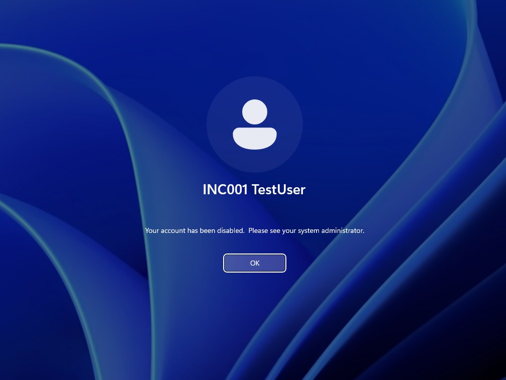
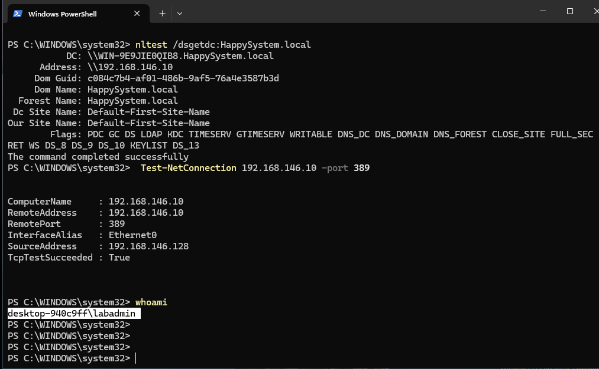
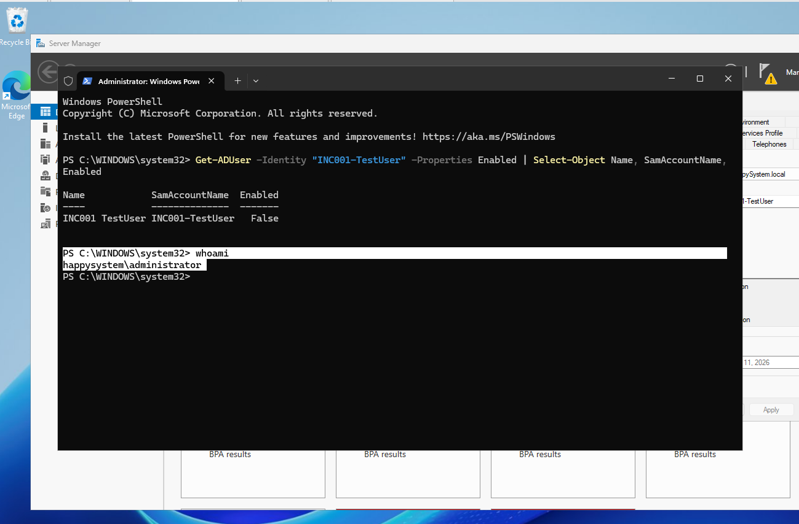
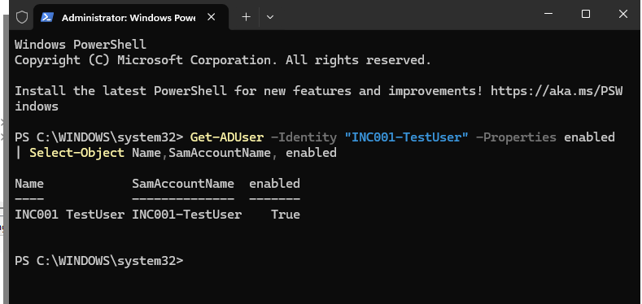
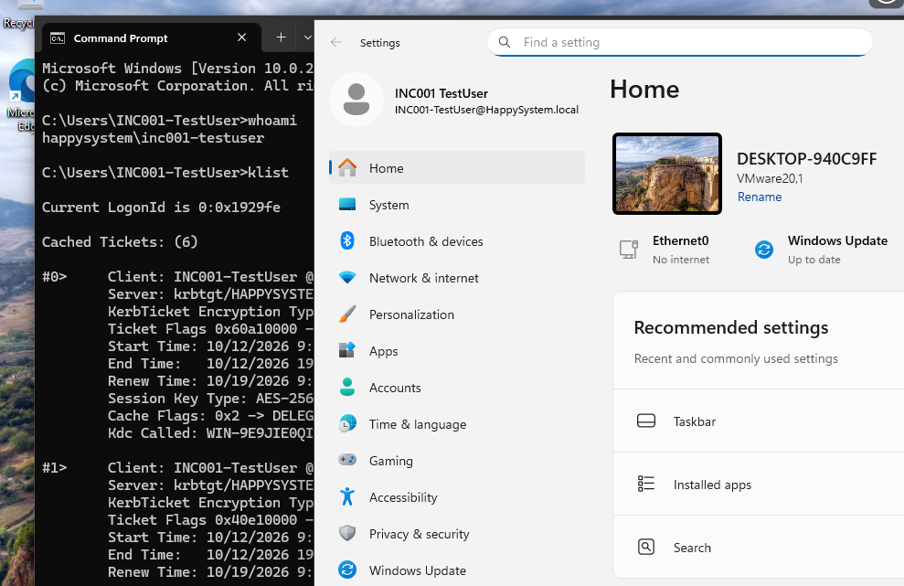

# INC-001 — Domain sign-in denied

**Environment:** Windows Server 2025 (AD DS/DNS), Windows 11, VMware Host-only network  
**Account:** `HAPPYSYSTEM\INC001-TestUser`  
**Type:** Simulated helpdesk ticket — home lab

## The issue

A test user could not sign in to a domain-joined Windows 11 PC. The sign-in screen reported: **“Your account has been disabled. Please see your system administrator.”**

In this exercise, only the disposable test account was affected. The account had signed in successfully before the fault was introduced.



## What I checked

I signed in to the client with the working local administrator account and checked whether it could still find the domain controller and reach LDAP:

```powershell
nltest /dsgetdc:HappySystem.local
Test-NetConnection 192.168.146.10 -Port 389
```

`nltest` returned the expected DC at `192.168.146.10`. The TCP 389 check returned `TcpTestSucceeded : True`. This established basic connectivity; it didn't, by itself, identify the login failure.



I then checked the user's account state on the server:

```powershell
Get-ADUser -Identity "INC001-TestUser" -Properties Enabled |
    Select-Object Name, SamAccountName, Enabled
```

The result was **`Enabled : False`**. The account had been disabled intentionally for the exercise; this matched the error on the sign-in screen.



## Fix and test

I re-enabled the test account in Active Directory Users and Computers. Running the same `Get-ADUser` query afterward returned **`Enabled : True`**.



I then signed in to Windows 11 with the same test account. `whoami` returned `happysystem\inc001-testuser`, and `klist` showed Kerberos tickets for the domain, including a ticket-granting ticket.



**Result:** The test user's domain sign-in was restored. No password reset or network change was needed for this incident.

## Takeaway

The sign-in message pointed to the account state, but I still checked DC reachability before changing anything. In a real helpdesk ticket, I'd confirm *why* an account was disabled and get authorization before enabling it: the disablement might have been intentional.

---
[Back to incident index](../../README.md)
