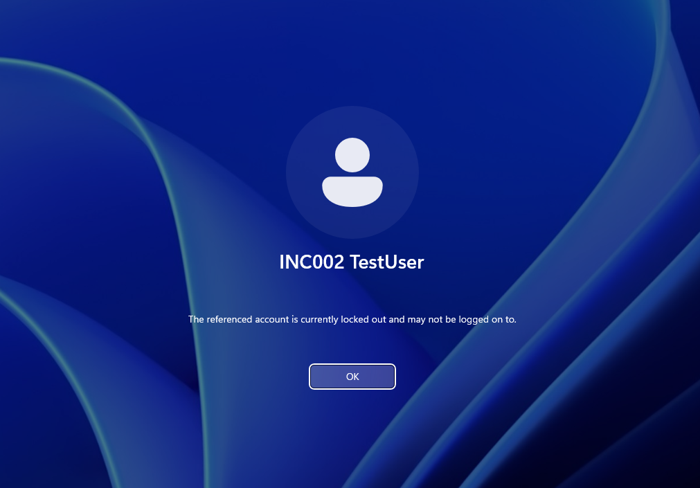
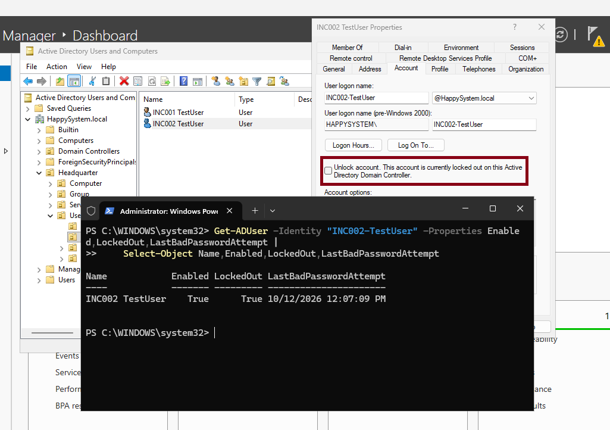
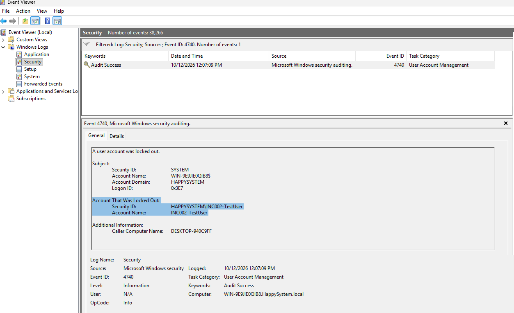
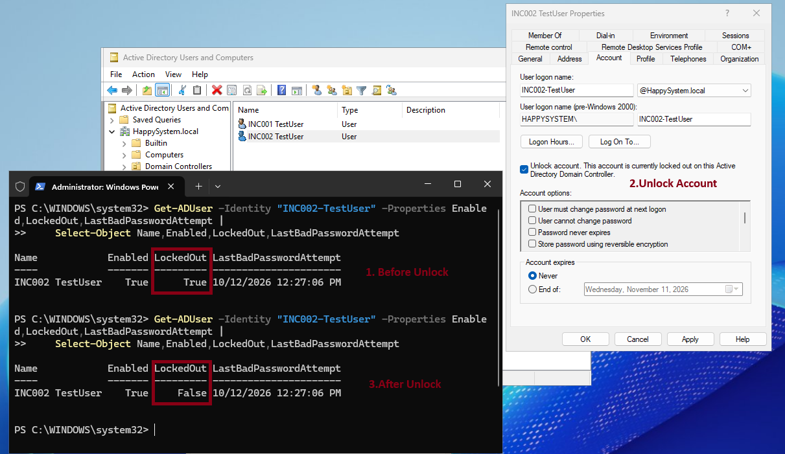
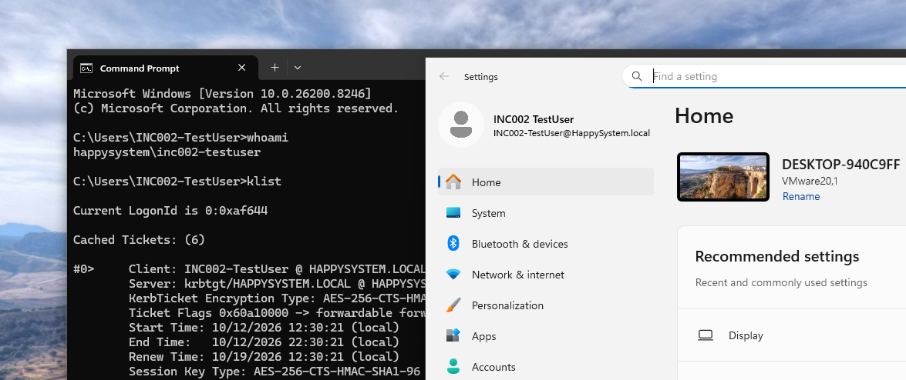

# INC-002 — Account locked after failed sign-ins

**Environment:** Windows Server 2025 (AD DS/DNS), Windows 11, VMware Host-only network  
**Account:** `HAPPYSYSTEM\INC002-TestUser`  
**Type:** Simulated helpdesk ticket — home lab

## The issue

A test user was unable to sign in to a domain-joined Windows 11 PC. Windows reported: **“The referenced account is currently locked out and may not be logged on to.”**

I reproduced the lockout by entering an incorrect password for a disposable test account. No other domain accounts were used for the exercise.



## What I checked

Before testing, I created a Fine-Grained Password Policy (`INC002-LabLockout`) for this account. Its lockout threshold was **3 attempts**, with a **10-minute observation window** and **10-minute lockout duration**. The Default Domain Password Policy still had a lockout threshold of `0`.

On the domain controller, I checked the account status:

```powershell
Get-ADUser -Identity "INC002-TestUser" -Properties Enabled,LockedOut,LastBadPasswordAttempt |
    Select-Object Name,Enabled,LockedOut,LastBadPasswordAttempt
```

The account was **enabled** (`Enabled = True`) but **locked** (`LockedOut = True`). This was different from INC-001, where the account itself had been disabled.



I then checked **Event Viewer → Windows Logs → Security**, filtering for **Event ID 4740**. The event identified `INC002-TestUser` as the locked account and `DESKTOP-940C9FF` as the caller computer. That matched the Windows 11 test client where I had submitted the incorrect password attempts.

Event 4740 identifies the caller computer, but it does not necessarily identify the process responsible. This lab did **not** reproduce a saved Credential Manager password or a background application causing recurring failures.



## Fix and test

I stopped the test sign-in attempts and used **Active Directory Users and Computers → Account → Unlock account**. The before-and-after PowerShell checks showed the state changing from **`LockedOut = True`** to **`LockedOut = False`**.



I signed in again to Windows 11 with the correct password and checked the active session:

```cmd
whoami
klist
```

`whoami` returned `happysystem\inc002-testuser`, and `klist` showed a Kerberos ticket-granting ticket for `HAPPYSYSTEM.LOCAL`.



**Result:** The account was unlocked and the test user signed in successfully. This verifies the immediate fix, not a long-term absence of recurring lockouts. The screenshots include more than one controlled test cycle, so their event timestamps are not one continuous incident timeline.

## Takeaway

Unlocking an account is straightforward; finding **what caused the failures** matters more. In a workplace I'd check Event 4740 and relevant failed-authentication events, trace the originating device or service, and only unlock the account after confirming the source has been addressed and the request is authorized.

---
[Back to incident index](../../README.md)
