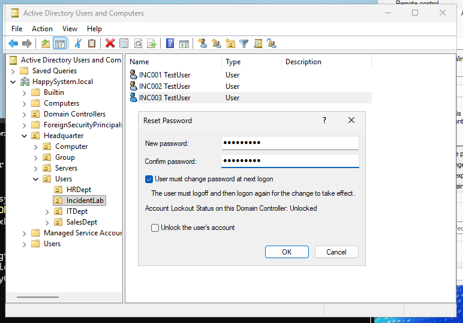
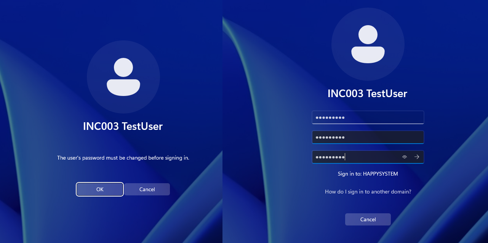
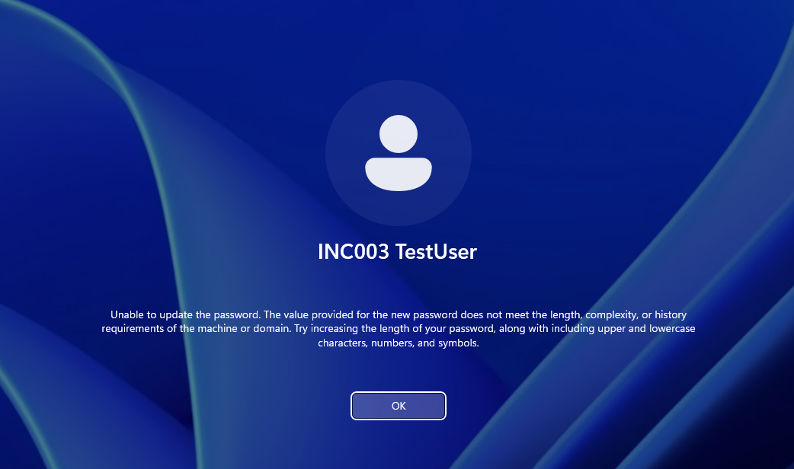
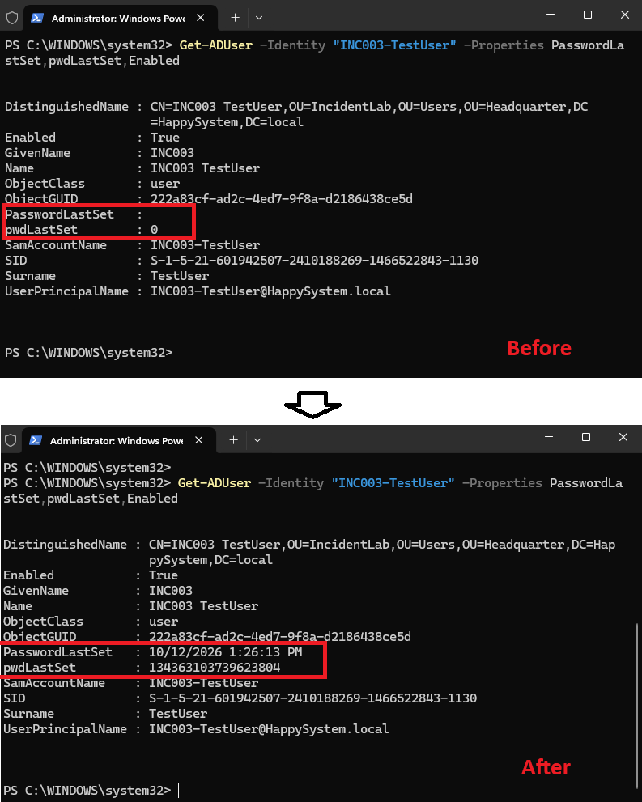
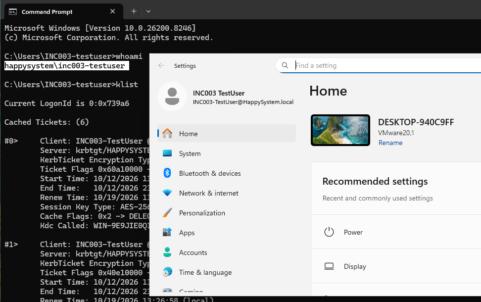

# INC-003 — Password change required at sign-in

**Environment:** Windows Server 2025 (AD DS/DNS), domain-joined Windows 11 VM, VMware Host-only network  
**Account:** `HAPPYSYSTEM\INC003-TestUser`  
**Type:** Simulated helpdesk ticket — home lab

## The issue

A test user received a temporary password but could not finish signing in until the password was changed. Windows displayed **“The user's password must be changed before signing in.”**

I reproduced the prompt by resetting the dedicated test account's password in Active Directory Users and Computers (ADUC) and selecting **User must change password at next logon**.





## What I checked

When I tried to set a new password that did not meet the domain's requirements, Windows rejected it. The error referred to **length, complexity, or password history**; it did not identify which specific requirement failed.



I checked the test account on the domain controller with PowerShell:

```powershell
Get-ADUser -Identity "INC003-TestUser" -Properties PasswordLastSet,pwdLastSet,Enabled
```

Before the change, `pwdLastSet` was `0` and `PasswordLastSet` was empty. This confirmed the account was marked to change its password at the next sign-in.

## Fix and test

I completed the Windows password-change process using a new password accepted by the domain policy. I then ran the same AD query again. `PasswordLastSet` showed **12 October 2026, 1:26:13 PM**, and the raw `pwdLastSet` value was no longer `0`.



I signed in to Windows 11 and checked the active user session:

```cmd
whoami
klist
```

`whoami` returned `happysystem\inc003-testuser`, and `klist` showed Kerberos tickets for `HAPPYSYSTEM.LOCAL`, including a ticket-granting ticket.



**Result:** The mandatory password change was completed and the test user signed in successfully. No domain-wide password policy was changed for this incident.

## Takeaway

A mandatory password-change prompt is usually expected behavior when an administrator resets a temporary password. If the new password is rejected, I should check the effective password requirements and help the user choose a compliant password, without asking them to disclose it. In a real support ticket, I would also verify the user's identity before resetting credentials.

---
[Back to incident index](../../README.md)
