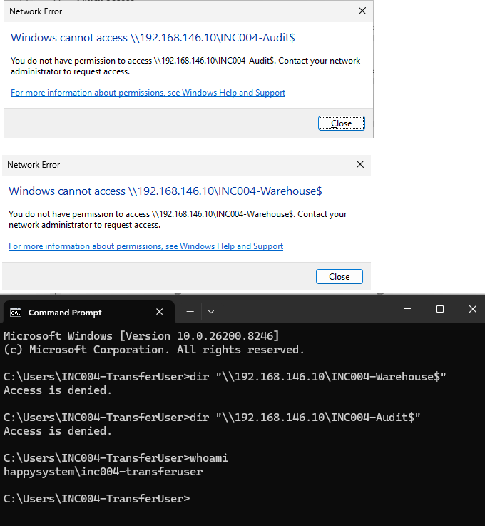
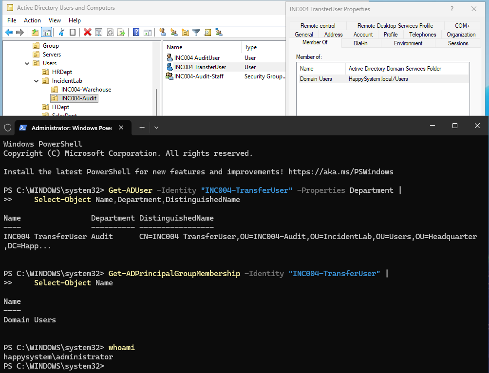
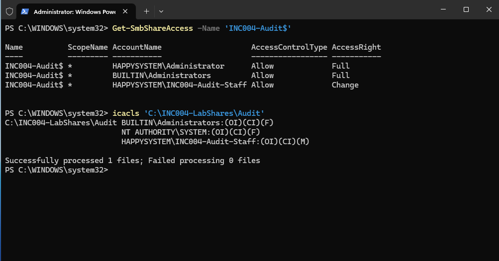
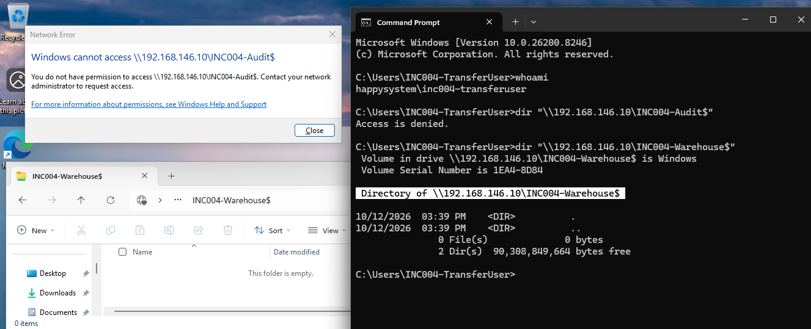
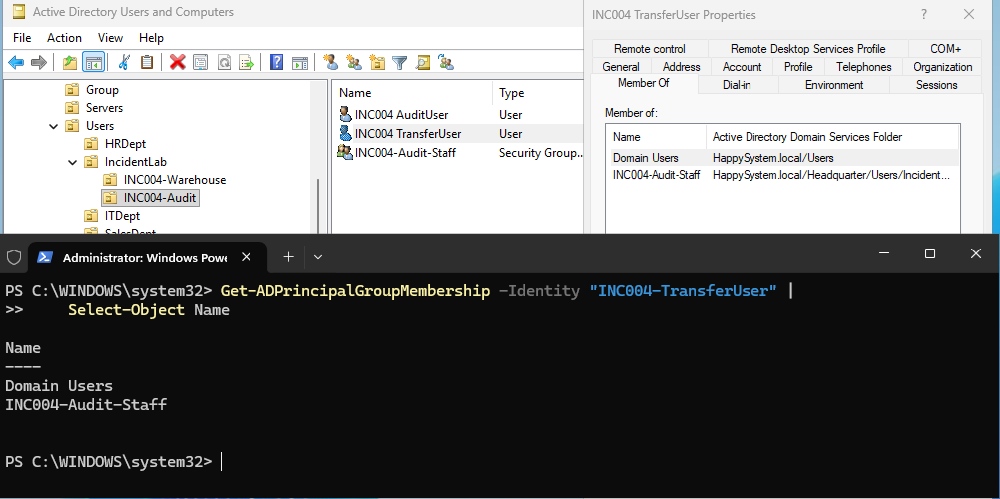
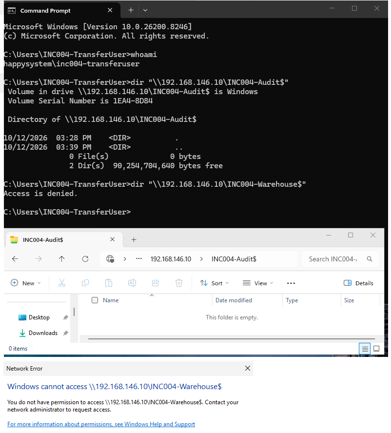

# INC-004 — Department transfer: access denied

**Environment:** Windows Server 2025 (AD DS, SMB/NTFS), domain-joined Windows 11, VMware Host-only network  
**Account:** `HAPPYSYSTEM\INC004-TransferUser`  
**Type:** Simulated helpdesk ticket — home lab

## The issue

A test employee moved from Warehouse to Audit but could not open the Audit department's shared folder. I had already tested the two department shares with separate Warehouse and Audit accounts; each account could open its own share and was denied access to the other.

For the simulation, I moved `INC004-TransferUser` to the Audit OU, changed the Department attribute to `Audit`, and removed the old Warehouse group membership. I intentionally left out the new Audit security group. ([OU move](../../screenshots/INC-004/00-ou-transfer.png) · [Old group removal](../../screenshots/INC-004/00-remove-warehouse-group.png))

After a fresh sign-in, both department shares returned **Access is denied**.



## What I checked

On the domain controller, I checked the account's OU, Department attribute and group membership:

```powershell
Get-ADUser -Identity 'INC004-TransferUser' -Properties Department |
    Select-Object Name,Department,DistinguishedName

Get-ADPrincipalGroupMembership -Identity 'INC004-TransferUser' |
    Select-Object Name
```

The account was in the Audit OU with Department set to `Audit`, but the membership list contained only `Domain Users`. Moving an account between OUs did not grant access to the new department's resources.



I also checked the Audit share and NTFS permissions:

```powershell
Get-SmbShareAccess -Name 'INC004-Audit$'
icacls 'C:\INC004-LabShares\Audit'
```

`INC004-Audit-Staff` had **Change** access at the SMB share and **Modify** access at the NTFS folder. The test account was missing membership in that group, not the share's required permission entries.



There was an additional session-related finding. Immediately after I removed the Warehouse group, the existing Windows session could still open the Warehouse share. Earlier `whoami /groups` output still showed `INC004-Warehouse-Staff` in that session's token. After signing out and back in, Warehouse access was denied as expected.



## Fix and test

I added `INC004-TransferUser` to `INC004-Audit-Staff` in Active Directory Users and Computers. I kept the old Warehouse membership removed. The group membership check then showed `Domain Users` and `INC004-Audit-Staff`.



I signed out of Windows 11 and signed in again as the transferred user, then tested both shares:

```cmd
whoami
dir "\\192.168.146.10\INC004-Audit$"
dir "\\192.168.146.10\INC004-Warehouse$"
```

The Audit directory listing worked, and the Warehouse share returned **Access is denied**. The Audit share also opened in File Explorer.



**Result:** The simulated transfer was completed with access to the new department and without access to the old department.

## Takeaway

An employee's OU and Department attribute do not automatically update their security group membership. For a department-transfer ticket, I'd check both the user's current groups and the share/NTFS permissions, remove unnecessary old access, and have the user sign out and back in to refresh authorization. In a real workplace, I would confirm that the access change was approved before applying it.

---
[Back to incident index](../../README.md)
