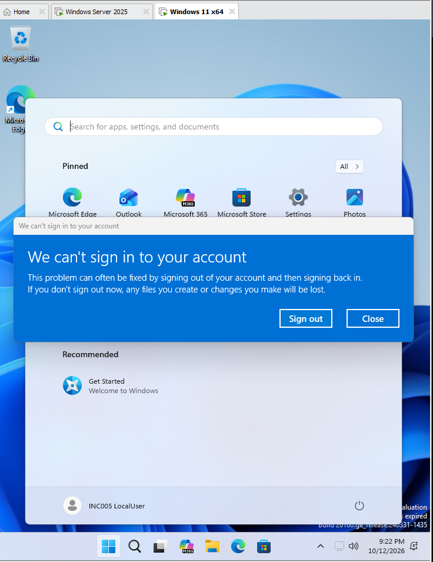
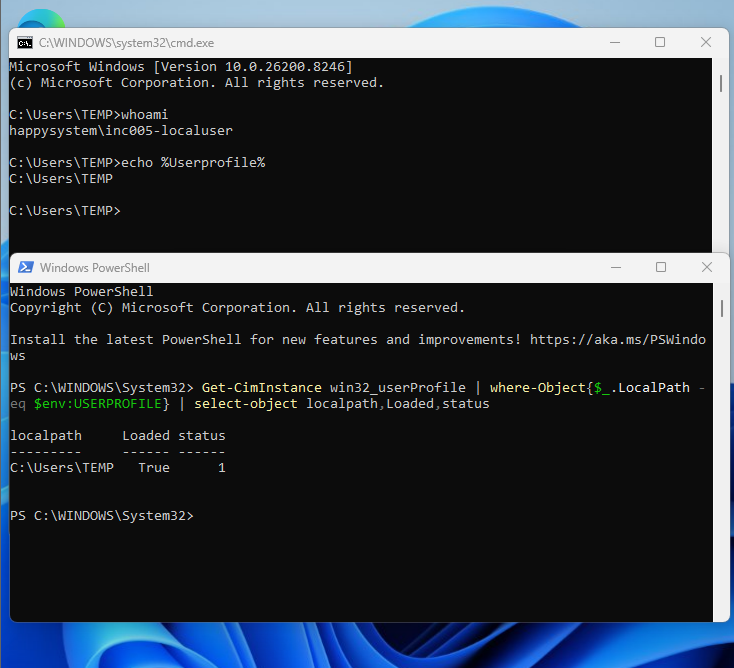
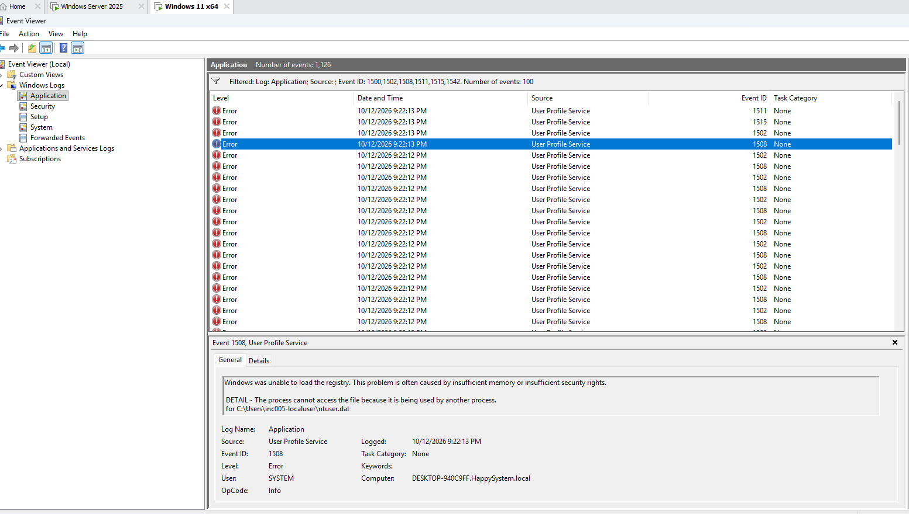
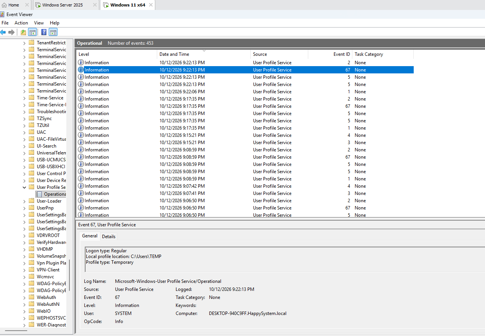
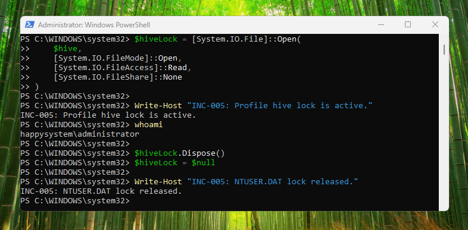
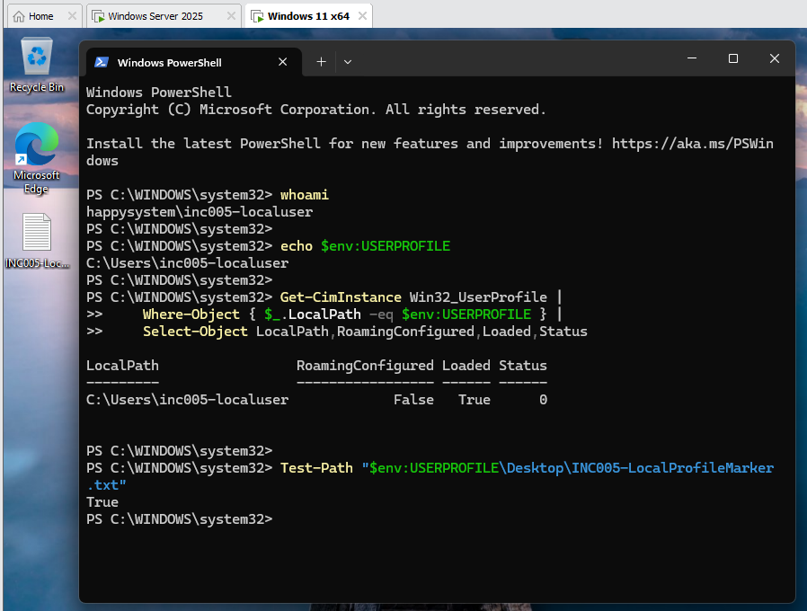

# INC-005 — Temporary Windows Profile After Sign-in

**Simulated Incident / Home Lab**  
**Area:** Windows 11, Active Directory, Windows User Profile Service

## User report

> "My desktop looks new and my usual files are missing after sign-in."

## Lab setup

I used a disposable domain account (`HAPPYSYSTEM\INC005-LocalUser`) on a domain-joined Windows 11 VM. The account had a healthy **local** profile at `C:\Users\inc005-localuser`, with `INC005-LocalProfileMarker.txt` on its desktop. To keep this case separate from a roaming-profile lab, I temporarily excluded only the test workstation from the existing roaming-profile GPO and verified `RoamingConfigured = False` and `Status = 0` before testing. A VM snapshot was saved.

I then simulated a profile-loading failure by holding an exclusive file handle on the test user's `NTUSER.DAT` from a separate administrator session. This was a controlled lab fault, not a production change.

## Investigation

The user's sign-in reached the desktop, but Windows displayed **"We can't sign in to your account."**

`whoami` still returned the expected domain user, while `%USERPROFILE%` pointed to `C:\Users\TEMP`. The `Win32_UserProfile` query returned `Loaded = True` and `Status = 1` for that temporary profile.

In **Event Viewer → Windows Logs → Application**, User Profile Service **Event ID 1508** explained the failure: Windows could not load `C:\Users\inc005-localuser\ntuser.dat` because the file was being used by another process. Related profile-loading errors were recorded around the same sign-in.

The **User Profile Service → Operational** log also recorded **Event ID 67**, identifying the profile location as `C:\Users\TEMP` and the profile type as *Temporary*.

## Root cause and resolution

An exclusive lock on the user's `NTUSER.DAT` prevented User Profile Service from loading the normal registry hive. Windows fell back to a temporary profile. After signing the affected user out, I returned to the administrator session and released the file handle with `$hiveLock.Dispose()`.

## Verification

A fresh sign-in loaded `C:\Users\inc005-localuser` again. The profile query showed `RoamingConfigured = False`, `Loaded = True`, and `Status = 0`. The original desktop marker was still present (`Test-Path = True`). No profile folder or registry entry needed to be deleted.

**Result:** Resolved and verified in the home lab.

**Lab cleanup:** The test-only GPO security-filter exception should be removed afterward so the workstation returns to its original roaming-profile policy scope.
