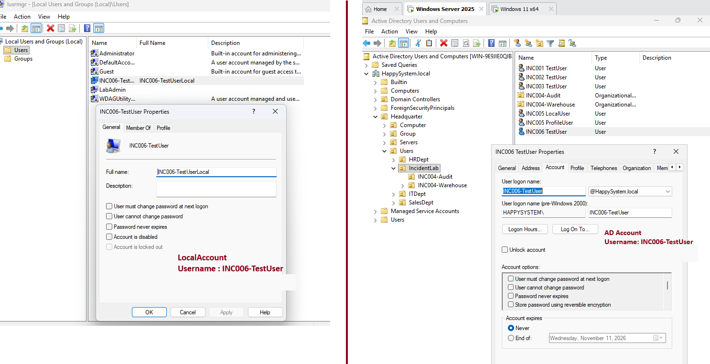
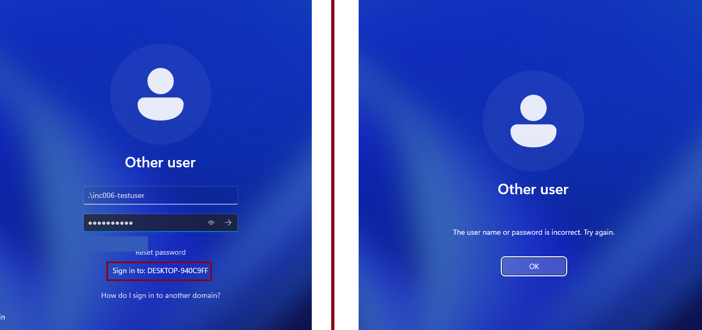
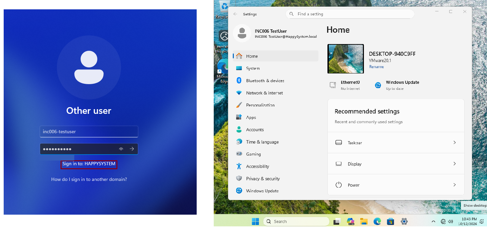
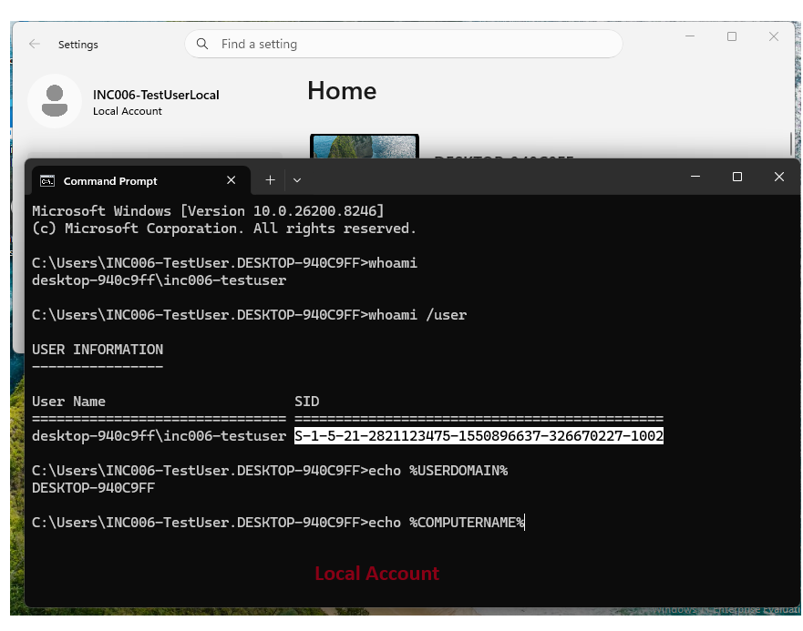
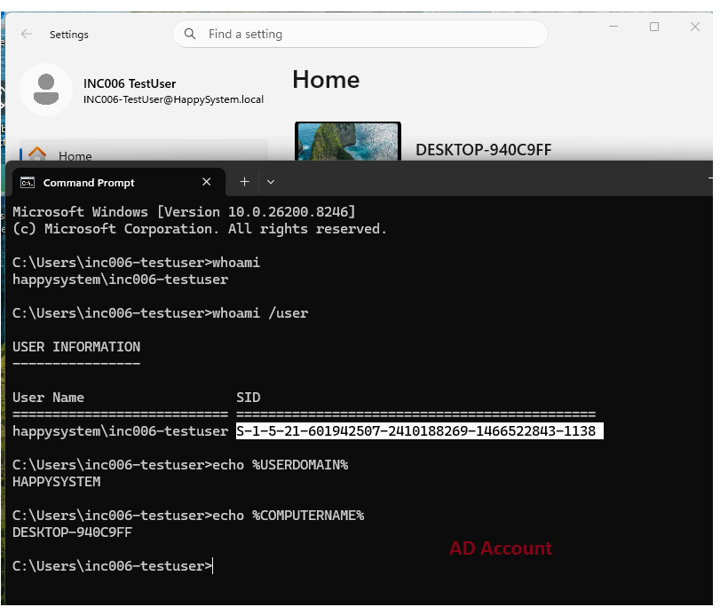
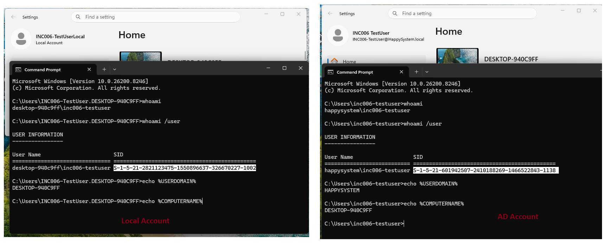

# INC-006 — Wrong account context at Windows sign-in

**Simulated Incident / Home Lab**  
**Area:** Windows 11, Active Directory, local accounts, authentication

## User report

> "My password works on another computer, but Windows says it is incorrect here."

## Lab setup

On a domain-joined Windows 11 VM (`DESKTOP-940C9FF`), I created a local account and a domain account with the same sign-in name, `INC006-TestUser`, but different test passwords:

- Local: `DESKTOP-940C9FF\INC006-TestUser` (entered as `.\INC006-TestUser`)
- Domain: `HAPPYSYSTEM\INC006-TestUser`

Both accounts were disposable. The exercise was to distinguish which identity Windows was attempting to authenticate, rather than resetting a valid password unnecessarily.



## Investigation

I first selected `.\INC006-TestUser` at the Windows sign-in screen and entered the **domain account's** test password. Windows showed **"The user name or password is incorrect."** The sign-in screen identified the destination as `DESKTOP-940C9FF`, which told me Windows was checking the *local* account.



I changed the account context to `HAPPYSYSTEM` and used the same domain password. Sign-in succeeded. This showed that the domain credentials worked; the failed attempt had targeted the wrong account database.



To confirm the difference, I signed in separately with each account's correct test password and checked the security identity:

```cmd
whoami
whoami /user
echo %USERDOMAIN%
echo %COMPUTERNAME%
```

The **local account** returned `desktop-940c9ff\inc006-testuser` and a SID ending in `-1002`.



The **domain account** returned `happysystem\inc006-testuser` and a different SID ending in `-1138`.





## Root cause and resolution

The attempted sign-in used the **local account context** (`.\`) with the password belonging to the **domain account**. The matching usernames made the mistake easy to overlook, but the two accounts have different SIDs, passwords, and security contexts.

The resolution was to select the intended domain identity (`HAPPYSYSTEM\INC006-TestUser`) and use its corresponding password. I also verified that the local identity could sign in separately with its own password.

## Additional lab finding

During testing, the local account also encountered an **unrelated temporary-profile issue**. The workstation's computer-level Roaming Profiles GPO was assigning a network profile path to local sign-ins. I temporarily isolated this test workstation from that GPO to verify the two identities cleanly. This was separate from the incorrect-password error, and the exact cause of the roaming-profile loading failure was not established in this incident.

**Result:** The incorrect sign-in context was identified and the domain sign-in was verified. The local and domain accounts were confirmed as distinct security identities.

## Takeaway

When a password works in one place but not another, I should confirm whether Windows is signing in to the local computer or the domain before resetting the account. `whoami`, `whoami /user`, and the sign-in screen's **Sign in to** label help verify the context.

---
[Back to incident index](../../README.md)
