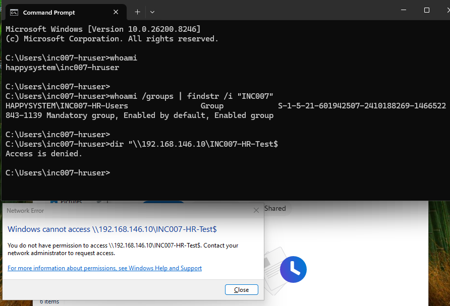
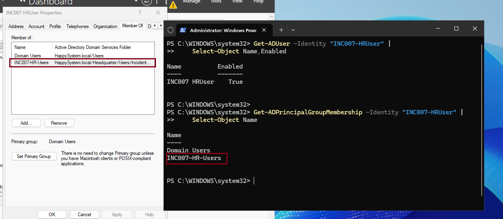
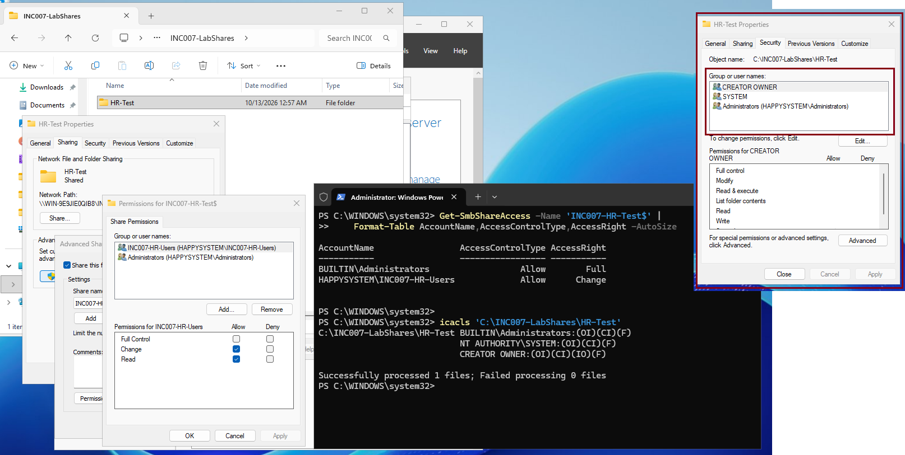
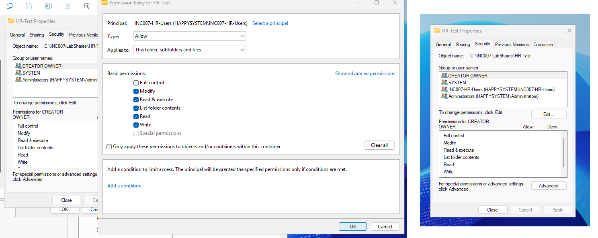
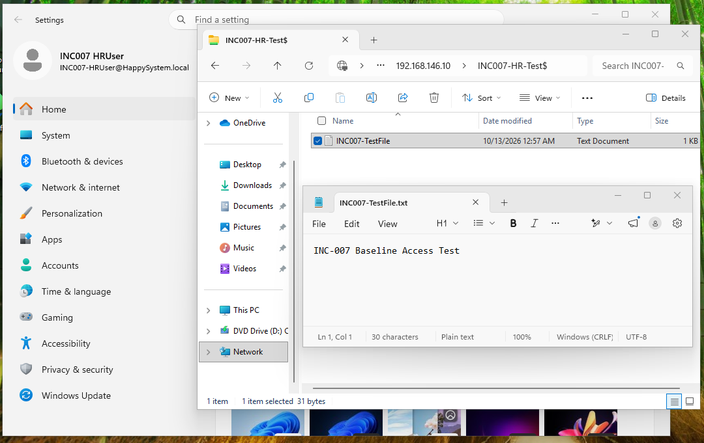
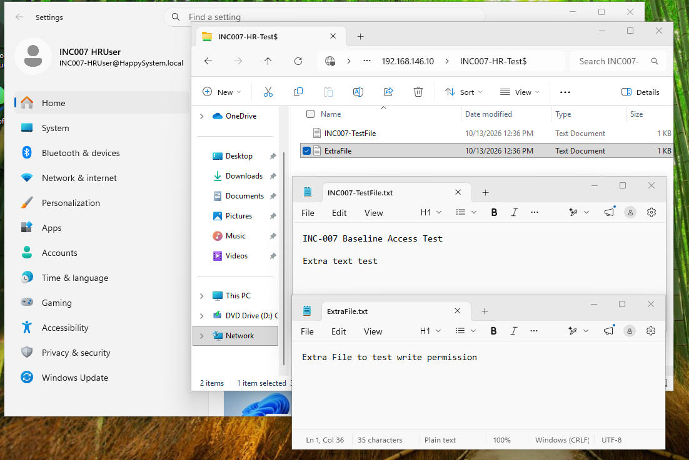

# INC-007 — Access Denied to HR Shared Folder

**Simulated Incident / Home Lab**  
**Area:** Windows Server 2025, Active Directory, SMB shares, NTFS permissions

## User report

> "I had access to the HR share yesterday. Today it says Access Denied."

## Lab setup

I created a dedicated HR test account (`HAPPYSYSTEM\INC007-HRUser`) and security group (`INC007-HR-Users`) in the isolated Active Directory lab. The test folder was `C:\INC007-LabShares\HR-Test` on Windows Server 2025, shared as `\\192.168.146.10\INC007-HR-Test$`. No existing department share was changed.

Initially, the HR group had **Change** permission on the SMB share and **Modify** permission on the folder's NTFS ACL. I confirmed the user could list the share, create a file and read it. I then simulated a permission regression by removing only the HR group's NTFS entry, leaving group membership and SMB permissions unchanged.

## Investigation

The affected user remained signed in as `happysystem\inc007-hruser`, and `whoami /groups` showed membership in `HAPPYSYSTEM\INC007-HR-Users`. However, opening the UNC path in File Explorer and running `dir` both returned **Access Denied**.



On the domain controller, I checked the user's AD account and group membership. The account was enabled and was still a member of `INC007-HR-Users`, so a missing group assignment was not the cause.



I compared the two permission layers:

```powershell
Get-SmbShareAccess -Name 'INC007-HR-Test$' |
    Format-Table AccountName,AccessControlType,AccessRight -AutoSize
icacls 'C:\INC007-LabShares\HR-Test'
```

The SMB share still allowed the HR group **Change** access, but the folder's NTFS ACL contained only the administrative, SYSTEM and CREATOR OWNER entries. The HR group's NTFS **Modify** permission was missing.



## Root cause and resolution

The simulated configuration change removed the HR group's **NTFS Allow (Modify)** entry. SMB permissions alone could not grant file access where the NTFS permissions did not allow it.

I restored an **Allow → Modify** NTFS entry for `HAPPYSYSTEM\INC007-HR-Users`, applying to **this folder, subfolders and files**. I kept the existing administrative and SYSTEM permissions and did not alter the SMB share or AD group membership.



## Verification

Back on the Windows 11 client, the HR user could open the same network share and read the original `INC007-TestFile.txt`, including its baseline test content.



I also created an additional text file in the shared folder (`ExtraFile.txt`). File Explorer displayed both test files and Notepad showed the additional test content, confirming that write access had returned, not just read access.



**Result:** Resolved and verified in the home lab. The dedicated test share was left with its intended HR group access restored.

## Takeaway

When an AD user belongs to the correct group but cannot open a network folder, I should check **both** SMB share permissions and NTFS permissions before changing account membership. For access over SMB, the more restrictive applicable permissions determine what the user can do.

---
[Back to incident index](../../README.md)
