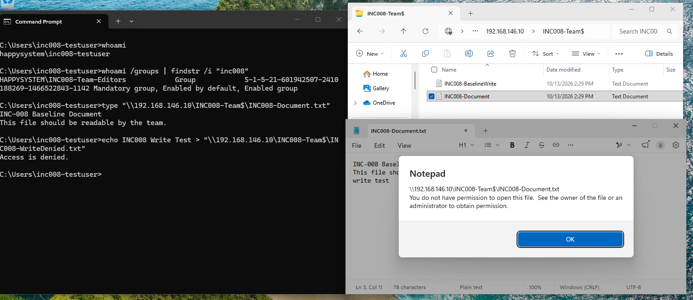
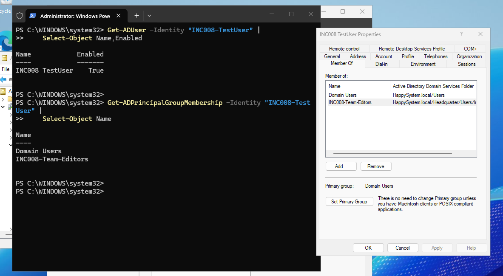
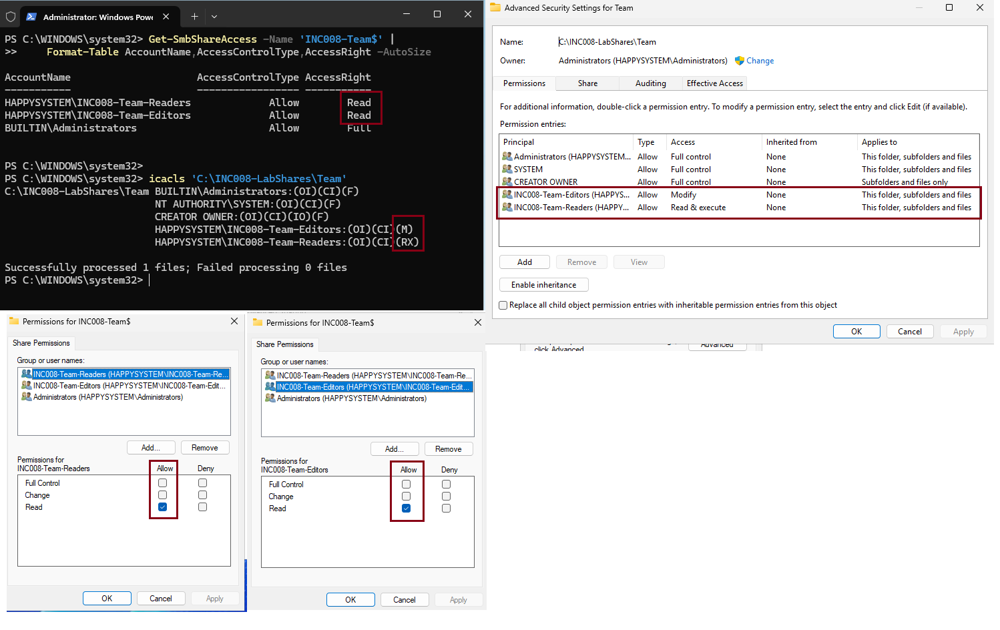
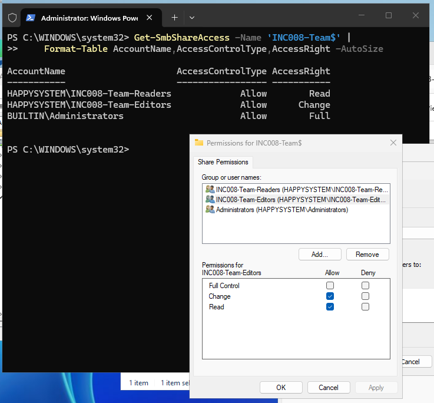
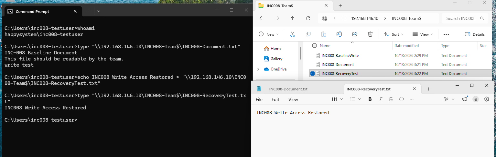

# INC-008 — Can Read Shared Files but Cannot Save New Files

**Simulated Incident / Home Lab**  
**Area:** Windows Server 2025, Active Directory, SMB share permissions, NTFS ACLs

## User report

> "I can open the team folder and read documents, but I cannot save a new file."

## Lab setup

I created a disposable domain user (`HAPPYSYSTEM\INC008-TestUser`) in the `INC008-Team-Editors` security group and a separate test share on Windows Server 2025: `\\192.168.146.10\INC008-Team$`. The backing folder was `C:\INC008-LabShares\Team`. Nothing in the existing department shares was changed.

The Editors group initially had **Change** on the SMB share and **Modify** on the NTFS folder. I verified that the user could browse the share and create a baseline file. To simulate the complaint, I changed only the Editors group's SMB permission from **Change** to **Read**, leaving the NTFS permissions and group membership intact.

## Investigation

The affected user was still signed in as `happysystem\inc008-testuser`, and the Windows security token contained `INC008-Team-Editors`. The existing document opened and could be read, but a new-file attempt returned **Access is denied**. Notepad also showed a permission error when attempting to save to the share.



I checked the AD account on the server. It was enabled and belonged to `Domain Users` and `INC008-Team-Editors`, so missing group membership did not explain the write failure.



I compared the share and file-system permissions:

```powershell
Get-SmbShareAccess -Name 'INC008-Team$' |
    Format-Table AccountName,AccessControlType,AccessRight -AutoSize
icacls 'C:\INC008-LabShares\Team'
```

The Editors group had only **Read** at the SMB share layer, even though its NTFS permission remained **Modify**. The Readers group correctly had SMB **Read** and NTFS **Read & Execute**.



## Root cause and resolution

The simulated fault was an incorrect **SMB share permission** for the Editors group. SMB Read limited network access to reading, regardless of the more permissive NTFS Modify entry. This was not a password, connectivity or group-membership issue.

I restored **Allow → Change** (with Read) for `HAPPYSYSTEM\INC008-Team-Editors` in the share permissions. I did not alter the NTFS ACL, Readers group's access or any other incident share. `Get-SmbShareAccess` confirmed the Editors group had **Change** again.



## Verification

Back on the Windows 11 client, I read the existing `INC008-Document.txt` and created `INC008-RecoveryTest.txt` through the same UNC path. Reading the new file returned **INC008 Write Access Restored**; File Explorer and Notepad also showed the new file.



**Result:** Resolved and verified in the home lab. The share was left with the intended Editors **Change** / NTFS **Modify** and Readers **Read** / NTFS **Read & Execute** access.

## Takeaway

When a user can read files over a network share but cannot save them, I should check **SMB share permissions and NTFS permissions separately**. NTFS Modify does not override an SMB share permission restricted to Read.

---
[Back to incident index](../../README.md)
