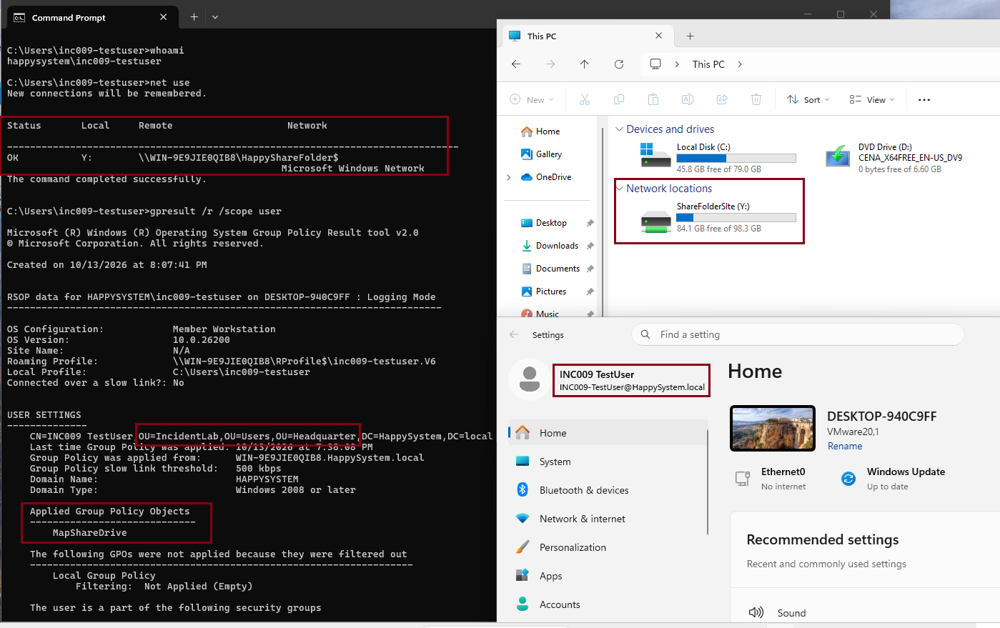
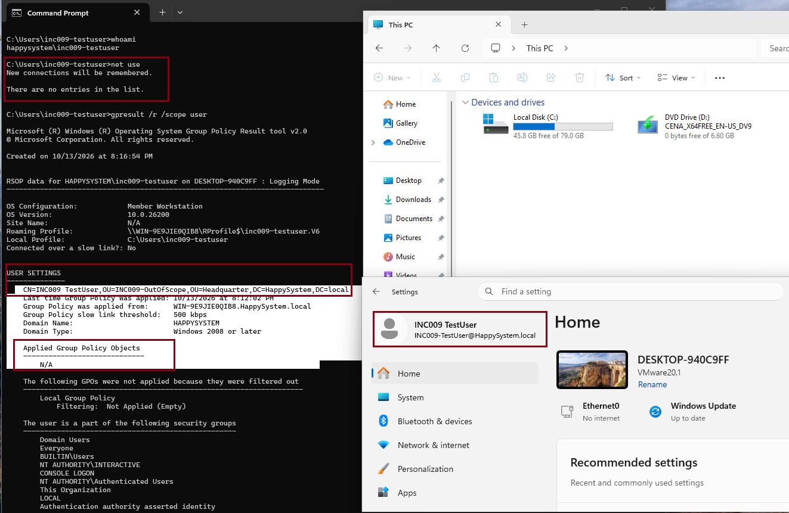
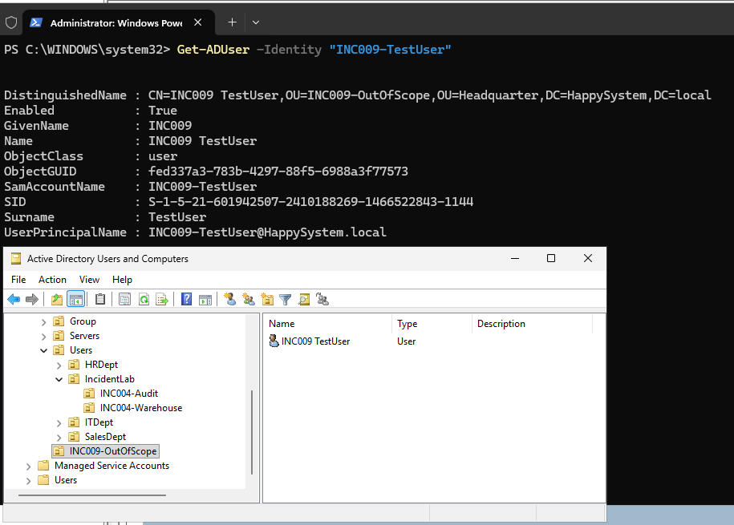
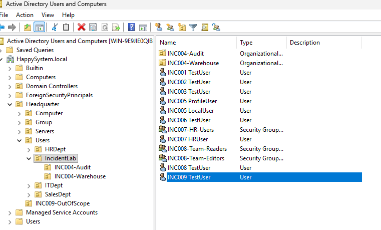
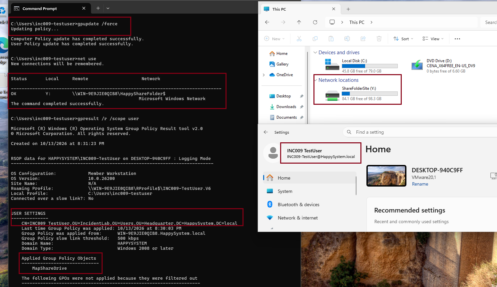

# INC-009 — Mapped Network Drive Missing After Sign-in

**Simulated Incident / Home Lab**  
**Category:** Group Policy / File Services  
**Status:** Resolved and verified

## User report

> "My mapped Y: drive is missing from File Explorer after I sign in."

## Lab environment

- Active Directory domain: `HappySystem.local`
- Domain controller and file server: Windows Server 2025 (`WIN-9E9JIE0QIB8`)
- Client: Windows 11 (`DESKTOP-940C9FF`)
- Test account: `HAPPYSYSTEM\INC009-TestUser`
- Drive mapping: `Y:` → `\\WIN-9E9JIE0QIB8\HappyShareFolder$`
- GPO: `MapShareDrive`, linked to `Headquarter/Users`

## Troubleshooting

I first signed in with the test account while it was located in `Headquarter/Users/IncidentLab`. The `MapShareDrive` GPO was applied, and both `net use` and File Explorer showed a working Y: drive.

To reproduce the incident, I moved the test account to `Headquarter/INC009-OutOfScope`, outside the GPO's linked OU. After a fresh sign-in, Y: was no longer listed in `net use` or File Explorer. `gpresult /r /scope user` also showed that no user GPO was applied.

I checked the account in Active Directory Users and Computers and confirmed its new distinguished name with `Get-ADUser`. The user was outside `Headquarter/Users`, where `MapShareDrive` was linked.

## Root cause

The user account had been placed in an OU outside the scope of the drive-mapping GPO. The account was valid and the share was available, but the user no longer received the policy that created Y:.

## Resolution and verification

I moved `INC009-TestUser` back to `Headquarter/Users/IncidentLab`, leaving the existing GPO settings and share permissions unchanged.

After signing in again and refreshing policy, `gpresult` showed `MapShareDrive` applied. `net use` showed Y: connected to the expected share, and File Explorer displayed the mapped drive again.

**Outcome:** The Y: drive returned without changing SMB or NTFS permissions. This lab reinforced the need to verify a user's OU and resultant Group Policy before troubleshooting the file share itself.
