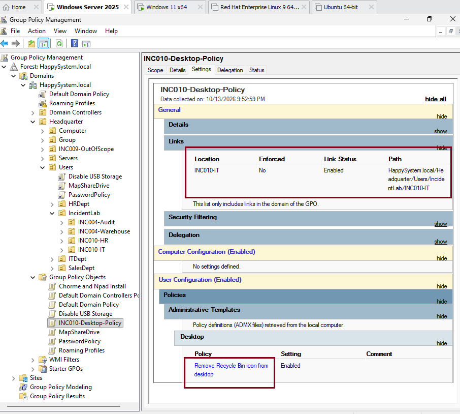
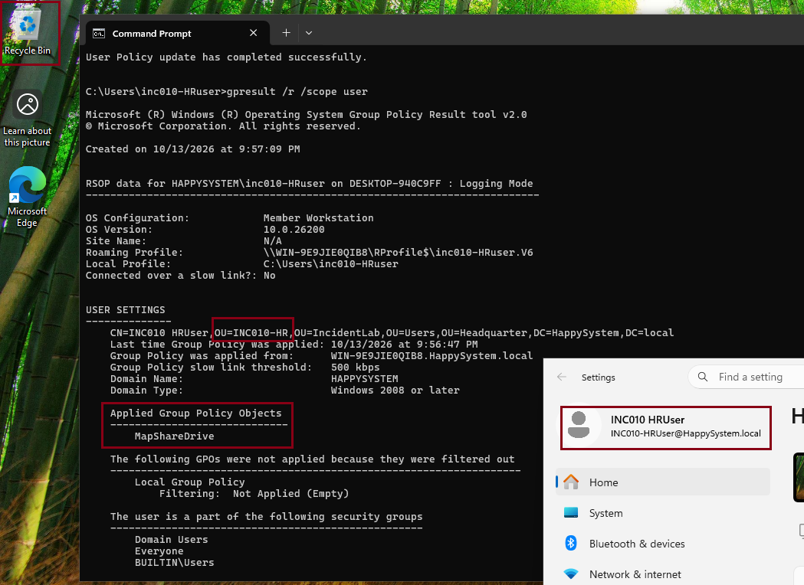
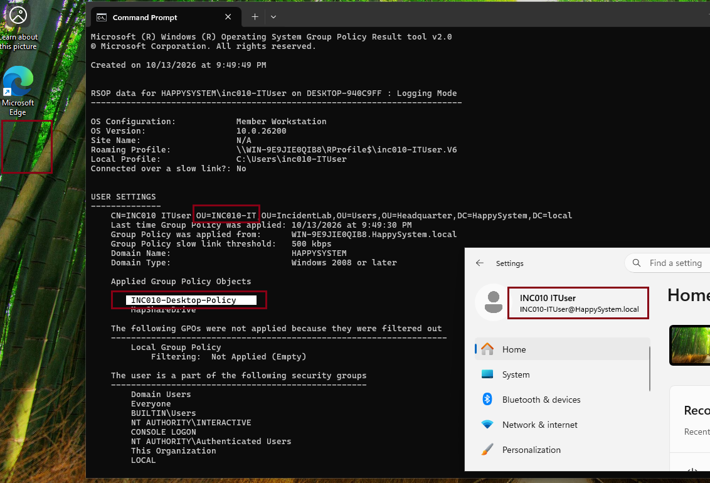
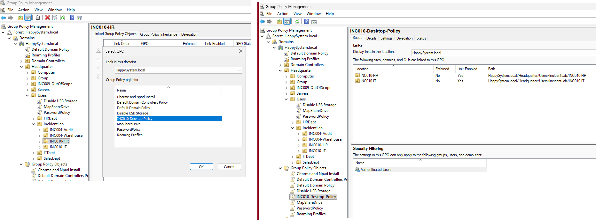
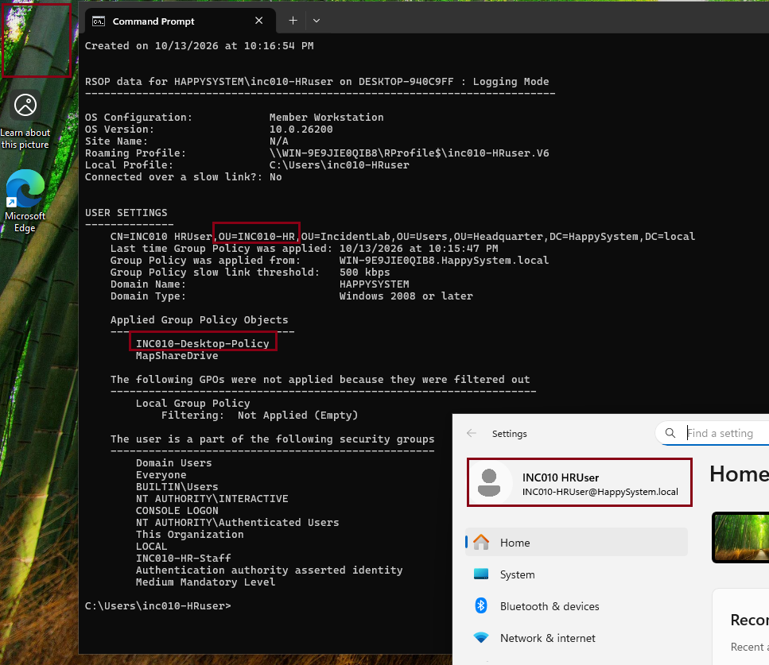

# INC-010 — Desktop GPO Not Applied to HR Users

**Simulated Incident / Home Lab**

## Issue

An HR employee reported that a desktop setting available to IT colleagues was missing from their account. The test policy hides the Recycle Bin desktop icon; it does not delete the bin or its contents.

## Lab environment

- Active Directory domain: `HappySystem.local`
- Domain controller: Windows Server 2025
- Client: domain-joined Windows 11 (`DESKTOP-940C9FF`)
- Test accounts: `INC010-ITUser` and `INC010-HRUser`
- Test OUs: `INC010-IT` and `INC010-HR`, under `Headquarter/Users/IncidentLab`
- GPO: `INC010-Desktop-Policy` — **Remove Recycle Bin icon from desktop** enabled

## Investigation

The policy was linked only to the `INC010-IT` OU. On the same Windows 11 client, `gpresult /r /scope user` showed that the IT test user received `INC010-Desktop-Policy` and the Recycle Bin icon was hidden.

The HR test user received `MapShareDrive` but not `INC010-Desktop-Policy`, and the Recycle Bin icon remained visible. Both accounts were enabled and located in their intended test OUs. The policy was therefore missing from the HR user's applicable GPO scope, rather than failing because of the desktop setting itself.

## Root cause

`INC010-Desktop-Policy` had no link to the `INC010-HR` OU. Linking a GPO only to the IT OU did not make it apply to the sibling HR OU.

## Resolution

Added an **existing GPO link** for `INC010-Desktop-Policy` to `INC010-HR`, while retaining its link to `INC010-IT`. The test GPO remained scoped to the two dedicated incident OUs; no changes were made to the domain-wide policies or the existing `MapShareDrive` GPO.

## Verification

Refreshed user Group Policy on the Windows 11 client and checked the HR user's session again. `gpresult /r /scope user` listed `INC010-Desktop-Policy` as applied, and the Recycle Bin icon was no longer visible on the desktop. The IT configuration remained unchanged.

**Outcome:** Resolved in the simulated lab. The failure was caused by OU-based GPO link scope, not a broken user account or a missing domain connection.

## Evidence

**1. Original GPO scope — linked to IT only**

**2. HR baseline — policy not applied, Recycle Bin still visible**

**3. IT baseline — policy applied, Recycle Bin hidden**

**4. Corrective action — HR OU link added**

**5. HR verification — policy applied and Recycle Bin hidden**

## Takeaway

When a user reports a missing Group Policy setting, check the GPO links and the user's OU first, then confirm the actual applied policies with `gpresult`. A correct setting inside a GPO has no effect if the GPO is outside the user's scope.
