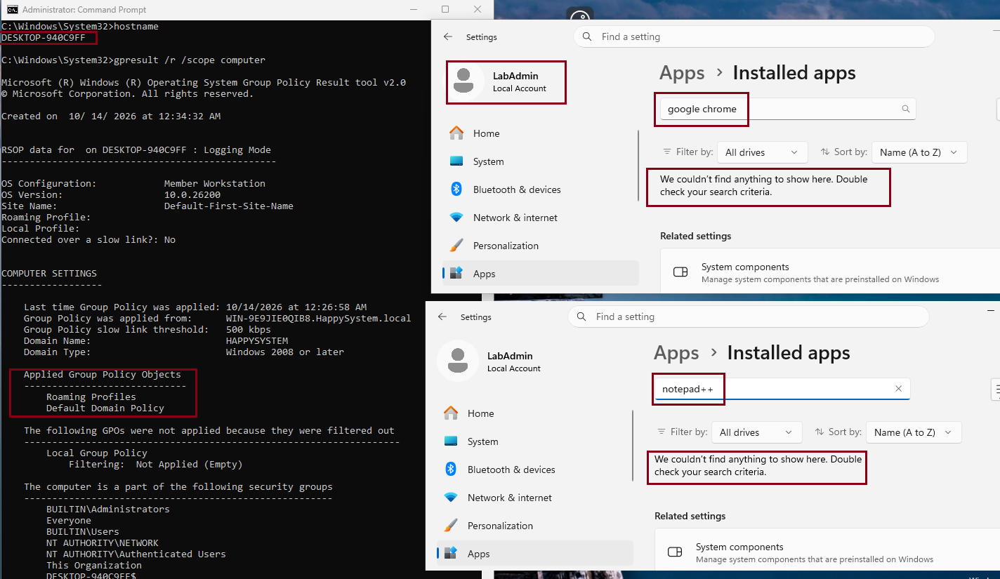
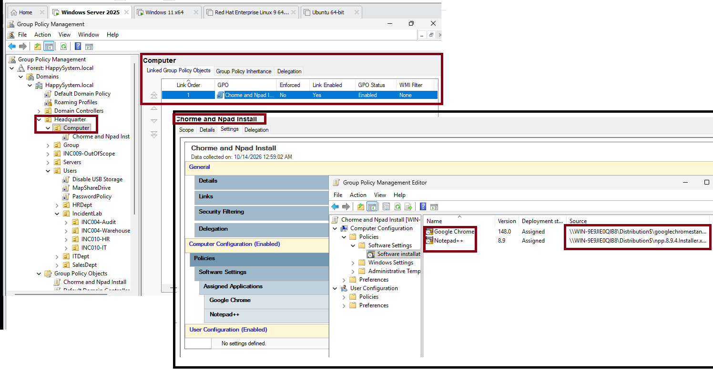
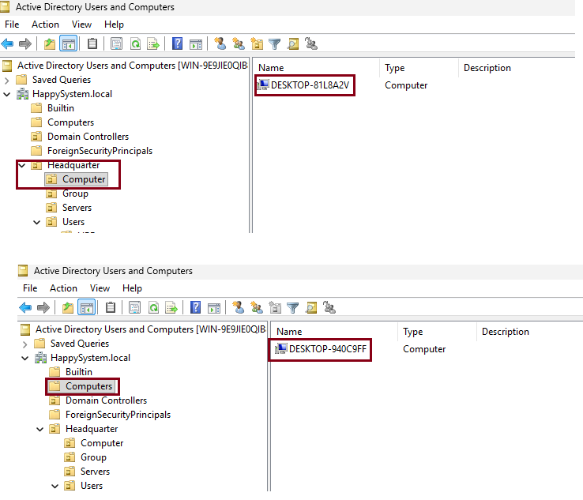
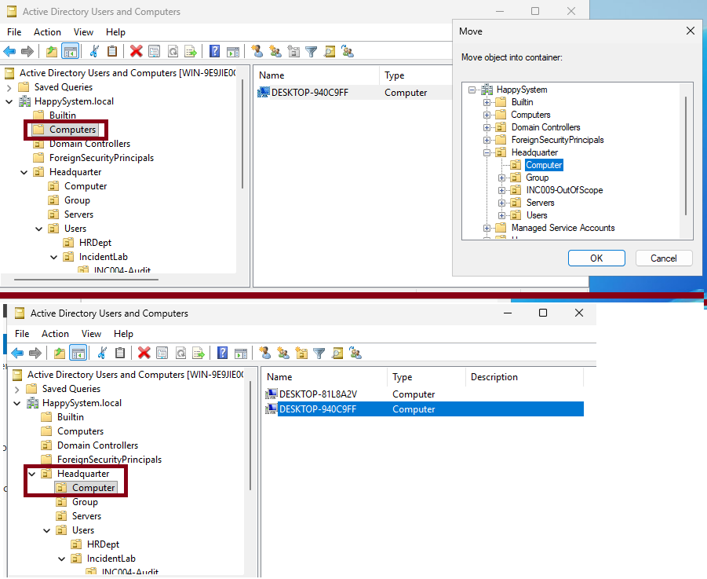
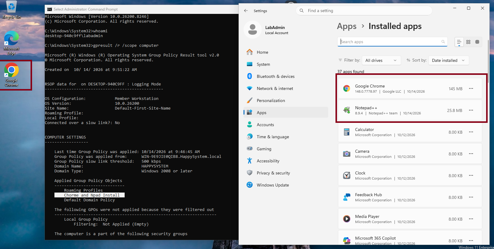

# INC-011 — Assigned Software Not Installing Through Group Policy

**Simulated incident | Windows Server 2025 / Windows 11 home lab**

## Incident

A domain-joined Windows 11 workstation was missing Google Chrome and Notepad++, although both applications were assigned through a computer-based Software Installation GPO.

## Environment

- **Domain:** `HappySystem.local`
- **Client:** `DESKTOP-940C9FF` (Windows 11)
- **GPO:** `Chrome and Npad Install`
- **Policy location:** `Computer Configuration > Policies > Software Settings > Software Installation`
- **Software source:** `\\WIN-9E9JIE0QIB8\Distribution$` (MSI packages)

## Investigation

The installed apps list did not contain either application. `gpresult /r /scope computer` showed that the software deployment GPO was not applied. The workstation was still joined to the domain and received other computer policies.

In Group Policy Management, both Chrome and Notepad++ were assigned under **Computer Configuration**. The GPO was linked to `Headquarter > Computer`.

ADUC showed the workstation object at `CN=Computers,DC=HappySystem,DC=local`, rather than under the linked OU. These are different Active Directory containers, so the GPO did not reach this workstation through its existing link.

I also checked the `Distribution$` share and NTFS read permissions, reviewed the computer account's effective access, and verified that both MSI packages existed at the distribution location. This ruled out an obvious missing source file or root-share read restriction before changing scope.

## Resolution

I moved **only** `DESKTOP-940C9FF` from the default `Computers` container to `Headquarter > Computer` using Active Directory Users and Computers. I left the GPO and the other computer object unchanged.

On the client, `gpupdate /force` reported that Software Installation settings required processing at startup. After the startup processing, I checked the computer-side Group Policy results and the installed applications.

## Verification

`gpresult /r /scope computer` now listed **Chrome and Npad Install** under applied GPOs. Windows Installed Apps showed **Google Chrome 148** and **Notepad++ 8.9.4**, and Chrome appeared on the desktop.

**Result:** Both computer-assigned applications installed successfully.

## Root cause and lesson

**Root cause:** The domain-joined workstation's computer object was outside the OU where the Software Installation GPO was linked.

For computer-assigned MSI deployments, check the **computer object's OU**, the computer-side `gpresult`, MSI source availability, and startup processing. A local administrator can inspect the result because the deployment targets the computer, not the signed-in user.
