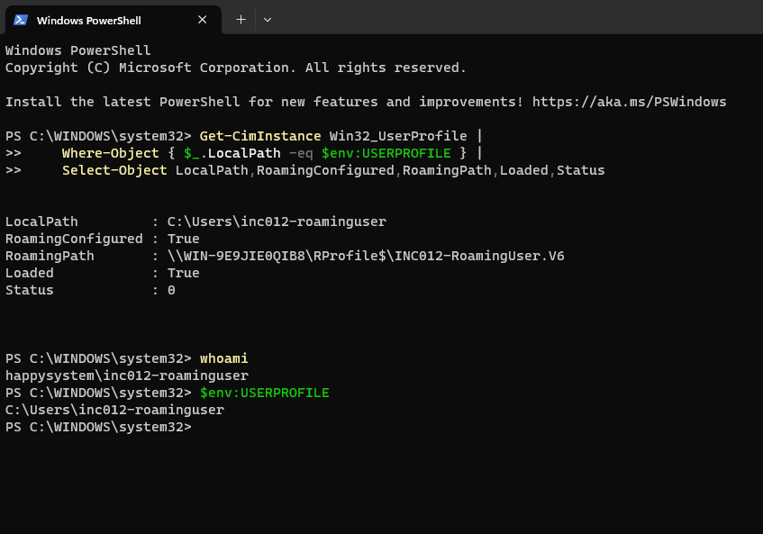
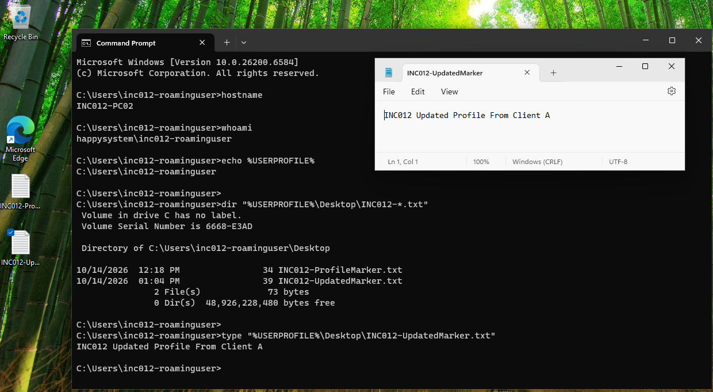

# INC-012 — Roaming Profile Not Updated on a Second Workstation

**Simulated Incident / Home Lab**  
**Category:** Windows Profiles / SMB Connectivity  
**Status:** Resolved and verified

## User report

> "The files I added to my desktop on one PC are missing when I sign in to another PC."

## Lab environment

- Domain: `HappySystem.local`
- Domain controller and roaming-profile file server: Windows Server 2025 (`WIN-9E9JIE0QIB8`, `192.168.146.10`)
- Client A: Windows 11 (`DESKTOP-940C9FF`)
- Client B: Windows 11 (`INC012-PC02`)
- Test account: `HAPPYSYSTEM\INC012-RoamingUser`
- Roaming profile share: `\\WIN-9E9JIE0QIB8\RProfile$`
- Roaming profile: `INC012-RoamingUser.V6`
- Group Policy: `Roaming Profiles` (computer-side profile path)

## Troubleshooting

I confirmed that the test account could roam between the two workstations. On Client A, I created `INC012-UpdatedMarker.txt` on the desktop and signed out. I verified that the new file reached the server's roaming-profile Desktop folder. Client B had previously cached the older profile, which contained only `INC012-ProfileMarker.txt`.

For this test, I enabled a temporary outbound Windows Firewall rule on Client B to block TCP 445 to `192.168.146.10`. After signing in on Client B, the original desktop marker was still available but the updated marker was missing. The command prompt returned **The system cannot find the file specified** when I tried to read it.

I checked `Win32_UserProfile`: the domain account was signed in, the local profile was loaded, and the roaming path pointed to the expected server share. `Status = 0` did not prove the server copy was current; the missing updated marker demonstrated that the latest changes had not arrived on this client.

I checked the outbound firewall rule and tested SMB connectivity with `Test-NetConnection 192.168.146.10 -Port 445`. Ping worked, but the TCP 445 connection failed while the block rule was enabled.

## Root cause

A temporary outbound firewall rule on Client B blocked TCP 445 to the roaming-profile server. The workstation could sign in using its existing local profile copy, but it could not retrieve the latest desktop changes from the server. The issue was **SMB connectivity**, not an incorrect user account or a missing server-side file.

## Resolution and verification

I signed out of the affected account, disabled `INC012-Lab-Block-SMB` on Client B, and tested the connection again. TCP 445 was reachable (`TcpTestSucceeded : True`). I did not change the server share, NTFS permissions, or the roaming-profile GPO.

After signing back in as `HAPPYSYSTEM\INC012-RoamingUser`, Client B showed both desktop markers. I opened the updated file and confirmed its content matched the version uploaded from Client A: `INC012 Updated Profile From Client A`.

**Outcome:** The latest desktop file became available on Client B once SMB access was restored and the roaming profile was loaded again. This case highlighted why a successful ping or domain sign-in does not necessarily mean the profile file share is accessible.
