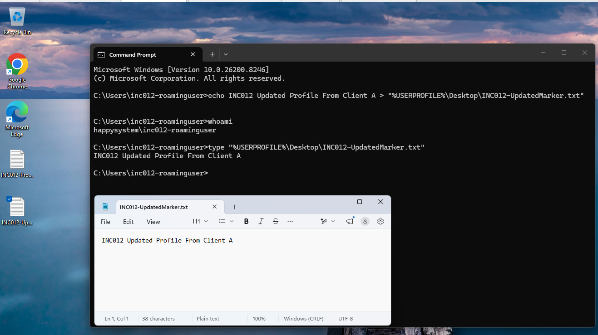
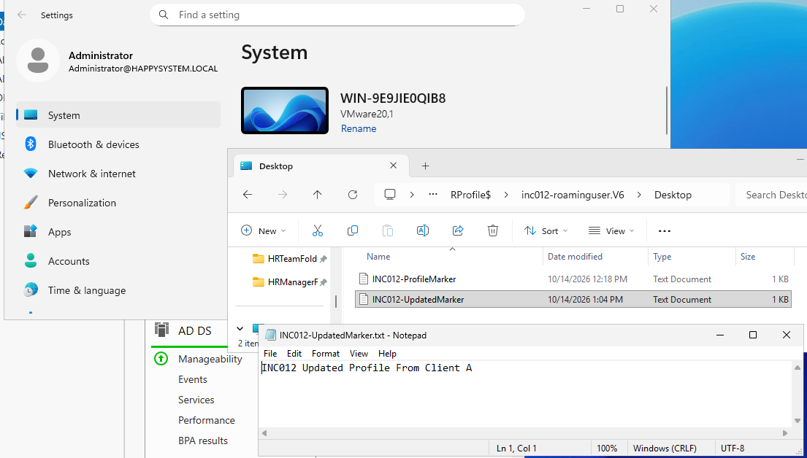
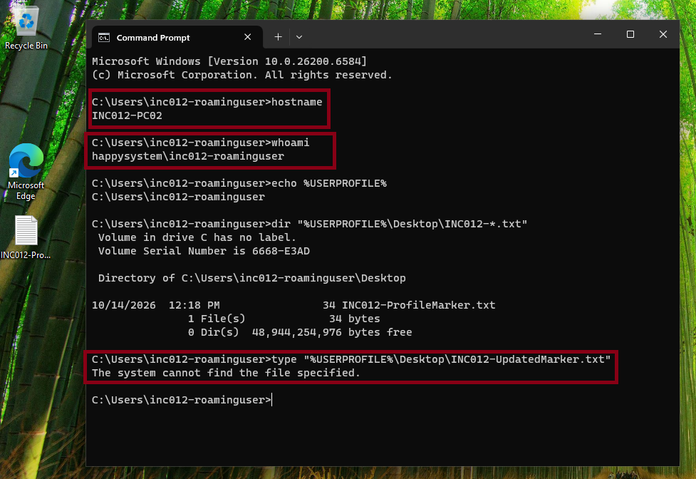
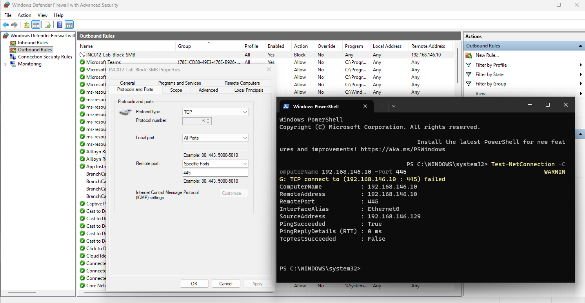
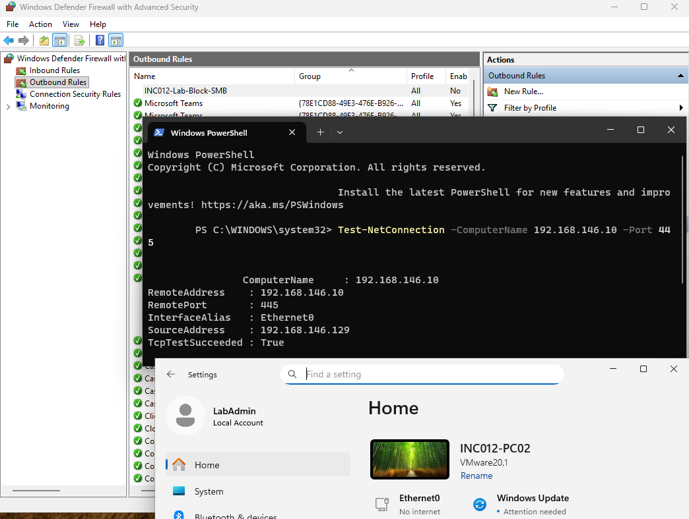

# INC-012 — Roaming Profile Not Updated on a Second Workstation

**Simulated Incident / Home Lab**  
**Category:** Windows Profiles / SMB Connectivity  
**Status:** Resolved and verified

## User report

> "The desktop file I added on my first PC is missing when I sign in to my second PC."

## Lab environment

- Domain: `HappySystem.local`
- Domain controller and profile file server: Windows Server 2025 (`WIN-9E9JIE0QIB8`, `192.168.146.10`)
- Client A: Windows 11 (`DESKTOP-940C9FF`)
- Client B: Windows 11 (`INC012-PC02`)
- Test user: `HAPPYSYSTEM\INC012-RoamingUser`
- Profile share: `\\WIN-9E9JIE0QIB8\RProfile$`
- Configuration: computer-side `Roaming Profiles` GPO

## Baseline and reported problem

I first verified that a desktop marker could roam successfully from Client A to Client B. I then signed out of Client B, returned to Client A, and created a second file, `INC012-UpdatedMarker.txt`, with the text `INC012 Updated Profile From Client A`.

After signing out of Client A, I checked the server profile folder (`C:\RProfile$\inc012-roaminguser.V6\Desktop`). Both the original and the updated marker were present. This confirmed that the newest version had reached the file server.

## Investigation

To reproduce a client-side network issue, I enabled a temporary outbound firewall rule on Client B blocking TCP 445 to `192.168.146.10`. When I signed in using the same domain account, the older desktop marker was present, but `INC012-UpdatedMarker.txt` was missing. Reading it from CMD returned **The system cannot find the file specified**.

I inspected `Win32_UserProfile`. The account had a loaded local profile at `C:\Users\inc012-roaminguser`, with the expected roaming profile path configured. `Status = 0` was not proof of successful synchronization; the file comparison showed the client's profile was out of date.

I checked the outbound firewall rule and tested the server's SMB port using `Test-NetConnection 192.168.146.10 -Port 445`. Ping succeeded, but `TcpTestSucceeded` was `False`. This isolated the problem to SMB access rather than general IP reachability.

## Root cause

Client B could not retrieve the latest roaming profile files because the temporary outbound firewall rule blocked SMB traffic to the file server. Windows used the existing local profile copy, which did not contain the updated marker.

## Resolution and verification

I signed out of the affected user account while SMB was still blocked, signed in as local `LabAdmin`, disabled `INC012-Lab-Block-SMB`, and repeated the connectivity test. TCP 445 was reachable again (`TcpTestSucceeded : True`). No roaming-profile GPO, share, or NTFS permissions were changed.

After signing back in as `HAPPYSYSTEM\INC012-RoamingUser`, Client B showed both desktop markers. CMD and Notepad confirmed that the updated file contained the exact text uploaded from Client A.

**Outcome:** The second workstation received the latest desktop changes once SMB connectivity was restored. This test showed why a successful ping and domain sign-in do not, by themselves, confirm access to a roaming-profile file share.
