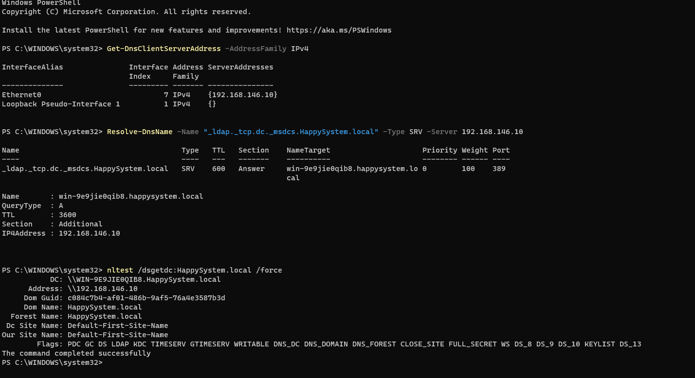
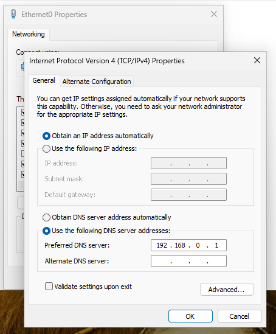
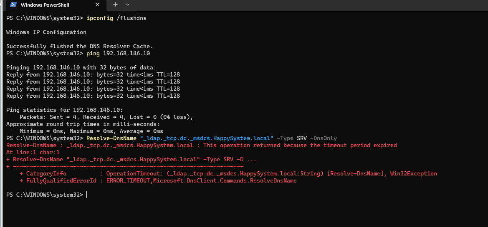
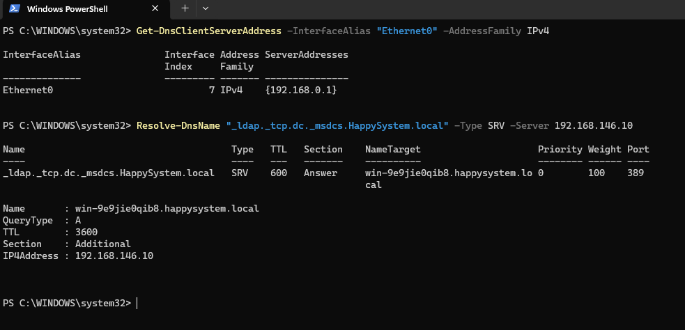
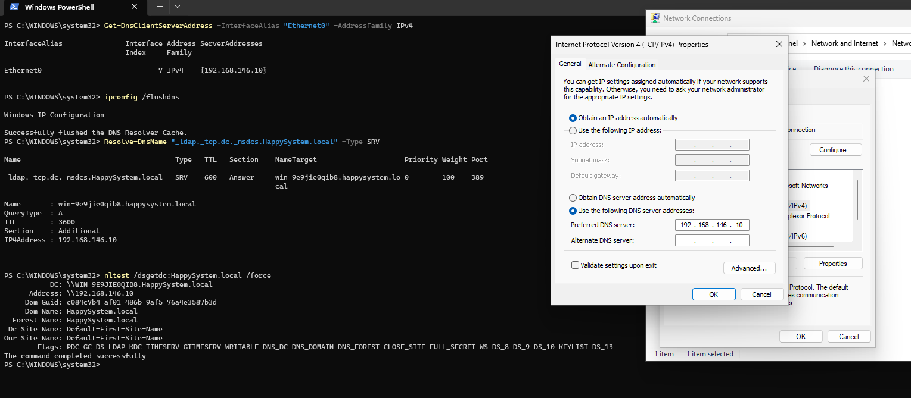

# INC-013 — Incorrect DNS Server Prevents AD Service Discovery

**Simulated Incident / Home Lab**  
**Category:** Windows Networking / DNS / Active Directory  
**Status:** Resolved and verified

## User report

> "The workstation can reach the server by IP address, but it cannot look up the domain's services."

## Lab environment

- Domain: `HappySystem.local`
- Domain controller / DNS server: Windows Server 2025 (`WIN-9E9JIE0QIB8`, `192.168.146.10`)
- Affected workstation: Windows 11 (`INC012-PC02`), VMware host-only network
- Test administrator: local `LabAdmin`
- Correct DNS address: `192.168.146.10`
- Incorrect DNS address used for the test: `192.168.0.1`

## Investigation

### 1. Check the working baseline

Before changing anything, I verified the workstation's DNS settings and Active Directory service records.

```powershell
Get-DnsClientServerAddress -AddressFamily IPv4
```

**Why:** Shows which DNS server IP addresses the network adapters are configured to use. `Ethernet0` originally pointed to `192.168.146.10`.

```powershell
Resolve-DnsName "_ldap._tcp.dc._msdcs.HappySystem.local" -Type SRV -Server 192.168.146.10
```

**Why:** Looks up the LDAP SRV record used to locate a domain controller. `-Type SRV` requests a service record; `-Server` explicitly queries the known-good DNS server. The result identified `WIN-9E9JIE0QIB8` on port `389`.

```cmd
nltest /dsgetdc:HappySystem.local /force
```

**Why:** Requests domain-controller discovery rather than relying on previously obtained locator information. The workstation successfully found `WIN-9E9JIE0QIB8`.



### 2. Reproduce the DNS problem

On `INC012-PC02` only, I changed the IPv4 **Preferred DNS server** from `192.168.146.10` to `192.168.0.1` through the network adapter properties, while leaving DHCP-assigned IP addressing enabled. This was a controlled, temporary lab fault.



```cmd
ipconfig /flushdns
```

**Why:** Clears the local DNS resolver cache so previously resolved records do not mask the current DNS configuration. This command **does not** change the configured DNS server.

```cmd
ping 192.168.146.10
```

**Why:** Tests basic IP reachability using ICMP without needing DNS to translate a hostname. All four replies succeeded (0% packet loss), so the server was still reachable by IP.

```powershell
Resolve-DnsName "_ldap._tcp.dc._msdcs.HappySystem.local" -Type SRV -DnsOnly
```

**Why:** Tests whether the workstation can resolve the AD SRV record using its **currently configured DNS settings**. Unlike the baseline command, it does not override the resolver with `-Server`; `-DnsOnly` limits the query to DNS. The request timed out.



### 3. Isolate the root cause

```powershell
Get-DnsClientServerAddress -InterfaceAlias "Ethernet0" -AddressFamily IPv4
```

**Why:** Checks the actual resolver setting on the affected adapter. It confirmed `192.168.0.1`, rather than the lab's AD DNS server.

```powershell
Resolve-DnsName "_ldap._tcp.dc._msdcs.HappySystem.local" -Type SRV -Server 192.168.146.10
```

**Why:** Repeats the same SRV lookup but queries `192.168.146.10` directly, bypassing the incorrect default resolver. This succeeded and returned the domain controller on LDAP port `389`, showing that the record and DNS service were available.



## Root cause

The workstation's preferred DNS server was set to `192.168.0.1`, not the Active Directory DNS server at `192.168.146.10`. In this isolated lab, the incorrect address could not provide the required AD SRV response. Basic IP connectivity continued to work, but DNS-based service discovery timed out.

## Resolution and verification

I restored **Preferred DNS server = `192.168.146.10`** in the Windows IPv4 adapter properties. No changes were needed on the domain controller or in the DNS zone.

```powershell
Get-DnsClientServerAddress -InterfaceAlias "Ethernet0" -AddressFamily IPv4
```

**Why:** Confirms the active DNS configuration now points to `192.168.146.10`.

```cmd
ipconfig /flushdns
```

**Why:** Clears any cached DNS responses before testing the restored configuration.

```powershell
Resolve-DnsName "_ldap._tcp.dc._msdcs.HappySystem.local" -Type SRV
```

**Why:** Verifies that the workstation can now resolve the domain-controller SRV record **without explicitly selecting a DNS server**. The lookup succeeded.

```cmd
nltest /dsgetdc:HappySystem.local /force
```

**Why:** Confirms domain-controller discovery after the DNS fix. The client found `WIN-9E9JIE0QIB8` at `192.168.146.10`.



**Outcome:** DNS-based AD service discovery was restored. The test demonstrates that successful IP ping does not establish that a workstation's DNS configuration is correct. This incident verified SRV resolution and DC discovery; domain sign-in failure or drive access failure was not separately reproduced.

## References

Microsoft documentation used to explain and verify the troubleshooting methods (the lab observations above come from the captured screenshots):

- [Get-DnsClientServerAddress — inspect configured DNS servers](https://learn.microsoft.com/en-us/powershell/module/dnsclient/get-dnsclientserveraddress)
- [Resolve-DnsName — query SRV records, select a DNS server, or use DNS-only resolution](https://learn.microsoft.com/en-us/powershell/module/dnsclient/resolve-dnsname)
- [ipconfig — `/flushdns` and DNS resolver cache](https://learn.microsoft.com/en-us/windows-server/administration/windows-commands/ipconfig)
- [Domain controller locator records — `_ldap._tcp.dc._msdcs`](https://learn.microsoft.com/en-us/troubleshoot/windows-server/active-directory/optimize-dc-location-global-catalog)
- [Domain join troubleshooting — DNS server, SRV records, and `nltest /dsgetdc`](https://learn.microsoft.com/en-us/troubleshoot/windows-server/active-directory/error-code-0x54b)

[← Back to Incident Index](../../README.md)
