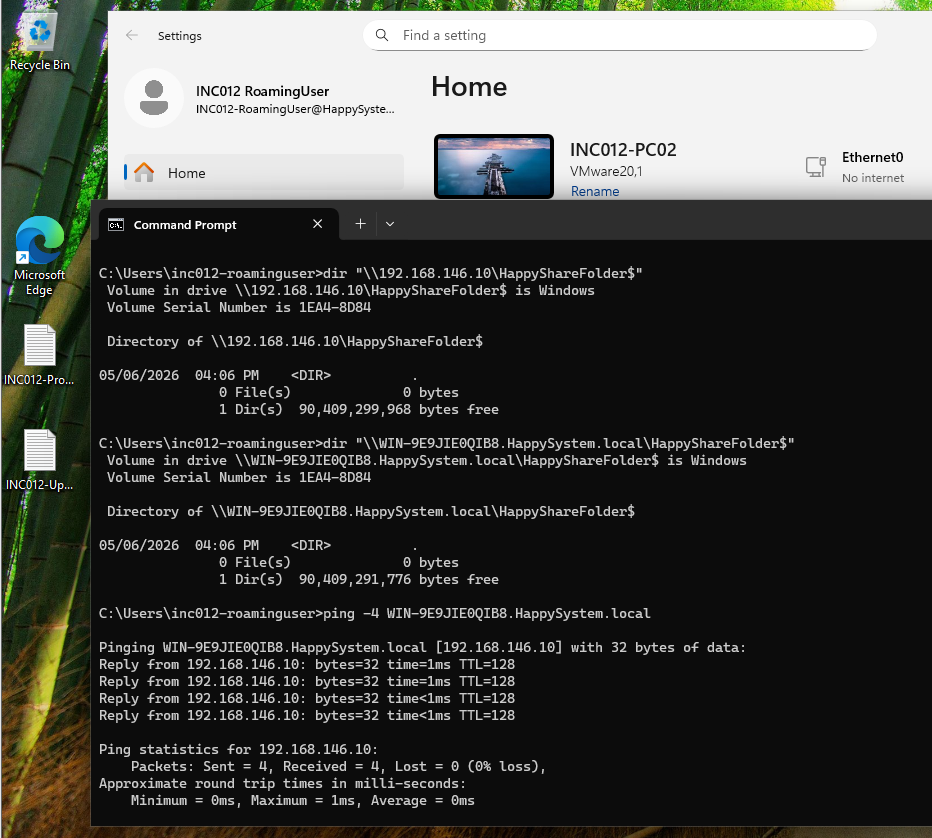
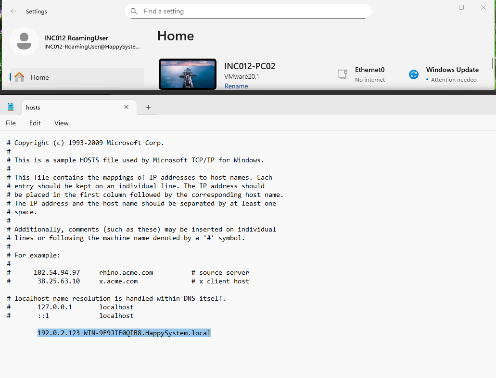
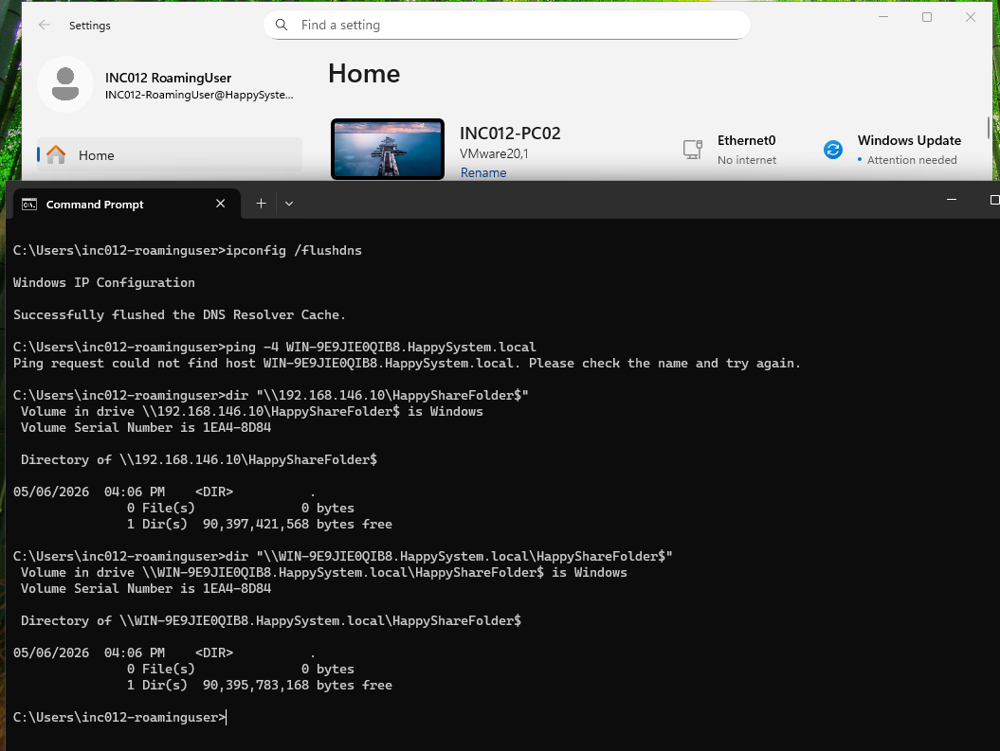
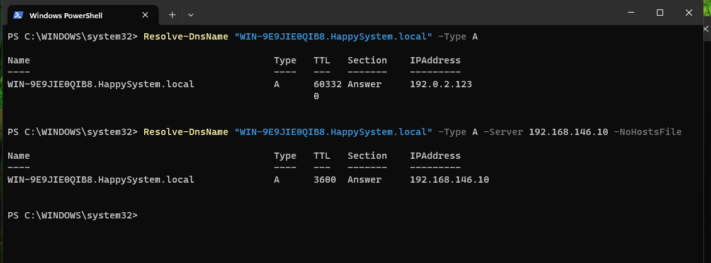
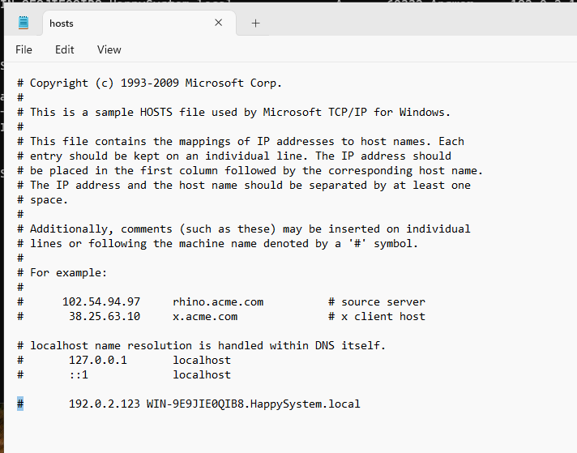
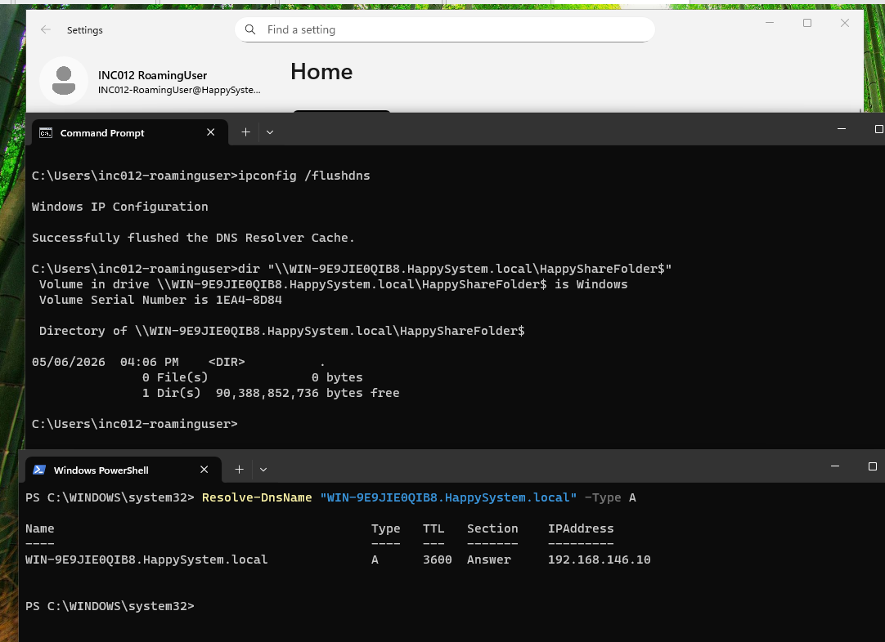

# INC-014 — Incorrect Hosts File Entry Causes Wrong Hostname Resolution

**Simulated Incident / Home Lab**  
**Category:** Windows Networking / Name Resolution / SMB  
**Status:** Resolved and verified

## User report

> "The file server is reachable by IP, but its hostname does not resolve correctly."

## Lab environment

- Domain: `HappySystem.local`
- File server / domain controller: Windows Server 2025 (`WIN-9E9JIE0QIB8`, `192.168.146.10`)
- Test workstation: Windows 11 (`INC012-PC02`), VMware host-only network
- Test user: `HAPPYSYSTEM\INC012-RoamingUser`
- File share: `HappyShareFolder$` (read-only access test; no file changes)
- Correct hostname mapping: `WIN-9E9JIE0QIB8.HappySystem.local` → `192.168.146.10`
- Incorrect local hosts mapping used for the test: `192.0.2.123` (documentation-only test address)

## Investigation

### 1. Establish a working baseline

I first checked the same shared folder by IP address and fully qualified domain name (FQDN). Both paths worked before introducing the fault.

```cmd
dir "\\192.168.146.10\HappyShareFolder$"
dir "\\WIN-9E9JIE0QIB8.HappySystem.local\HappyShareFolder$"
```

**Why:** The first path connects directly to the server IP. The second path uses a hostname and therefore depends on name resolution, although Windows may also reuse an existing SMB connection.

```cmd
ping -4 WIN-9E9JIE0QIB8.HappySystem.local
```

**Why:** The address displayed in the `Pinging` line gives a quick indication of which IPv4 address Windows resolves for the FQDN. In the baseline, it resolved to `192.168.146.10`, with four successful replies.



### 2. Introduce an incorrect local hosts entry

On the test workstation only, I edited `C:\Windows\System32\drivers\etc\hosts` as an administrator and added this temporary entry:

```text
192.0.2.123 WIN-9E9JIE0QIB8.HappySystem.local
```

**Why this causes a problem:** An active hosts-file entry supplies an explicit hostname-to-IP mapping. The incorrect entry points the server FQDN away from the actual file server, even though the domain DNS record remains correct. This was an isolated test change; the DNS server and other lab clients were not modified.



### 3. Test the affected workstation

```cmd
ipconfig /flushdns
```

**Why:** Clears dynamically cached DNS answers before retesting. It does not remove or repair an active hosts-file entry.

```cmd
ping -4 WIN-9E9JIE0QIB8.HappySystem.local
```

**Why:** Tests name resolution from the affected client. In this run, `ping` reported that it could not find the host. This did not by itself show which address Windows had selected, so I performed a direct name-resolution comparison next.

```cmd
dir "\\192.168.146.10\HappyShareFolder$"
dir "\\WIN-9E9JIE0QIB8.HappySystem.local\HappyShareFolder$"
```

**Why:** Rechecks IP-based and name-based SMB access. The IP path continued to work. **The hostname path also remained accessible** in the recorded test. Existing SMB connection reuse is one possible explanation, but I could not confirm that because the attempted `Get-SmbConnection` check returned `Access is denied` in the user session. I therefore did **not** treat this as a reproduced SMB share access failure.



### 4. Identify the root cause

```powershell
Resolve-DnsName "WIN-9E9JIE0QIB8.HappySystem.local" -Type A
```

**Why:** Checks the IP address returned by the workstation's normal resolution path. It returned the incorrect hosts-file address, `192.0.2.123`.

```powershell
Resolve-DnsName "WIN-9E9JIE0QIB8.HappySystem.local" -Type A -Server 192.168.146.10 -NoHostsFile
```

**Why:** Queries the known-good AD DNS server while explicitly skipping the local hosts file. The result was `192.168.146.10`. Comparing these two answers isolates the problem to local name-resolution configuration rather than a missing or incorrect server-side A record.



## Root cause

An incorrect active entry in the Windows client's `hosts` file mapped the domain controller / file-server FQDN to `192.0.2.123` instead of `192.168.146.10`. This overrode the valid DNS answer for normal hostname resolution on that workstation. The fault was local to the test PC; the Active Directory DNS server continued to return the correct record.

The lab **confirmed incorrect hostname resolution**, not a new SMB connection failure. The successful `\\Hostname\Share` result during the test was retained in the evidence rather than rewritten as an access error.

## Resolution and verification

I disabled the temporary mapping by placing `#` at the beginning of its line in the hosts file. The `#` turns the entry into a comment, so it is no longer an active hostname mapping. The lab entry can also be deleted entirely after documentation is complete.

```text
# 192.0.2.123 WIN-9E9JIE0QIB8.HappySystem.local
```



```cmd
ipconfig /flushdns
```

**Why:** Removes dynamically cached resolver responses before confirming that normal resolution is restored.

```powershell
Resolve-DnsName "WIN-9E9JIE0QIB8.HappySystem.local" -Type A
```

**Why:** Verifies the normal workstation resolution path without a DNS-server override or `-NoHostsFile`. The correct server IP, `192.168.146.10`, was returned.

```cmd
dir "\\WIN-9E9JIE0QIB8.HappySystem.local\HappyShareFolder$"
```

**Why:** Confirms that the existing file share remains accessible by the FQDN after the mapping is corrected. This is a successful final functional check, not proof that name-based SMB access had failed during the fault.



**Outcome:** Local hostname resolution was restored without changing the domain controller, DNS zone, network adapter's DNS server, or SMB share permissions. This incident shows why local hosts entries should be checked when a client's resolved address differs from a verified DNS server answer.

## References

Microsoft documentation used to explain the Windows behavior and commands. The actual test outcomes above are based on the lab screenshots.

- [Hosts File Editor — what the Windows hosts file does](https://learn.microsoft.com/en-us/windows/powertoys/hosts-file-editor)
- [Host Names and IP Addresses — hosts-file resolution behavior](https://learn.microsoft.com/en-us/windows/win32/snmp/host-names-and-ip-addresses)
- [Resolve-DnsName — `-Server`, `-Type`, and `-NoHostsFile`](https://learn.microsoft.com/en-us/powershell/module/dnsclient/resolve-dnsname)
- [ipconfig — `/flushdns` and the DNS resolver cache](https://learn.microsoft.com/en-us/windows-server/administration/windows-commands/ipconfig)
- [Get-SmbConnection — inspecting existing SMB client connections](https://learn.microsoft.com/en-us/powershell/module/smbshare/get-smbconnection)

[← Back to Incident Index](../../README.md)
