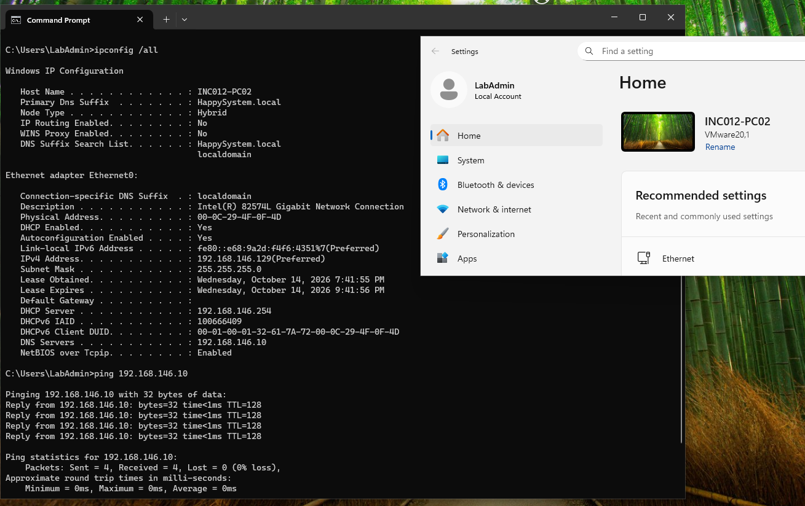
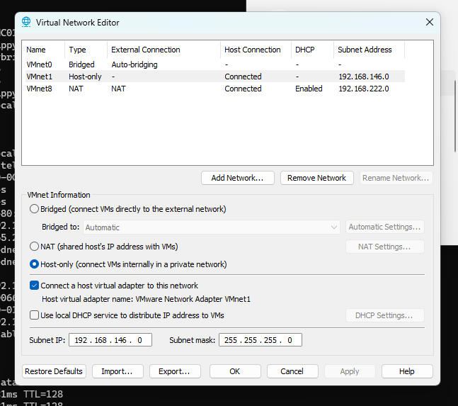
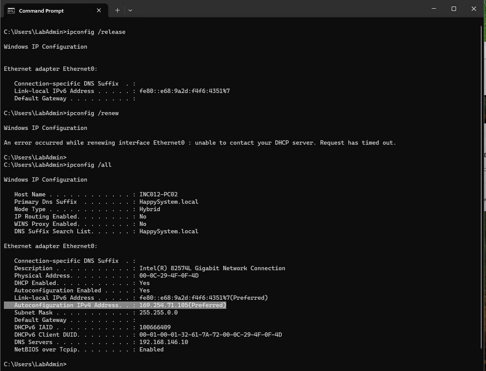
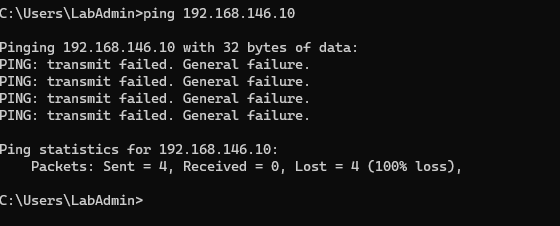
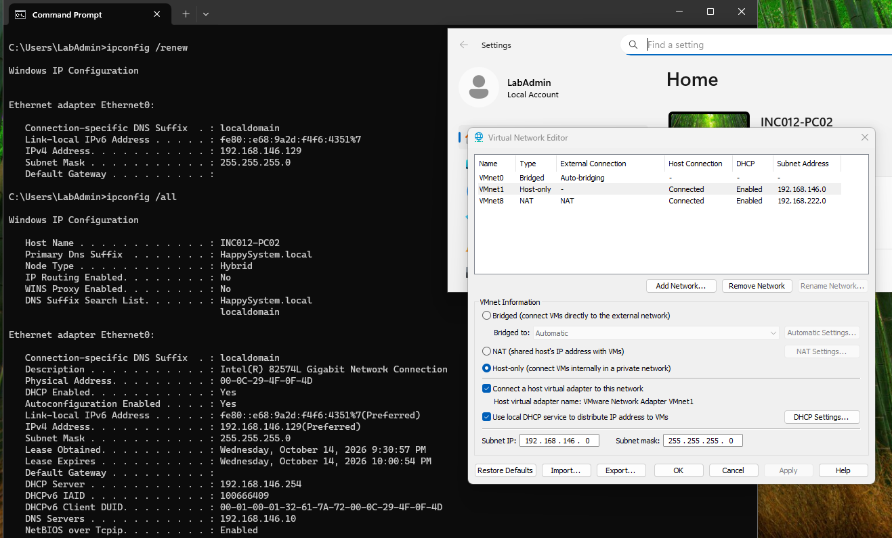
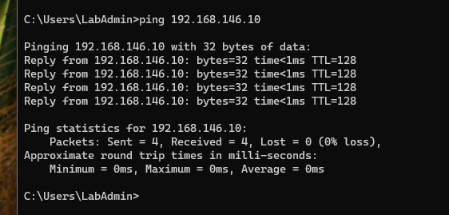

# INC-015 — Client Receives an APIPA Address After DHCP Failure

**Simulated Incident / Home Lab**  
**Category:** Network & Remote / DHCP / Windows Networking  
**Status:** Resolved and verified

## User report

> "My PC has a 169.254.x.x address and can't connect to the internal server."

## Lab environment

- **Test client:** Windows 11, `INC012-PC02`, logged in as local `LabAdmin`
- **Internal server / domain controller:** Windows Server 2025, `192.168.146.10` (`HappySystem.local`)
- **Isolated virtual network:** VMware Workstation VMnet1, Host-only, `192.168.146.0/24`
- **DHCP source:** VMware local DHCP service on VMnet1 (`192.168.146.254`)
- **Expected client configuration:** DHCP enabled, address in `192.168.146.0/24`, DNS server `192.168.146.10`
- **Controlled fault:** Temporarily disabled the local VMware DHCP service on VMnet1, then released and renewed the client lease

## Investigation

### 1. Verify the healthy connection

Before changing anything, I checked the client's IPv4 configuration and confirmed it could reach the domain controller.

```cmd
ipconfig /all
ping 192.168.146.10
```

**Why `ipconfig /all`:** Shows whether DHCP is enabled, which IPv4 address and subnet mask the client received, its DHCP server, and its DNS server. The baseline reported `192.168.146.129/24`, DHCP server `192.168.146.254`, and DNS server `192.168.146.10`.

**Why `ping`:** Checks basic IPv4 reachability to the internal server. The baseline returned four replies with no loss. Ping alone cannot confirm that DHCP is healthy, so it was paired with the lease details.



### 2. Introduce a controlled DHCP outage

In the VMware Virtual Network Editor, I selected **VMnet1 (Host-only)** and unchecked **Use local DHCP service to distribute IP address to VMs**. I left VMnet1 and its `192.168.146.0/24` subnet in place. The domain controller was not modified.

**Why:** This simulates an unavailable DHCP source on an isolated training network without manually entering a fake APIPA address. Other DHCP clients on VMnet1 could also be affected while the test service was disabled.



### 3. Reproduce the DHCP lease failure and APIPA assignment

From the Windows 11 test client:

```cmd
ipconfig /release
ipconfig /renew
ipconfig /all
```

**Why `/release`:** Discards the previously assigned DHCP address, removing the working configuration so the lab can test a fresh request.

**Why `/renew`:** Requests an IPv4 configuration from the DHCP source. Here the command reported: **"unable to contact your DHCP server. Request has timed out."**

**Why `/all` again:** Verifies the resulting address rather than assuming the renewal failed in a particular way. Windows remained DHCP-enabled but assigned itself `169.254.71.105` with a `255.255.0.0` subnet mask. This is an **Automatic Private IP Addressing (APIPA)** address, not a valid address on the lab's `192.168.146.0/24` network.



### 4. Check the impact on internal connectivity

```cmd
ping 192.168.146.10
```

**Why:** Tests whether the client can still communicate with the server after losing its DHCP lease. The result was **"PING: transmit failed. General failure"**, with zero replies. The client's APIPA configuration was not suitable for reaching the internal server on this lab network.



## Root cause

The local **VMware DHCP service for VMnet1 was disabled** as part of this controlled test. When the client released its valid lease and requested another address, no DHCP server responded. Windows assigned an APIPA address (`169.254.71.105/16`) instead. The client then could not reach the domain controller at `192.168.146.10` using its current IPv4 configuration.

In a real incident, an APIPA address indicates that a client has **not obtained a usable DHCP lease**; it does not, by itself, prove the DHCP server is stopped. Other potential causes include a disconnected adapter, VLAN/switch issues, DHCP relay problems, client service issues, or blocked DHCP traffic.

## Resolution and verification

### 5. Restore the DHCP source

In VMware Virtual Network Editor, I re-enabled **Use local DHCP service to distribute IP address to VMs** for **VMnet1**. I did not change the subnet, domain controller, or client DNS settings.

```cmd
ipconfig /renew
ipconfig /all
```

**Why:** After the DHCP source was restored, `/renew` acquired a working lease, and `/all` confirmed the assigned settings rather than relying on the absence of an error. The client recovered `192.168.146.129/24`, DHCP server `192.168.146.254`, and DNS server `192.168.146.10`. The APIPA address was no longer in use.



### 6. Validate internal network and domain discovery

```cmd
ping 192.168.146.10
```

**Why:** Confirms basic connectivity has returned. Four replies were received with zero packet loss.



```cmd
nltest /dsgetdc:HappySystem.local /force
```

**Why:** Requests fresh domain-controller discovery, confirming that the recovered network and name-resolution configuration can locate Active Directory services. The verification returned `WIN-9E9JIE0QIB8.HappySystem.local` at `192.168.146.10` and **"The command completed successfully."** This additional check was reviewed in the lab; it is not shown in the six-image GitHub set.

**Outcome:** Re-enabling DHCP and renewing the lease restored a valid client address, internal IPv4 connectivity, and domain-controller discovery. No changes to Active Directory, DNS records, or SMB permissions were needed.

## Takeaway

When Windows shows a `169.254.x.x` address, begin by checking **DHCP availability and lease negotiation**. Compare the IP configuration before and after remediation and verify that connectivity actually returns. A successful `ping` is useful, but it should not replace DHCP lease verification.

**Lab cleanup:** VMnet1 DHCP was turned back on, and the client had a normal `192.168.146.x` lease at the end of the test.

## References

The following Microsoft Learn articles document Windows APIPA behavior, DHCP troubleshooting considerations, and the commands used here. Test results above are from the lab screenshots.

- [How to use automatic TCP/IP addressing without a DHCP server — APIPA](https://learn.microsoft.com/en-us/troubleshoot/windows-server/networking/how-to-use-automatic-tcpip-addressing-without-a-dh)
- [ipconfig — `/all`, `/release`, and `/renew`](https://learn.microsoft.com/en-us/windows-server/administration/windows-commands/ipconfig)
- [Guidance for troubleshooting DHCP](https://learn.microsoft.com/en-us/troubleshoot/windows-server/networking/troubleshoot-dhcp-guidance)
- [Troubleshooting DNS clients — renewing a DHCP-supplied configuration](https://learn.microsoft.com/en-us/windows-server/networking/dns/troubleshoot/troubleshoot-dns-client)

[← Back to Incident Index](../../README.md)
