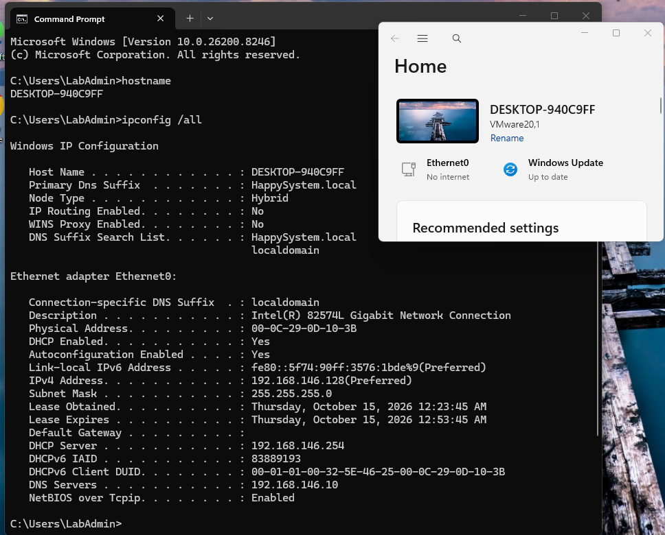
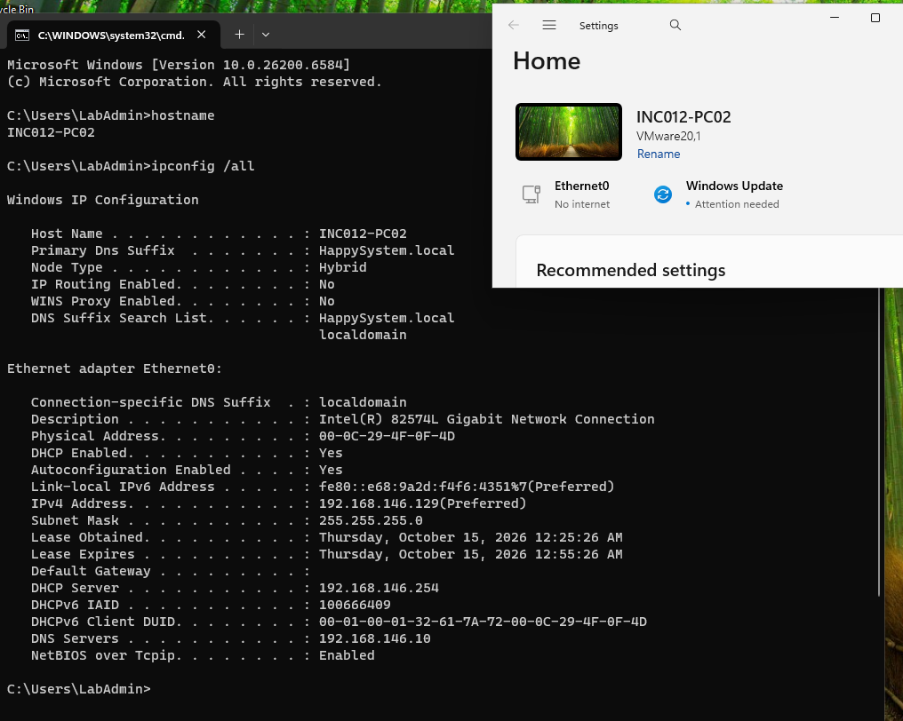
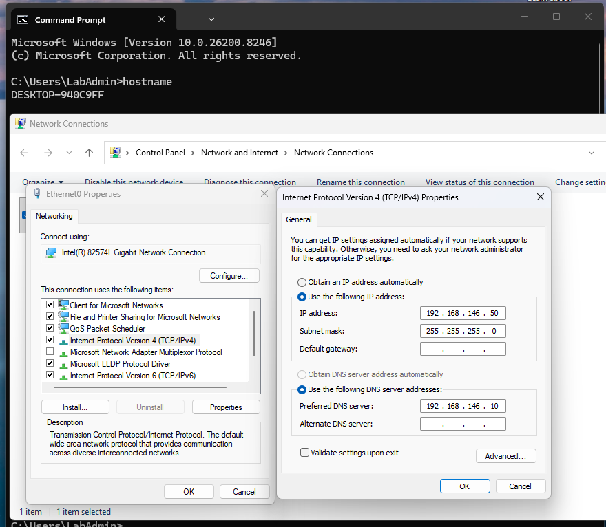
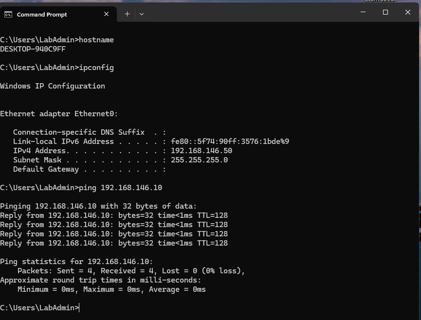
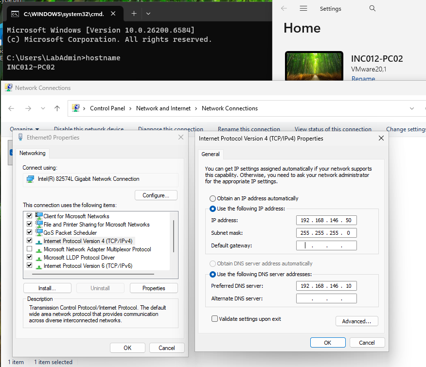
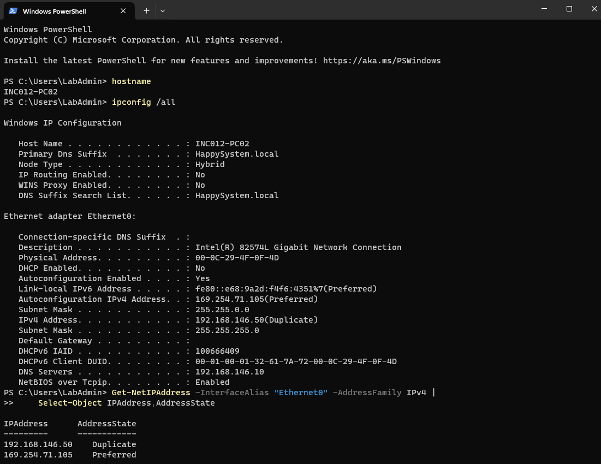
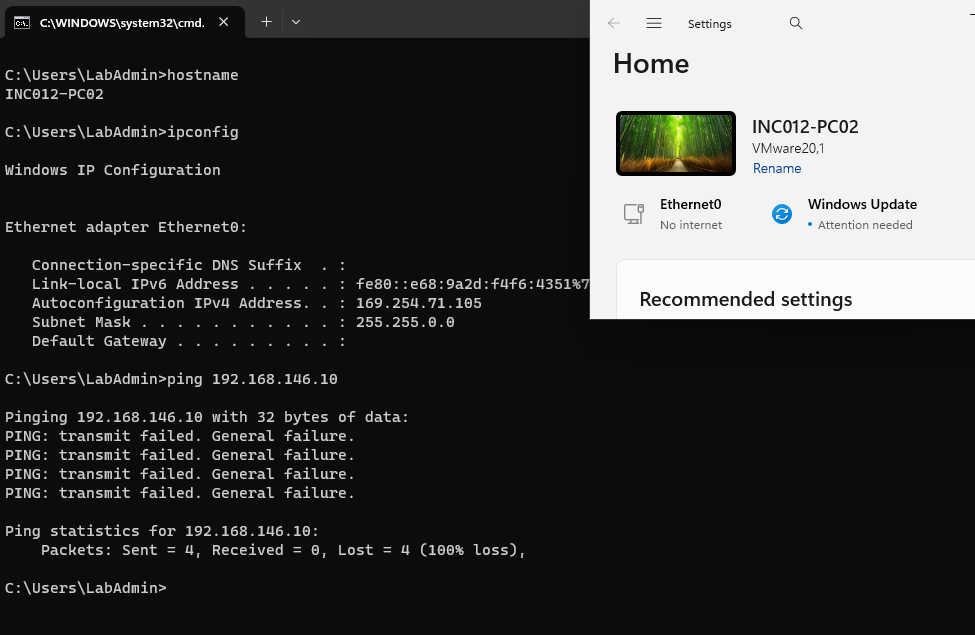
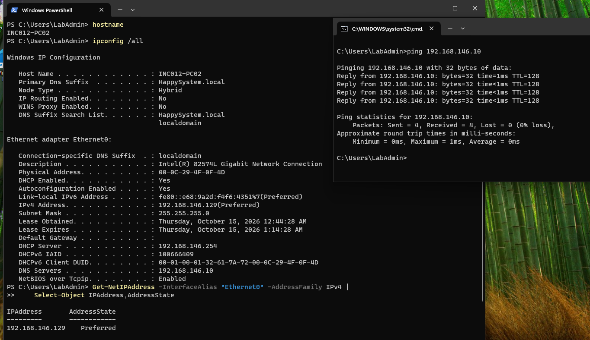
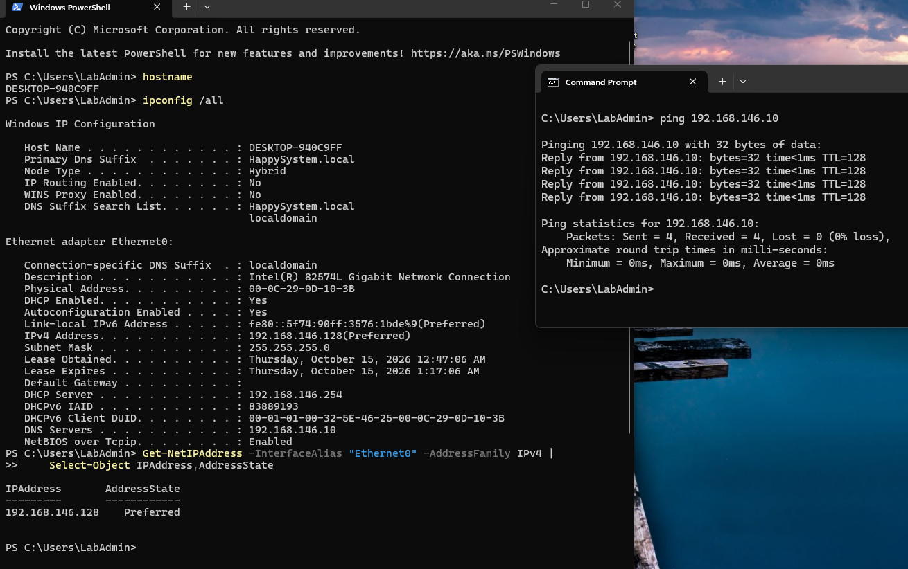

# INC-016 — Duplicate Static IP Address Causes Network Connectivity Failure

**Simulated Incident / Home Lab**  
**Category:** Windows Networking / IPv4 / Address Conflict  
**Status:** Resolved and verified

## User report

> "My workstation has lost access to the company network. Another PC is using the same IP address."

## Lab environment

- Domain: `HappySystem.local`
- Domain controller / DNS: Windows Server 2025 (`WIN-9E9JIE0QIB8`, `192.168.146.10`)
- Client A: Windows 11 (`DESKTOP-940C9FF`)
- Client B: Windows 11 (`INC012-PC02`)
- Test administrator: local `LabAdmin` on each Windows client
- Virtual network: VMware VMnet1 (host-only), `192.168.146.0/24`
- VMware DHCP pool: `192.168.146.128–192.168.146.254`
- Duplicate static IPv4 address used in the test: `192.168.146.50`

This test was performed on two isolated Windows 11 VMs. I left the domain controller, DNS server, and VMware DHCP service unchanged.

## Investigation

### 1. Check the working baseline on both PCs

I checked both computers before making any changes. Client A had `192.168.146.128` and Client B had `192.168.146.129`; both received DHCP settings from `192.168.146.254`, with DNS directed to `192.168.146.10`.

```cmd
hostname
ipconfig /all
```

**Why `hostname`:** Makes sure the results come from the intended workstation, particularly when two similar VMs are open side by side.

**Why `ipconfig /all`:** Shows the active IPv4 address, subnet mask, whether DHCP is enabled, the DHCP server, and the configured DNS server. The baseline confirmed two separate addresses before I introduced a conflict.





### 2. Give Client A a static test address

In Client A's **Ethernet0 → IPv4 Properties**, I switched from DHCP to a static configuration:

- IPv4 address: `192.168.146.50`
- Subnet mask: `255.255.255.0`
- Default gateway: blank (isolated host-only network)
- Preferred DNS: `192.168.146.10`

I selected `.50` outside the VMware DHCP pool to avoid conflicting with a normally assigned DHCP lease. It was a test address, not a production recommendation.



```cmd
hostname
ipconfig
ping 192.168.146.10
```

**Why:** I verified the static address really took effect and that Client A could still reach the server. `ipconfig` showed `192.168.146.50/24`, and the ping returned four replies with no packet loss.



### 3. Reproduce a duplicate IP address on Client B

I then opened the IPv4 adapter properties on Client B and assigned **the same** address, `192.168.146.50/24`, while keeping DNS at `192.168.146.10`. Both machines were now configured to claim the same IPv4 address on VMnet1.



```powershell
hostname
ipconfig /all
Get-NetIPAddress -InterfaceAlias "Ethernet0" -AddressFamily IPv4 |
    Select-Object IPAddress, AddressState
```

**Why `ipconfig /all`:** Confirms that DHCP was disabled on Client B and shows which address Windows actually considers usable. Its output listed `192.168.146.50 (Duplicate)` and an automatically configured `169.254.71.105 (Preferred)` address.

**Why `Get-NetIPAddress`:** The `AddressState` property provides a more precise diagnosis than a failed ping. Here it explicitly showed `192.168.146.50 = Duplicate` and `169.254.71.105 = Preferred`. Windows detected the conflict and did not use the duplicate address for normal communication.



### 4. Check the impact on connectivity

```cmd
ping 192.168.146.10
```

**Why:** Tests basic IPv4 reachability after the conflict. Client B returned **"PING: transmit failed. General failure"** on all four attempts. In this lab the active APIPA address was not suitable for communicating with the domain controller on `192.168.146.0/24`.



## Root cause

Both Windows 11 clients were manually assigned the same static address, `192.168.146.50`, on one host-only network. Windows detected the duplicate address on Client B and marked it **`Duplicate`**, so it was not available for normal use. The client also had a preferred IPv4 link-local/APIPA address (`169.254.71.105`), and its ping to the domain controller failed.

The address conflict—not an unavailable DHCP server—was the demonstrated cause. This is different from INC-015, where VMware DHCP itself was temporarily disabled. A `169.254.x.x` address can appear in more than one failure scenario; checking **`AddressState`** helps separate them.

## Resolution and verification

### 5. Restore Client B to its normal DHCP configuration

In Client B's IPv4 adapter properties, I changed the IP setting back to **Obtain an IP address automatically**, retaining the lab's DNS server `192.168.146.10`.

```powershell
hostname
ipconfig /all
Get-NetIPAddress -InterfaceAlias "Ethernet0" -AddressFamily IPv4 |
    Select-Object IPAddress, AddressState
ping 192.168.146.10
```

**Why:** Confirms that Client B again receives a DHCP lease, has no `Duplicate` state, and can reach the internal server. It recovered `192.168.146.129` from DHCP server `192.168.146.254`; `AddressState` became `Preferred` and all four ping requests succeeded.



### 6. Restore Client A and confirm both addresses are unique

I returned Client A to **Obtain an IP address automatically**, with Preferred DNS still set to `192.168.146.10`, and ran the same checks:

```powershell
hostname
ipconfig /all
Get-NetIPAddress -InterfaceAlias "Ethernet0" -AddressFamily IPv4 |
    Select-Object IPAddress, AddressState
ping 192.168.146.10
```

**Why:** Resolving a two-device conflict is not complete until *both* workstations are back in a supported, non-overlapping configuration. Client A recovered `192.168.146.128`, showed `Preferred` rather than `Duplicate`, and received four ping replies with no packet loss.



**Outcome:** Both clients were restored to DHCP, kept different addresses (`192.168.146.128` and `192.168.146.129`), and could reach the domain controller. The test reproduced a Windows-detected static IP conflict and showed that restoring unique address assignments resolved it. No DNS, domain controller, or VMware DHCP changes were required.

## Takeaway

A failed ping alone is not proof of an IP address conflict. Check the current address with `ipconfig /all`, then inspect `Get-NetIPAddress` for `AddressState = Duplicate`. In a real environment, trace the conflicting address to the devices using it and coordinate a valid addressing plan or DHCP reservation before making permanent changes. Here the conflict was deliberately introduced and reversed inside the lab.

## References

These Microsoft references explain the Windows command behavior and address-state terminology. The incident findings above come from the lab screenshots.

- [Get-NetIPAddress — `AddressState`, including `Duplicate` and `Preferred`](https://learn.microsoft.com/en-us/powershell/module/nettcpip/get-netipaddress)
- [ipconfig — inspect full IP configuration and DHCP settings](https://learn.microsoft.com/en-us/windows-server/administration/windows-commands/ipconfig)
- [Windows address-conflict detection — Duplicate Address Detection and ARP checks](https://learn.microsoft.com/en-us/troubleshoot/windows-server/networking/event-4199-windows-client-cannot-get-ip-address-dhcp-server)
- [Automatic TCP/IP addressing without a DHCP server — APIPA](https://learn.microsoft.com/en-us/troubleshoot/windows-server/networking/how-to-use-automatic-tcpip-addressing-without-a-dh)

[← Back to Incident Index](../../README.md)
