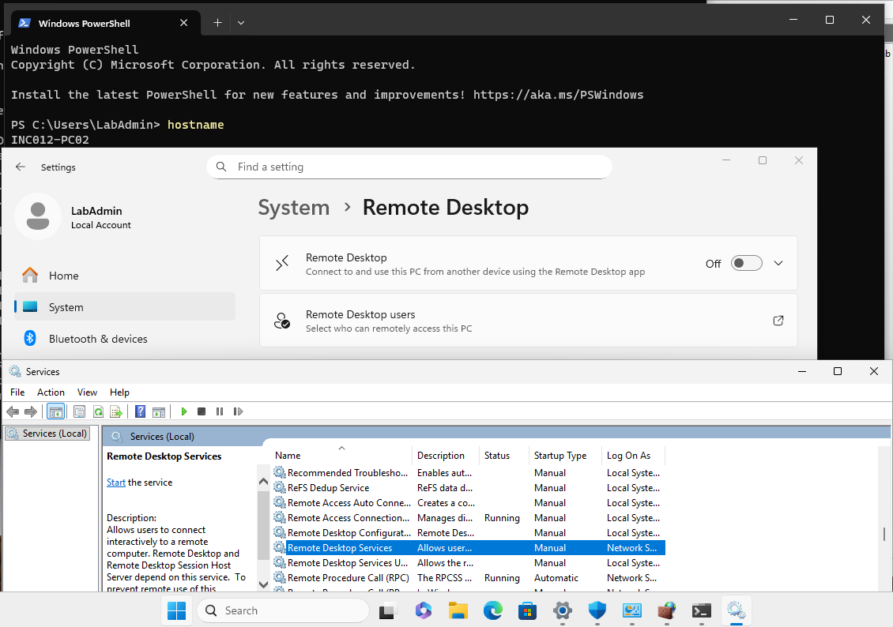
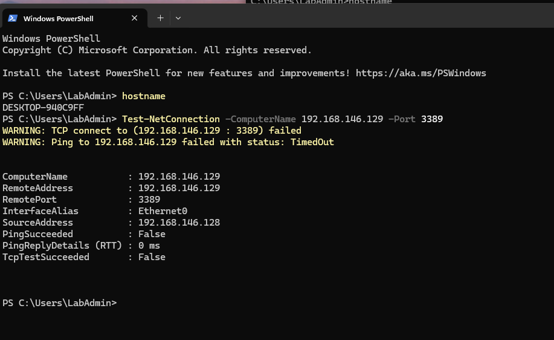
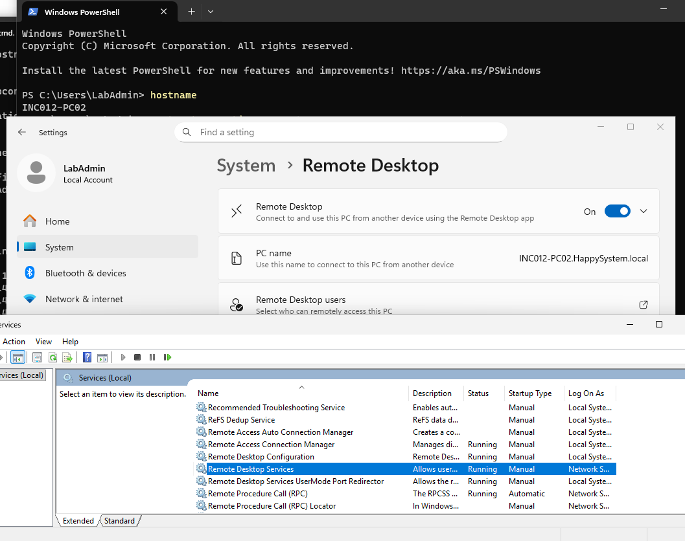
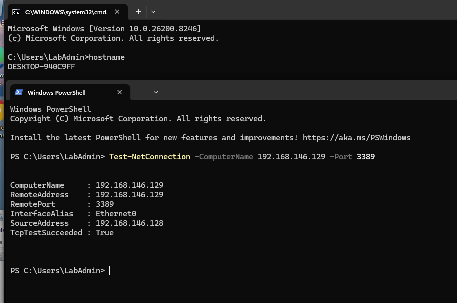
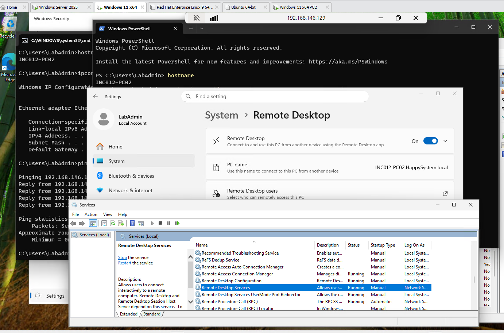
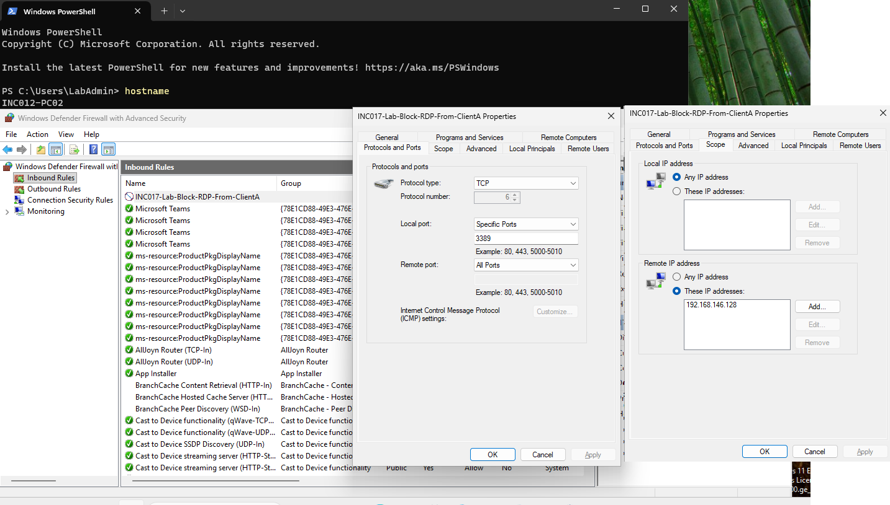
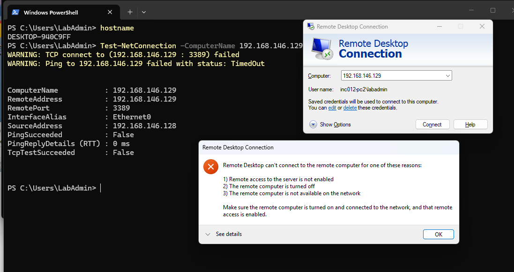
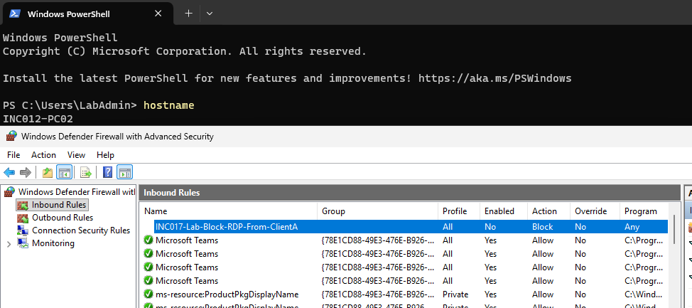
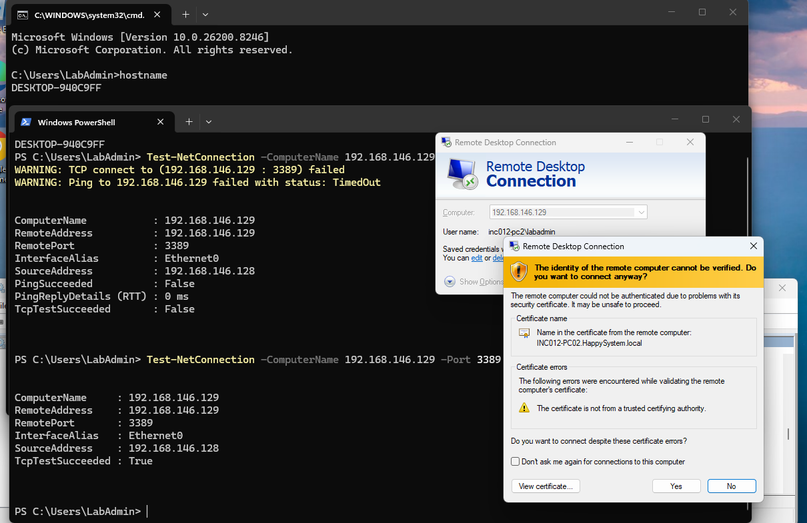
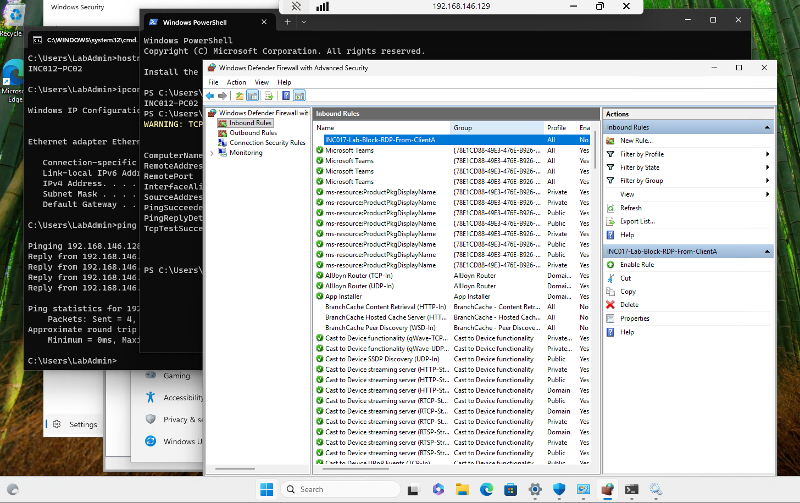

# INC-017 — Remote Desktop Connection Failure: RDP Disabled and Firewall Blocked

**Simulated Incident / Home Lab**  
**Category:** Network & Remote / Windows Remote Desktop / Firewall  
**Status:** Both failure scenarios resolved and verified

## User report

> "I can't connect to another workstation using Remote Desktop, although the computer is turned on."

## Lab environment

- Domain: `HappySystem.local`; internal domain controller/DNS: `192.168.146.10`
- Support workstation (Client A): Windows 11, `DESKTOP-940C9FF`, `192.168.146.128`
- Remote workstation (Client B): Windows 11, `INC012-PC02`, `192.168.146.129`
- Test account: Client B local `LabAdmin`
- Isolated network: VMware VMnet1, Host-only, `192.168.146.0/24`
- RDP: TCP port `3389` using the built-in Remote Desktop Connection client (`mstsc`)

I investigated **two separate causes** of the same RDP error in sequence: Remote Desktop was initially disabled on Client B; after establishing a working connection, I deliberately blocked RDP from Client A using a narrowly scoped inbound firewall rule. These were separate test stages, not two simultaneous faults.

## Investigation — Scenario A: Remote Desktop disabled

### 1. Check the host's Remote Desktop and service status

Client A was used as the support workstation and Client B as the RDP host. On Client B, **Settings → System → Remote Desktop** showed **Off**. In `services.msc`, **Remote Desktop Services** was not running and its startup type was **Manual**.



```powershell
hostname
Test-NetConnection -ComputerName 192.168.146.129 -Port 3389
```

**Why `hostname`:** Confirms that the test is being run from Client A rather than the target computer.

**Why `Test-NetConnection`:** Tests TCP connectivity to the RDP listener on port 3389. The first test returned **`TcpTestSucceeded: False`**. That establishes the port was unreachable, but does not by itself identify why.



### 2. Enable Remote Desktop and verify the listener

On Client B, I enabled **Remote Desktop** in Windows Settings. I did not change Client A's Remote Desktop setting, since Client A only needed to *initiate* connections. The host's Remote Desktop Services then showed **Running**, with startup type still **Manual**. I did not force the service to start automatically.



```powershell
Test-NetConnection -ComputerName 192.168.146.129 -Port 3389
```

**Why repeat it:** Comparing the same port test before and after a *single configuration change* helps isolate the cause. The result changed from **`False`** to **`True`**. An open port is not the same as a successful user login, so I also tested the actual RDP session.



From Client A, I launched `mstsc`, entered `192.168.146.129`, and connected using the permitted local `INC012-PC02\LabAdmin` account. The remote session opened and displayed Client B's desktop.



**Scenario A outcome:** The RDP feature had been disabled on the receiving computer. Enabling it restored the listener and allowed a successful remote login. A service in Manual/Stopped state before RDP is enabled is not, by itself, evidence of a separate service fault.

## Investigation — Scenario B: Inbound firewall rule blocks RDP

### 3. Introduce an isolated inbound TCP block

After disconnecting the working RDP session, I used the VMware console on Client B to create a Windows Defender Firewall inbound rule:

| Rule setting | Lab configuration |
|---|---|
| Rule name | `INC017-Lab-Block-RDP-From-ClientA` |
| Direction / Action | Inbound / Block |
| Protocol / Local port | TCP / `3389` |
| Remote IP scope | `192.168.146.128` (Client A only) |
| Profiles | Domain, Private, Public |

This rule was restricted to the support PC and RDP port. I kept the Remote Desktop feature enabled and its service running, so I could test the firewall as an independent failure cause. An explicit firewall **Block** rule can override an otherwise applicable **Allow** rule.



### 4. Reproduce and identify the blocked connection

```powershell
hostname
Test-NetConnection -ComputerName 192.168.146.129 -Port 3389
```

**Why:** The same command that previously showed `True` now returned **`TcpTestSucceeded: False`** from Client A. I also tried `mstsc` and received **"Remote Desktop can't connect to the remote computer"**. The timing and the matching TCP/firewall scope pointed to the new rule as the cause of the second failure.



**Important distinction:** Ping/ICMP requests from Client A to Client B had already timed out *before* this firewall rule existed. I did not use that ping failure as evidence that the **TCP 3389** block caused an ICMP problem. Ping and an RDP TCP connection are different tests; a machine may allow RDP while not responding to ICMP.

## Root cause

- **Scenario A — Configuration:** Remote Desktop was turned off on the receiving workstation. Port 3389 was not accepting a connection until the feature was enabled.
- **Scenario B — Firewall:** The controlled inbound **Block TCP 3389** rule on Client B applied to traffic sourced from Client A (`192.168.146.128`). This prevented a new RDP session even though Remote Desktop remained enabled.

A failed `Test-NetConnection` result showed **what** was unreachable. Checking the host feature state and the specific firewall rule established **why** it was unreachable at each stage.

## Resolution and verification

### 5. Disable the test firewall rule

From Client B's local VMware console, I opened `wf.msc` → **Inbound Rules** and selected **Disable Rule** for `INC017-Lab-Block-RDP-From-ClientA`. The rule remained visible but its **Enabled** column changed to **No**. I did not turn off Windows Defender Firewall or change unrelated rules.



### 6. Recheck TCP connectivity and sign in through RDP

```powershell
Test-NetConnection -ComputerName 192.168.146.129 -Port 3389
```

**Why:** Repeating the exact check verified the effect of disabling the one blocking rule. The result returned to **`TcpTestSucceeded: True`**.



The Remote Desktop client showed a certificate trust warning during reconnection because the presented certificate was not issued by a trusted certificate authority. That warning is separate from the TCP/firewall fault; on a managed environment, the certificate and target identity should be validated rather than ignoring warnings broadly.

I then established another RDP session to Client B, confirming remote access was restored after the firewall rule was disabled.



### Comparison

| Check | Scenario A: RDP off | Working state | Scenario B: Firewall block | After fix |
|---|---|---|---|---|
| Remote Desktop on Client B | Off | On | On | On |
| RDP service | Stopped | Running | Running | Running |
| TCP 3389 from Client A | False | True | False | True |
| Successful RDP login | Not established | Yes | No | Yes |

**Outcome:** Both independent failure scenarios were reproduced and resolved. The strongest verification was the combination of port testing and a real RDP session, not ping alone.

## Takeaway

Start with the target hostname/IP, confirm the remote PC supports and has enabled Remote Desktop, then test the RDP port. If the port is closed, inspect the listener/service and firewall *before* changing unrelated network settings. Once the port is reachable, test credentials, account rights, NLA, and certificates as separate stages. Use a targeted firewall change rather than disabling all firewall protection.

**Lab cleanup status:** At the end of the submitted evidence, the temporary block rule was **disabled** and RDP was **enabled** for recovery testing. Removing the lab-only rule and returning the RDP toggle to its original **Off** state were recommended follow-up cleanup steps, but no completed-cleanup screenshot was provided.

## References

These Microsoft Learn pages explain the Remote Desktop prerequisites, TCP test, and firewall behavior. Results reported above are based on the lab screenshots.

- [Enable Remote Desktop on your PC — supported editions, host settings, account access, and NLA](https://learn.microsoft.com/en-us/windows-server/remote/remote-desktop-services/remotepc/remote-desktop-allow-access)
- [Test-NetConnection — test a remote TCP port](https://learn.microsoft.com/en-us/powershell/module/nettcpip/test-netconnection)
- [Windows Firewall Rules — explicit block and allow rule precedence](https://learn.microsoft.com/en-us/windows/security/operating-system-security/network-security/windows-firewall/rules)
- [Remote Desktop clients FAQ — troubleshooting connections and blocked ports](https://learn.microsoft.com/en-us/windows-server/remote/remote-desktop-services/remotepc/remote-pc-connections-faq/)

[← Back to Incident Index](../../README.md)
