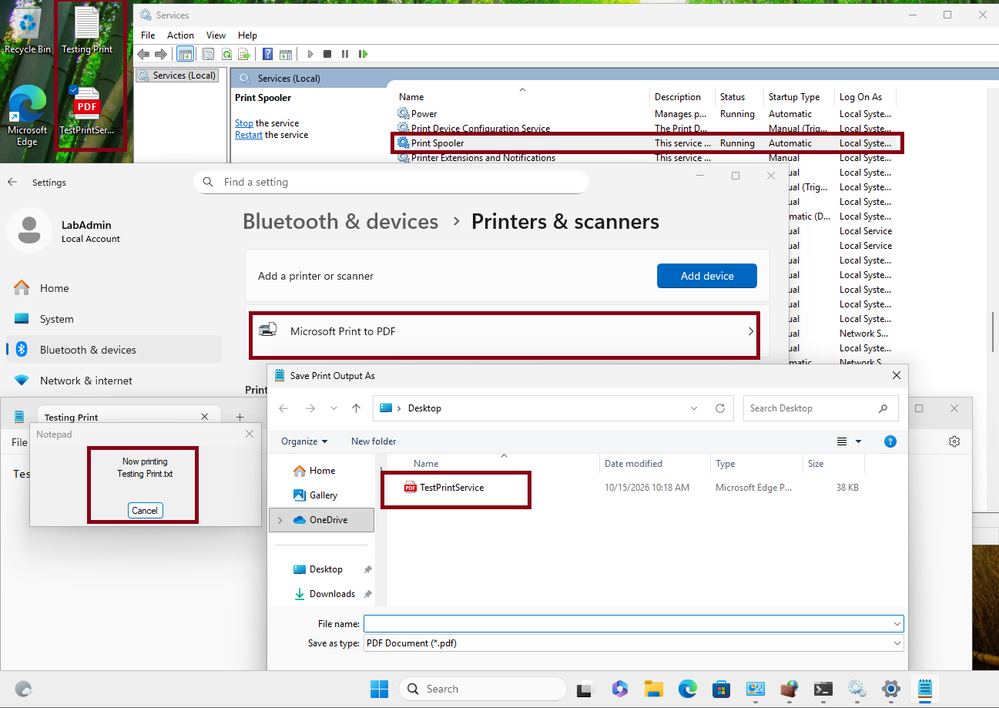
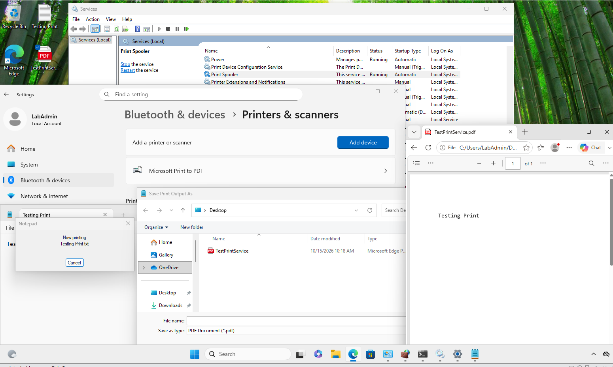
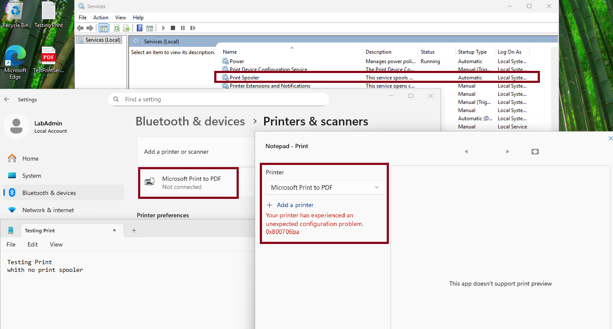
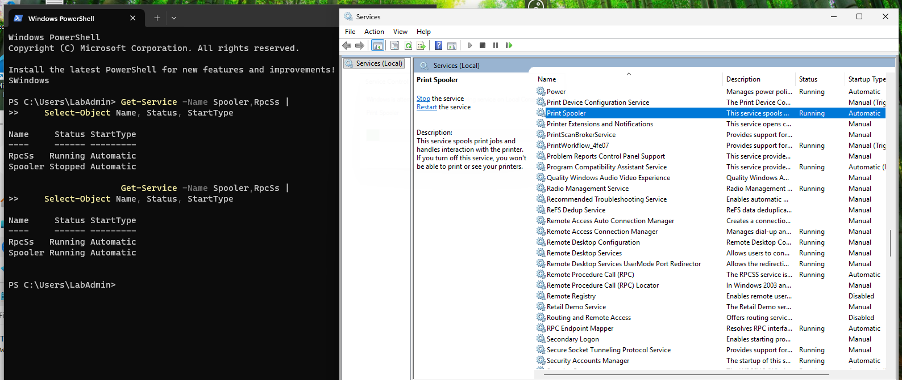
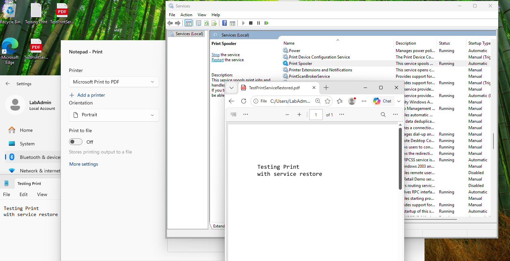

# INC-018 — Printing Fails When the Print Spooler Service Stops

**Simulated Incident / Home Lab**  
**Category:** Windows Client / Printing / Windows Services  
**Status:** Resolved and verified  
**Workbook mapping:** Originally INC-019; renumbered to INC-018 because the optional VPN exercise was deferred.

## User report

> "The printer is installed, but I cannot print a document."

## Lab environment

- **Client:** Windows 11 VM `INC012-PC02`, using the local `LabAdmin` account
- **Printer:** Built-in **Microsoft Print to PDF** (no physical printer or print server required)
- **Service under test:** **Print Spooler** (`Spooler`), startup type **Automatic**
- **Related Windows service:** **Remote Procedure Call** (`RpcSs`)
- **Isolation:** VMware home-lab environment; this test did not modify a production device
- **Controlled fault:** Deliberately stopped the Print Spooler service using `services.msc`

## Baseline — printing works

Before introducing a fault, I confirmed that **Print Spooler** was **Running** with its startup type set to **Automatic**. **Microsoft Print to PDF** was available in Windows **Settings → Bluetooth & devices → Printers & scanners**. The previously saved `TestPrintService.pdf` was visible on the test client's desktop.



I printed a short Notepad test document to **Microsoft Print to PDF** and opened the saved PDF. It displayed **“Testing Print”**, confirming the print workflow worked before the fault was introduced.



## Reproduce the issue

In `services.msc`, I manually stopped **Print Spooler** while leaving the **Startup Type** as **Automatic**, so only its *running state* changed. I then attempted another print from Notepad.

The results were observable in Windows:

- **Print Spooler** no longer showed **Running**.
- **Microsoft Print to PDF** showed **Not connected** in Windows Settings.
- The Notepad print dialog reported: **“Your printer has experienced an unexpected configuration problem. 0x800706ba.”**



## Diagnosis

I checked the state of both the print service and the core RPC service in PowerShell:

```powershell
Get-Service -Name Spooler,RpcSs |
    Select-Object Name, Status, StartType
```

**Why `Get-Service`:** Reads the current state of the named Windows services. Checking both services helps distinguish a stopped print service from an assumption that the underlying RPC service itself failed.

**Why `Select-Object`:** Limits the output to the service name, running status, and startup type so the before/after results are easy to compare.

The captured diagnostic output showed:

| Service | During the fault | Startup type |
|---|---|---|
| `Spooler` | **Stopped** | Automatic |
| `RpcSs` | **Running** | Automatic |

**Error interpretation:** `0x800706ba` is commonly associated with **RPC server unavailable**, but the error alone does *not* prove that `RpcSs` stopped. In this lab, the controlled stop of `Spooler`, the failed print attempt, and the PowerShell service results identified the local print service as the demonstrated cause.

## Resolution and verification

I returned to `services.msc` and selected **Start** for **Print Spooler**. I did **not** disable the firewall, reinstall a printer, change the RPC service, or delete the printer queue.

Running the same PowerShell check again showed **`Spooler: Running`** and **`RpcSs: Running`**, both with startup type **Automatic**. The Services console also showed Print Spooler running. The screenshot captures both the earlier stopped result and the later running result.



Finally, I printed another Notepad test using **Microsoft Print to PDF** and successfully opened `TestPrintServiceRestored.pdf`. The PDF contained **“Testing Print / with service restore”**, confirming the printing function was restored from the user's perspective.



### Verification summary

| Check | Baseline | During fault | After fix |
|---|---|---|---|
| Print Spooler | Running | **Stopped** | **Running** |
| Startup type | Automatic | Automatic | Automatic |
| RPC service (`RpcSs`) | Not separately checked | Running | Running |
| Microsoft Print to PDF | Available | Not connected | Available |
| PDF printing | Successful | **Error 0x800706ba** | **Successful** |

**Outcome:** The controlled Print Spooler stop reproduced a real user-facing print error. Starting that service restored the printer workflow, as verified by the service state and a newly generated PDF. No evidence suggested a separate failure of `RpcSs` or a need to reinstall the printer driver.

## Technician takeaway

For a printer that appears installed but cannot print, check the **Print Spooler** service and its startup configuration before making broader changes. Record the actual error, check related service status, apply the smallest appropriate fix, and **print a test page or document after recovery**. An RPC-related error code should prompt investigation, not an unsupported conclusion that the RPC service has stopped.

## References

The following Microsoft Learn documentation supports the troubleshooting approach; the findings above come from the screenshots collected in this lab.

- [Troubleshoot printing issues caused by Print Spooler service not running](https://learn.microsoft.com/en-us/troubleshoot/windows-server/printing/print-spooler-service-not-running)
- [Get-Service — Microsoft.PowerShell.Management (Windows PowerShell 5.1)](https://learn.microsoft.com/en-us/powershell/module/microsoft.powershell.management/get-service?view=powershell-5.1)
- [Start-Service — Microsoft.PowerShell.Management](https://learn.microsoft.com/en-us/powershell/module/microsoft.powershell.management/start-service?view=powershell-5.1)
- [Microsoft explanation of error 0x800706ba (“The RPC server is unavailable”)](https://learn.microsoft.com/en-us/troubleshoot/windows-server/certificates-and-public-key-infrastructure-pki/error-0x800706ba-certificate-enrollment) (general error-code context; not evidence of a certificate issue in this lab)

[← Back to Incident Index](../../README.md)
