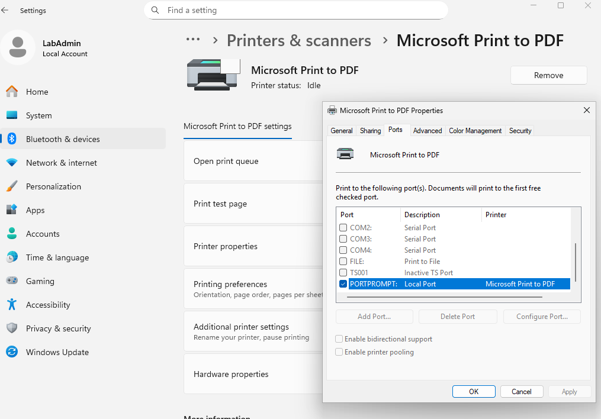
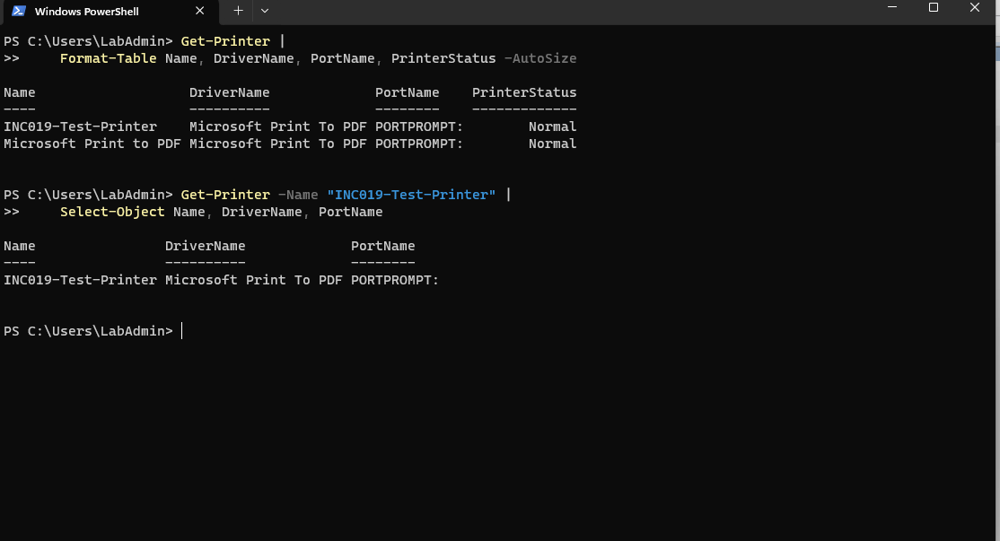
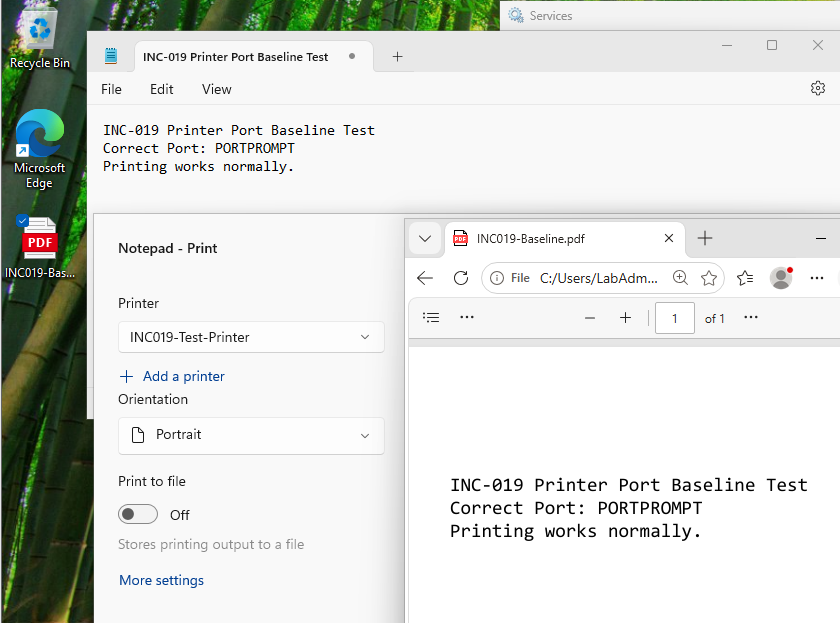
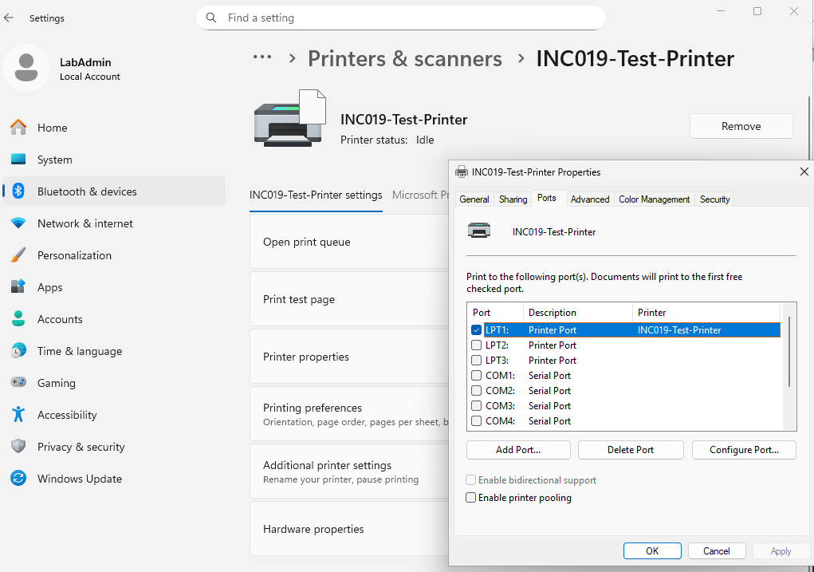
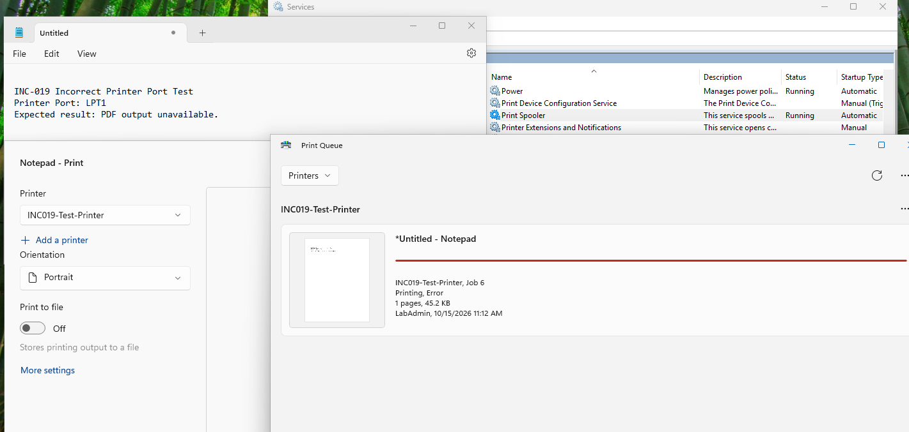
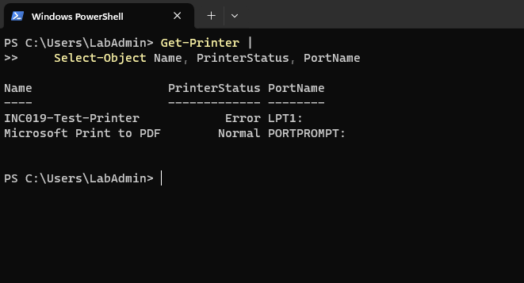
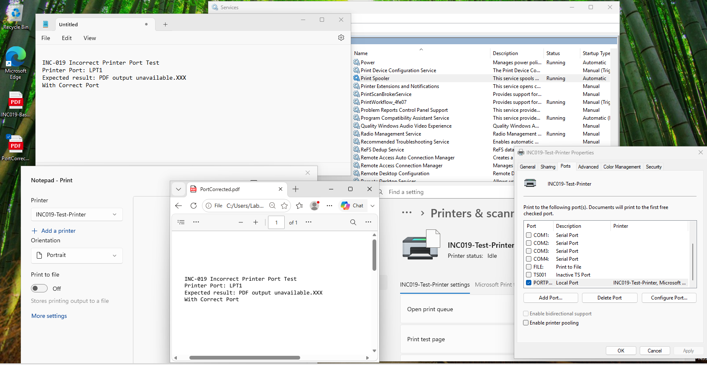

# INC-019 — Printing Fails Because of an Incorrect Printer Port

**Simulated Incident / Home Lab**  
**Category:** Windows Client / Printer Configuration / Print Queue  
**Status:** Resolved and verified  
**Workbook mapping:** Originally INC-020; renumbered to INC-019 after deferring the VPN exercise.

## User report

> "My printer is installed, but the print job fails instead of producing a document."

The original workbook scenario described a printer appearing **Offline**. This controlled test instead produced the observable Windows status **Error**. The report follows the actual evidence rather than claiming an Offline message was shown.

## Lab environment

- **Test device:** Windows 11 virtual machine `INC012-PC02` (`LabAdmin` local test account).
- **Production-safe stand-in:** A separate local print queue named `INC019-Test-Printer`, using the existing **Microsoft Print To PDF** driver. No physical or network printer was used.
- **Working output port:** `PORTPROMPT:` (prompts for the destination file name when creating a PDF).
- **Injected incorrect port:** `LPT1:` (legacy parallel printer port).
- **Print Spooler:** Running throughout this port-failure test.
- **Isolation:** Personal VMware home lab; the built-in `Microsoft Print to PDF` queue was left unchanged.

## Baseline — verify the print configuration

I first inspected the built-in **Microsoft Print to PDF** printer in **Printer properties → Ports**. It was idle, with `PORTPROMPT:` selected as its output port.



I then created a separate queue, **`INC019-Test-Printer`**, using the installed Microsoft Print To PDF driver and the same `PORTPROMPT:` port. When Windows Settings initially displayed only one queue, I checked the actual registered queues using PowerShell rather than assuming the original queue had been deleted:

```powershell
Get-Printer | Format-Table Name, DriverName, PortName, PrinterStatus -AutoSize
```

The output showed **both** queues as `Normal`, using the correct driver and `PORTPROMPT:`.



**Command explanation:** `Get-Printer` lists installed print queues and their properties; `Format-Table` displays the selected fields in a readable comparison. Checking the port and driver distinguishes a queue configuration issue from a missing printer.

I printed a short Notepad document using **`INC019-Test-Printer`**, saved `INC019-Baseline.pdf`, and opened it successfully. This established that the new queue could produce valid PDF output before changing its settings.



## Reproduce the issue — select the wrong port

On **`INC019-Test-Printer` only**, I changed **Printer properties → Ports** from `PORTPROMPT:` to **`LPT1:`**. The original built-in queue was not modified.



I sent another document from Notepad to the test printer. The print queue retained the job with the status **`Printing, Error`** and no PDF file was produced from this attempt. At the same time, the Services console showed **Print Spooler Running**, which made a stopped print service an unlikely explanation for this controlled failure.



## Diagnosis — compare printer ports and status

I inspected both printer queues using PowerShell:

```powershell
Get-Printer |
    Select-Object Name, PrinterStatus, PortName
```

**Why `Get-Printer`:** Retrieves the live printer queues and their configuration from Windows.

**Why `Select-Object`:** Limits the output to the printer name, reported status and selected port, so the affected printer can be compared with a known-good queue.

The captured results were:

| Printer | Status during fault | Port |
|---|---|---|
| `INC019-Test-Printer` | **Error** | **`LPT1:`** |
| `Microsoft Print to PDF` | Normal | `PORTPROMPT:` |



**Root cause:** The new test print queue was directed to the wrong output port. Its PDF driver and Print Spooler service were functional; the job could not produce the expected PDF through `LPT1:`. Comparing the two queues isolated the incorrect port choice instead of prompting an unnecessary driver reinstall or Spooler restart.

## Resolution and user-facing verification

In **Printer properties → Ports**, I changed **`INC019-Test-Printer`** back to **`PORTPROMPT:`**. Windows Settings then showed the test printer as **Idle**, and **Print Spooler** remained **Running**.

A subsequent Notepad print to the same test queue succeeded: Windows saved **`PortCorrected.pdf`**, and I opened the PDF to confirm that the print output was present and readable.



*Evidence note:* The recovered PDF contains the earlier test document's wording about `LPT1:` because that wording was part of the document text. It does **not** describe the recovered printer's active port; the Printer properties screenshot confirms `PORTPROMPT:` is selected. A separate final PowerShell status capture was not provided, so the result is based on the visible printer settings, Idle status and successful PDF output.

### Verification summary

| Check | Before fault | During fault | After fix |
|---|---|---|---|
| Test-printer port | `PORTPROMPT:` | **`LPT1:`** | **`PORTPROMPT:`** |
| Test-printer status | Normal | **Error** | Idle in Settings |
| Print Spooler | Not the source of failure | Running | Running |
| PDF printing | Successful | **Printing, Error** | **Successful** |
| Built-in Microsoft Print to PDF | Normal / unchanged | Normal / unchanged | Not altered |

**Outcome:** Restoring only the affected queue's correct output port resolved the simulated print failure. The successful PDF after the change provided user-facing validation.

## Technician takeaway

When a printer is installed but fails to print, check the **printer queue, Print Spooler state, driver and selected port** before making broad changes. A running Print Spooler does not guarantee a print job will succeed; a wrong output port can independently produce a queue error. Compare the affected printer with a known-good queue and confirm the fix by printing a new document. For a real network printer, further checks would include its **TCP/IP port, address and reachability**; those network checks were **not** performed in this local PDF-printer simulation.

## References

The Microsoft Learn sources below support the commands and general troubleshooting approach. Findings above come from the captured home-lab screenshots.

- [Get-Printer — PrintManagement](https://learn.microsoft.com/en-us/powershell/module/printmanagement/get-printer?view=windowsserver2025-ps)
- [Get-PrinterPort — PrintManagement](https://learn.microsoft.com/en-us/powershell/module/printmanagement/get-printerport?view=windowsserver2025-ps)
- [Add-Printer — PrintManagement](https://learn.microsoft.com/en-us/powershell/module/printmanagement/add-printer?view=windowsserver2022-ps)
- [Set-Printer — PrintManagement](https://learn.microsoft.com/en-us/powershell/module/printmanagement/set-printer?view=windowsserver2025-ps) (reference for printer-port configuration; the recorded fix used the GUI)
- [Troubleshooting printing scenarios — Microsoft Learn](https://learn.microsoft.com/en-us/troubleshoot/windows-server/printing/troubleshoot-printing-scenarios) (general diagnostic guidance; article is for Windows Server)

[← Back to Incident Index](../../README.md)
