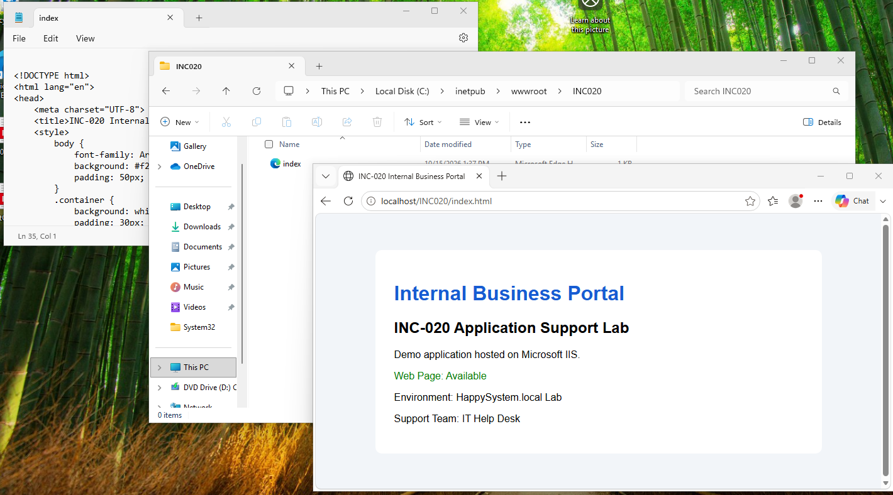
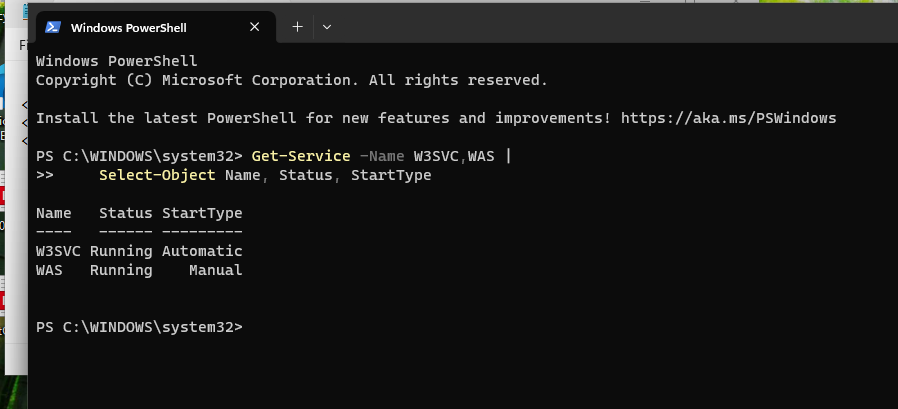
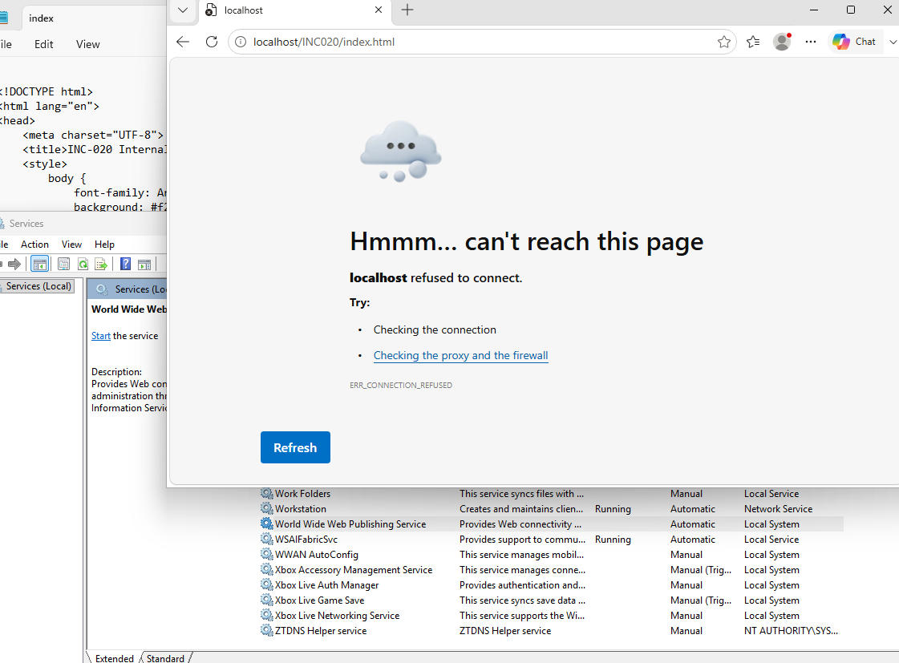
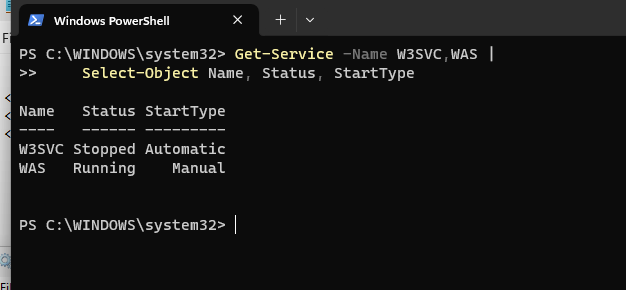
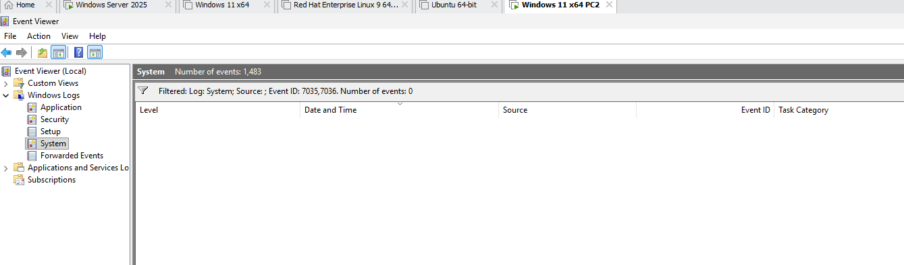
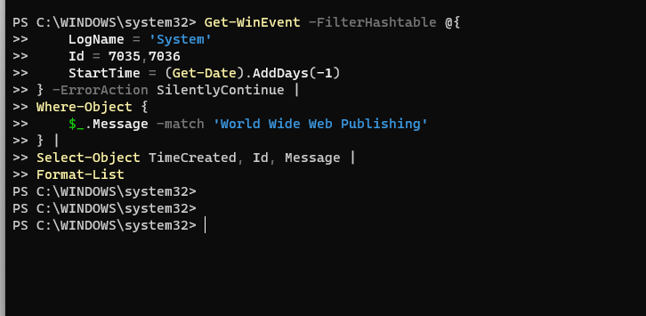
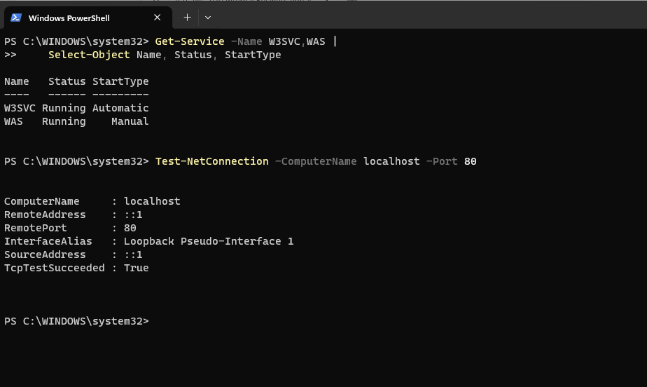
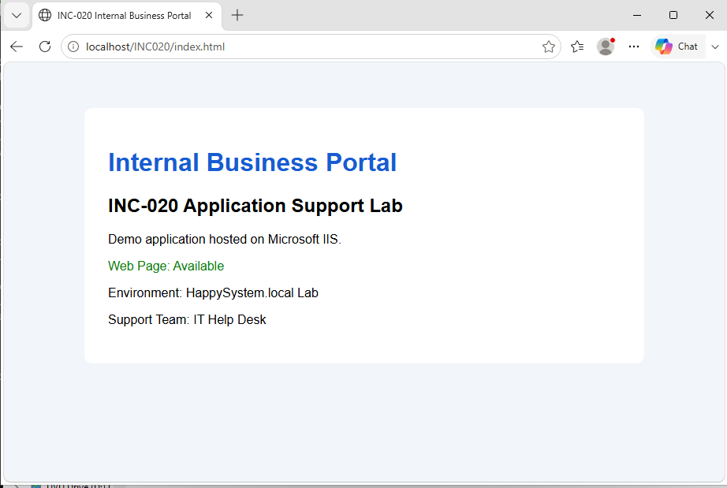

# INC-020 — Internal Business Portal Unavailable After IIS Service Stops

**Simulated Incident / Home Lab**  
**Category:** Windows Client / Application Support / IIS / Windows Services  
**Status:** Resolved and verified  
**Workbook mapping:** Original INC-021, renumbered to INC-020 after deferring the VPN exercise.

## User report

> "Our internal business application was working earlier, but I can no longer open it."

This lab used a **static HTML demo portal**, not a production business application. The original workbook scenario described an app showing "Service unavailable"; the observed error in this test was instead **`ERR_CONNECTION_REFUSED`**. This report records what was actually reproduced.

## Lab environment

- **Host:** Windows 11 VM `INC012-PC02` in an isolated VMware home lab.
- **Web platform:** Internet Information Services (IIS), installed as a Windows optional feature.
- **Demo site:** `C:\inetpub\wwwroot\INC020\index.html`, served at `http://localhost/INC020/index.html`.
- **Services investigated:** World Wide Web Publishing Service (`W3SVC`) and Windows Process Activation Service (`WAS`).
- **Scope:** Localhost HTTP test on the VM; no real corporate application or external website was affected.

## Healthy baseline

I installed IIS on the lab client, created a small **Internal Business Portal** page under the default web root, and opened it in Edge using `http://localhost/INC020/index.html`. The browser displayed **Web Page: Available**, confirming the local web content was being served.



I checked the hosting services before making changes:

```powershell
Get-Service -Name W3SVC,WAS |
    Select-Object Name, Status, StartType
```

Observed baseline:

| Service | Status | Startup type |
|---|---|---|
| `W3SVC` | Running | Automatic |
| `WAS` | Running | Manual |



**Why these commands:** `Get-Service` reads the current Windows service state. Selecting `Name`, `Status`, and `StartType` makes it possible to distinguish a stopped service from its configured startup behavior. `W3SVC` provides IIS HTTP-related functionality; `WAS` manages application pool activation and processes. `WAS` being set to **Manual** was observed and was not changed.

## Reproduce the outage

Using **Services (`services.msc`)**, I manually stopped **World Wide Web Publishing Service (`W3SVC`)**. I did not disable IIS, remove the HTML file, change the startup type, or stop `WAS`.

Refreshing the same URL produced **"localhost refused to connect" / `ERR_CONNECTION_REFUSED`**. The Services window also showed that `W3SVC` was no longer running.



This was a **controlled service-stop simulation**, not an unexpected service crash. The failed local HTTP connection did not establish a DNS, firewall, or code defect.

## Diagnosis — isolate the hosting service

I checked both IIS services again with the same command:

```powershell
Get-Service -Name W3SVC,WAS |
    Select-Object Name, Status, StartType
```

During the outage:

| Service | Status | Startup type |
|---|---|---|
| **`W3SVC`** | **Stopped** | Automatic |
| `WAS` | Running | Manual |



**Root cause:** HTTP service availability was interrupted because `W3SVC` had been stopped. The portal files remained in place; only the affected hosting service needed restoring. The contrasting `W3SVC` and `WAS` states narrowed the problem without reinstalling IIS or modifying the web page.

### Event Viewer check — no matching events found

I checked **Event Viewer → Windows Logs → System**, filtering for Service Control Manager event IDs **7035** (service control request) and **7036** (service state change). **The filtered view returned zero events** in this VM at the time of the investigation.



I also tried a targeted PowerShell query for these event IDs during the preceding day:

```powershell
Get-WinEvent -FilterHashtable @{
    LogName   = 'System'
    Id        = 7035,7036
    StartTime = (Get-Date).AddDays(-1)
} -ErrorAction SilentlyContinue |
Where-Object {
    $_.Message -match 'World Wide Web Publishing'
} |
Select-Object TimeCreated, Id, Message |
Format-List
```

This query returned **no matching output**.



**Command explanation:** `Get-WinEvent` reads Windows logs; `-FilterHashtable` limits the search by log, event ID, and time. `Where-Object` searches the message text for the affected service. `Select-Object` chooses useful event fields, and `Format-List` displays longer messages. Because there were no matching records, **no event log entry is claimed as proof of this outage**. The live service state and browser failure supplied the relevant evidence. An empty result is not proof that Windows never logged the service change elsewhere.

## Resolution — restore W3SVC

In **Services**, I started **World Wide Web Publishing Service** again, leaving its startup type **Automatic**. A follow-up service check showed both `W3SVC` and `WAS` **Running**.

I then checked whether HTTP was reachable locally:

```powershell
Test-NetConnection -ComputerName localhost -Port 80
```

Observed output included:

```text
RemoteAddress    : ::1
RemotePort       : 80
TcpTestSucceeded : True
```

`::1` is the IPv6 loopback address. `Test-NetConnection` checks TCP connectivity to port 80; it does **not** confirm that the correct HTML page loads. A browser test was therefore still needed.



## Final verification

I reloaded `http://localhost/INC020/index.html` in Edge. The same **Internal Business Portal** displayed **Web Page: Available** again.



| Check | Before fault | During fault | After fix |
|---|---|---|---|
| `W3SVC` | Running | **Stopped** | **Running** |
| `WAS` | Running | Running | Running |
| Internal portal | Loaded | **`ERR_CONNECTION_REFUSED`** | **Loaded** |
| HTTP TCP port 80 | Website served successfully | Not separately tested | **Reachable** |
| Event Viewer 7035/7036 | Not investigated | **No matches found** | No additional service log evidence |

**Outcome:** Restarting the stopped IIS HTTP hosting service restored access to the internal demo page. Both a successful TCP test and a successful browser reload confirmed recovery without changing the site content.

## Technician takeaway

When a user reports that a browser-based internal application is down, compare **application symptoms** with **service state** before reinstalling the app or changing networking settings. `ERR_CONNECTION_REFUSED` means the connection was refused; it does not, by itself, identify the cause. In this test, comparing `W3SVC` with `WAS`, using the known-good localhost baseline, and confirming the restored page isolated and verified the controlled hosting-service failure. Event logs are useful when available, but an absent matching event should be reported accurately rather than invented.

## Microsoft Learn references

These sources document the IIS components and commands used. The incident findings above come from the lab screenshots.

- [Introduction to IIS architecture — W3SVC, WAS, and HTTP.sys](https://learn.microsoft.com/en-us/iis/get-started/introduction-to-iis/introduction-to-iis-architecture)
- [Get-Service — Windows PowerShell](https://learn.microsoft.com/en-us/powershell/module/microsoft.powershell.management/get-service?view=powershell-5.1)
- [Get-WinEvent — Windows PowerShell](https://learn.microsoft.com/en-us/powershell/module/microsoft.powershell.diagnostics/get-winevent?view=powershell-5.1)
- [Test-NetConnection — NetTCPIP](https://learn.microsoft.com/powershell/module/nettcpip/test-netconnection)
- [IIS and Windows PowerShell introduction](https://learn.microsoft.com/en-us/iis/manage/powershell/an-introduction-to-windows-powershell-and-iis)

[← Back to Incident Index](../../README.md)
