# INC-021 — Windows Update Downloads Blocked by Isolated VM Networking

**Simulated Incident / Home Lab**  
**Category:** Windows Client / Windows Update / Network & DNS Troubleshooting  
**Status:** Download connectivity resolved; AD lab network restored  
**Workbook mapping:** Original INC-022, renumbered to INC-021 after deferring the VPN exercise.

## User report

> "The test laptop shows available Windows updates, but the updates are not downloading as expected."

This investigation used an existing, domain-joined Windows 11 VM on a **VMware host-only lab network**. The initial Windows Update page showed a Defender update at **Downloading — 0%**, not an explicit download error code. **A 0% reading alone does not prove an update failure.** The confirmed issues were missing external network routing and failed external DNS resolution; downloading subsequently progressed after network access was restored.

## Lab environment

| Item | Lab configuration |
|---|---|
| Test client | Windows 11 `INC012-PC02` (local `LabAdmin`) |
| Domain | `HappySystem.local` |
| Internal DNS / domain controller | `192.168.146.10` |
| Isolated VMware network | VMnet1 Host-only, `192.168.146.0/24` |
| Temporary internet-facing lab network | VMnet8 NAT, `192.168.222.0/24` |
| Test scope | Only the test VM's virtual adapter and DNS settings; no changes to the domain controller |

## Initial symptom and checks

Windows Update listed several available updates, including a Microsoft Defender Security Intelligence Update at **0%**. At that point, no Windows Update-specific error code was visible.

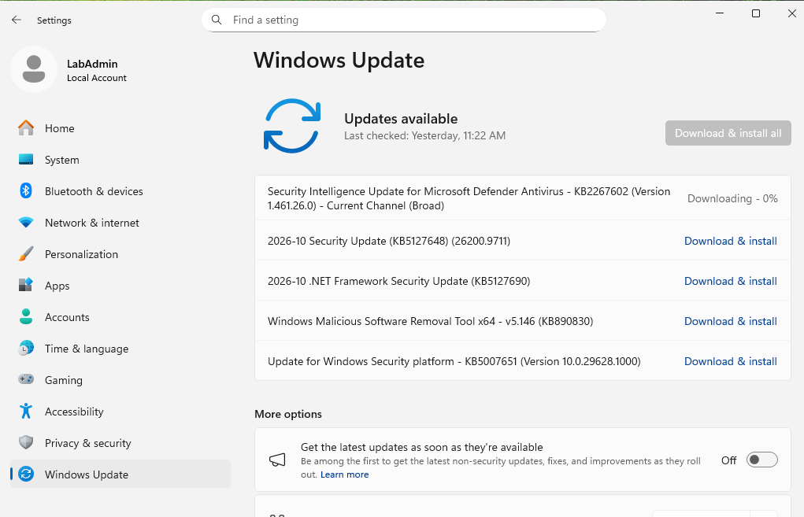

I checked the Windows Update service and Background Intelligent Transfer Service (BITS):

```powershell
Get-Service -Name wuauserv,BITS |
    Select-Object Name, Status, StartType
```

Observed: **`wuauserv` Running / Manual** and **`BITS` Stopped / Manual**. This did **not** establish a service fault: BITS can be stopped when no applicable background transfer is active.

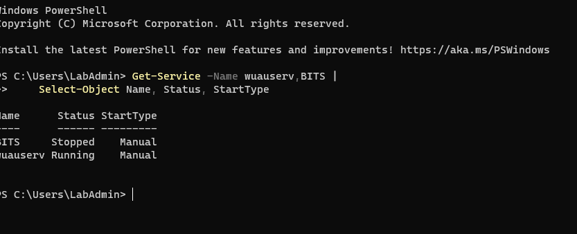

Next, I examined the network configuration:

```powershell
ipconfig /all
```

The client held `192.168.146.129/24`, used internal DNS `192.168.146.10`, and had **no IPv4 default gateway**. The address and DNS were appropriate for the AD lab, but VMnet1 was isolated from the external internet.

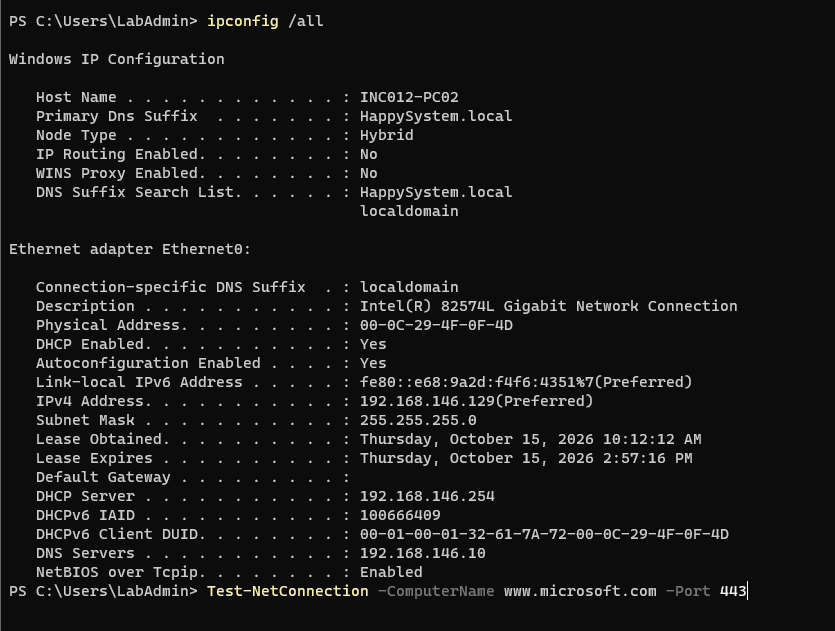

I tested external name resolution, HTTPS and default routing:

```powershell
Resolve-DnsName www.microsoft.com
Test-NetConnection -ComputerName www.microsoft.com -Port 443
Get-NetRoute -DestinationPrefix '0.0.0.0/0' -ErrorAction SilentlyContinue
```

**Observed:** external DNS queries timed out, the hostname-based HTTPS test could not proceed, and the IPv4 default-route query returned **no route**. At this stage, the HTTPS test did not establish whether TCP 443 was blocked: hostname resolution had failed first.

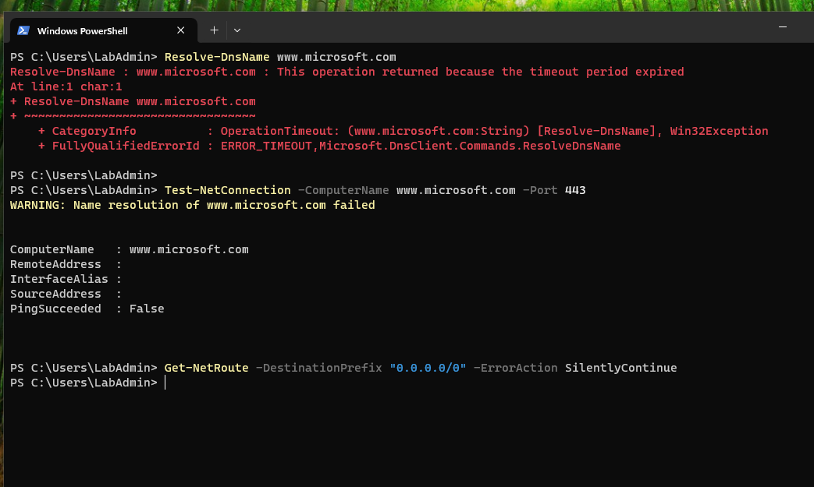

**Command purpose:** `ipconfig /all` exposes DNS, DHCP, address and gateway configuration. `Resolve-DnsName` tests DNS queries. `Test-NetConnection -Port 443` checks TCP reachability if a remote address can be resolved. `Get-NetRoute` checks the IPv4 routing table; the `0.0.0.0/0` destination represents the default route.

## First change — provide a NAT route

In VMware Workstation, I verified VMnet1 was **Host-only (`192.168.146.0/24`)** and VMnet8 was **NAT (`192.168.222.0/24`)**.

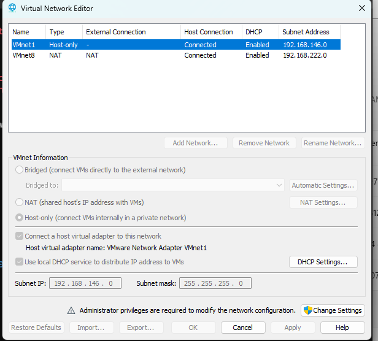

After taking a test-VM snapshot, I shut down **Client B only** and temporarily changed its virtual network adapter from Host-only to **NAT**, without modifying the domain controller or VMware's VMnet1 network.

When the VM restarted using the local test administrator account, DHCP assigned:

| Property | NAT result |
|---|---|
| IPv4 address | `192.168.222.132` |
| Default gateway | `192.168.222.2` |
| DHCP server | `192.168.222.254` |
| DNS server | **`192.168.146.10` (still the old AD DNS)** |

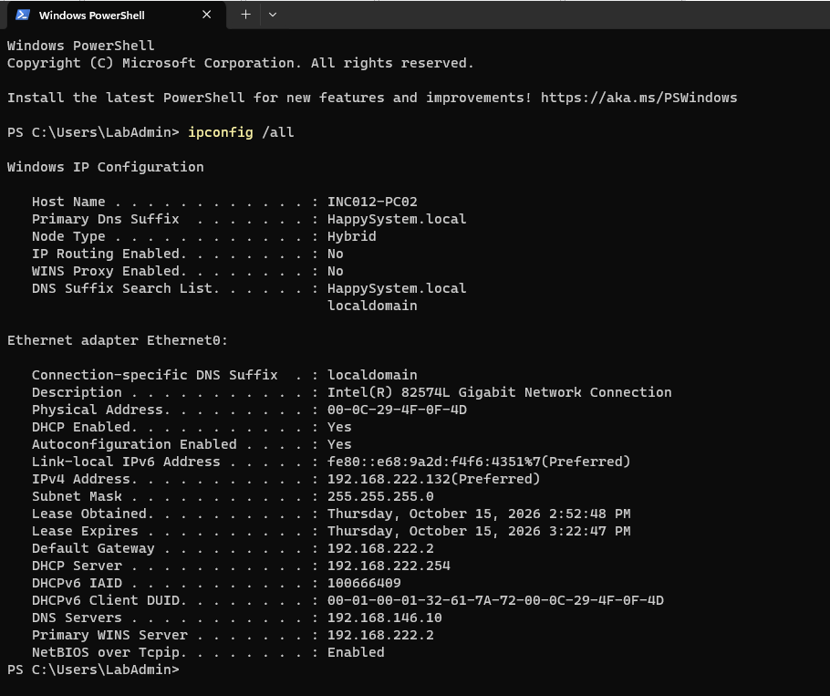

The **default route was now present**, with next hop `192.168.222.2`. However, `Resolve-DnsName www.microsoft.com` failed with **`RCODE_SERVER_FAILURE`**, and the TCP 443 command could not resolve the hostname.

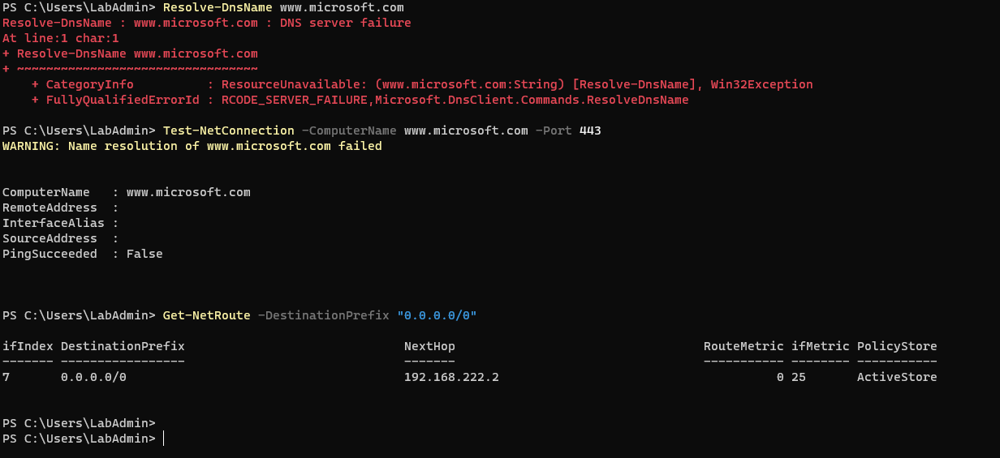

This exposed a **second, sequential configuration issue**: switching the VM to a different subnet did not automatically replace its previous, manually configured domain DNS address. The DNS server `192.168.146.10` was outside the current NAT subnet and was unsuitable for this temporary single-adapter test. The DNS failure was observable; it was not evidence that Microsoft's website or Windows Update servers were down.

## Second change — restore DNS resolution for the NAT test

Through **Ethernet0 → IPv4 / DNS settings**, I changed DNS assignment to **Automatic (DHCP)** while retaining automatic IP assignment. The resulting NAT settings showed the gateway **and DNS server** as `192.168.222.2`.

```powershell
ipconfig /all
ipconfig /flushdns
Resolve-DnsName www.microsoft.com
Test-NetConnection -ComputerName www.microsoft.com -Port 443
```

`ipconfig /flushdns` clears the local DNS resolver cache before retesting. It does not repair incorrect DNS routing or replace a DNS server setting by itself.

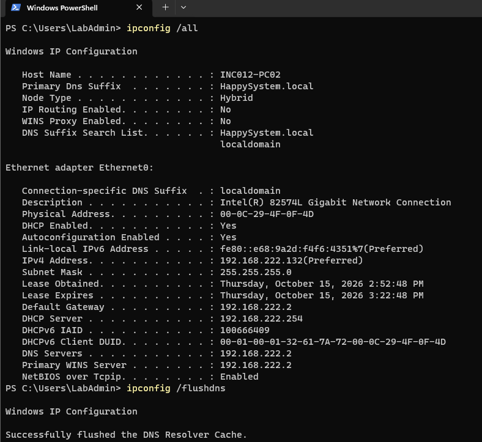

**External DNS succeeded:** `Resolve-DnsName` returned valid responses for `www.microsoft.com`, including CNAME and AAAA records.

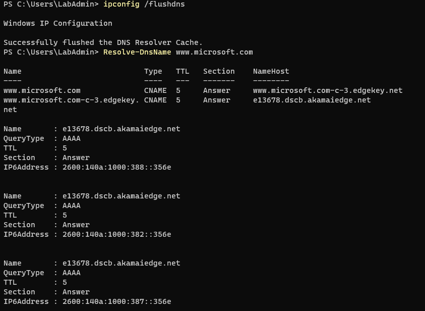

**TCP 443 succeeded:** `Test-NetConnection` reported `TcpTestSucceeded : True` with source `192.168.222.132`. This verified basic HTTPS reachability to the tested Microsoft hostname, not every individual Windows Update endpoint.

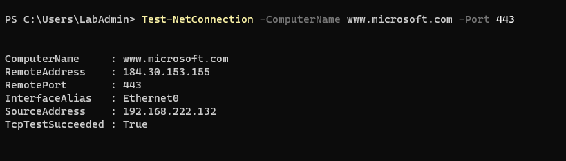

## Windows Update download verification

After internet routing and DNS were restored, Windows Update showed real download activity: the Malicious Software Removal Tool reached **94%**, and a security update displayed **Downloading — 6%**.

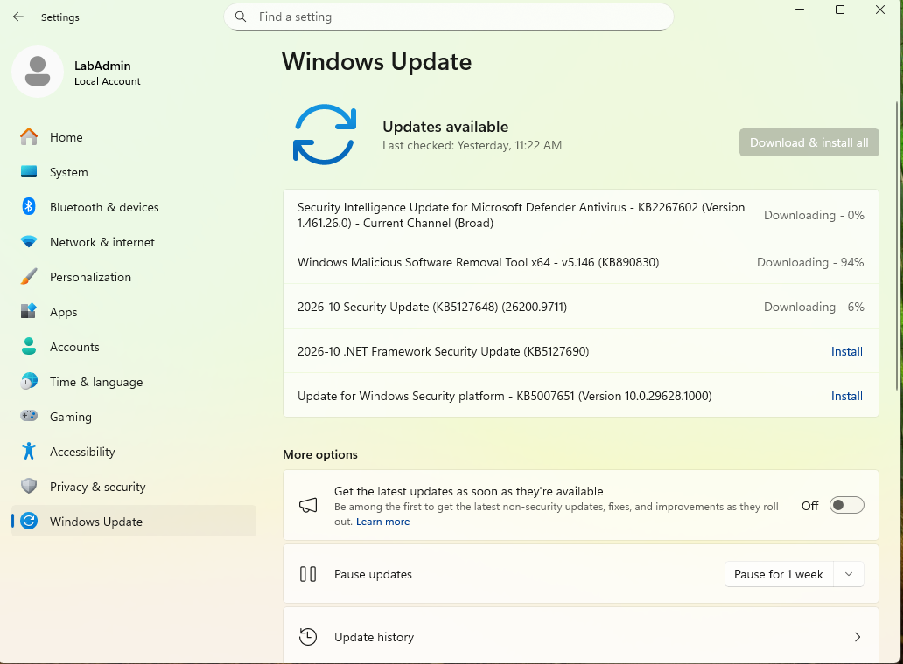

A later screenshot showed:

| Update | Observed state |
|---|---|
| Microsoft Defender Security Intelligence, KB2267602 | **Completed** |
| Malicious Software Removal Tool, KB890830 | **Completed** |
| Windows Security platform, KB5007651 | **Completed** |
| .NET Framework Security Update, KB5127690 | **Pending restart** |
| October Security Update, KB5127648 | **Downloading — 6%** |

Windows Update also reported **Restart required**. The evidence verifies that update transfer and some update processing resumed. **It does not prove that all updates finished installing**, nor that the remaining security update succeeded.

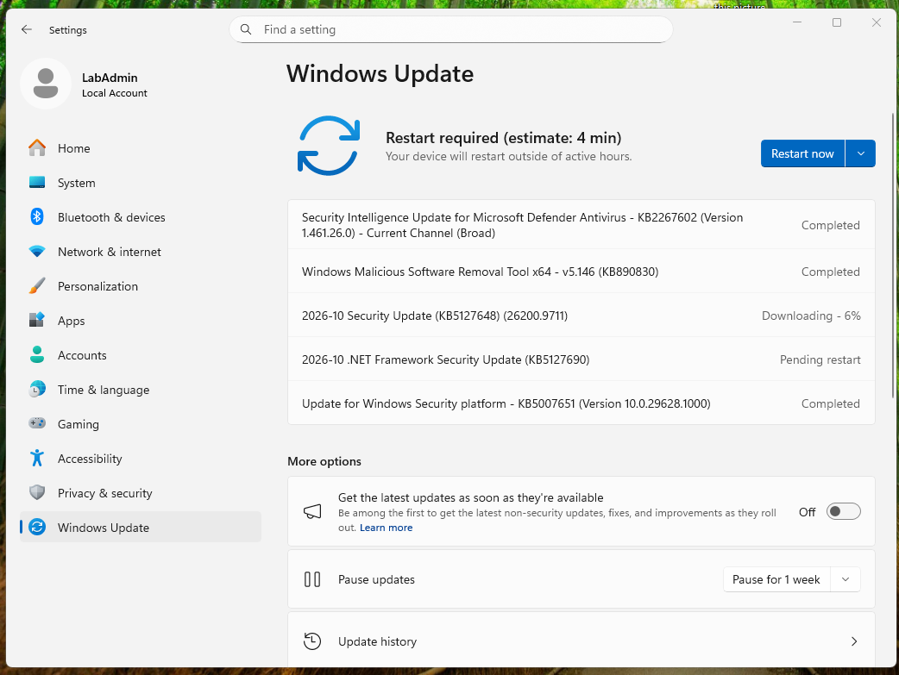

## Restore the original Active Directory lab network

After the download-connectivity check, I returned **Client B's VMware adapter to Host-only (VMnet1)** and restored the domain DNS server to `192.168.146.10`. The machine returned to the original lab configuration:

| Property | Verified restored state |
|---|---|
| IPv4 address | `192.168.146.129` |
| DNS server | `192.168.146.10` |
| DHCP server | `192.168.146.254` |
| Default gateway | None |

I verified Domain Controller discovery **without relying solely on the default DC Locator cache** and tested TCP access to the LDAP port:

```powershell
nltest /dsgetdc:HappySystem.local /force
Test-NetConnection -ComputerName 192.168.146.10 -Port 389
```

**Observed:** `nltest` found `WIN-9E9JIE0QIB8.HappySystem.local` at `192.168.146.10` and reported **"The command completed successfully."** The TCP 389 test returned **`TcpTestSucceeded : True`**. These results confirm DC discovery and LDAP port reachability. They do not, by themselves, verify user authentication or every domain policy.

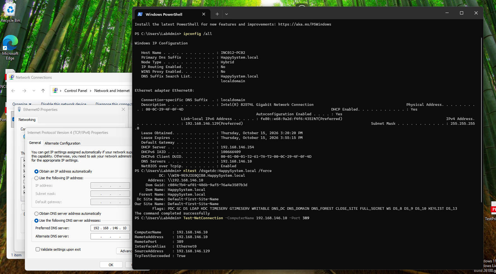

## Outcome and technician takeaway

**Outcome: Windows Update download connectivity restored; original AD network restored.** The isolated Host-only network had no internet default route. Moving to a NAT test network provided a route but also revealed a stale, unsuitable domain DNS configuration. Using DHCP-provided NAT DNS resolved external names, allowed a successful TCP 443 test, and coincided with demonstrated Windows Update download progress and several completed updates.

This was **network and DNS troubleshooting**, not a confirmed Windows Update cache/service corruption incident. I did not reset `SoftwareDistribution`, change BITS startup type, replace the domain's DNS configuration, or claim that an update error code was present. Any **pending restart or remaining incomplete update** should be handled separately during a suitable maintenance window.

### Quick checks learned

| Symptom | Check | Interpretation |
|---|---|---|
| Windows Update at 0% | Update status/error details | 0% alone is not a definitive fault |
| External names fail | `Resolve-DnsName`, DNS server settings | Separate name resolution from TCP connectivity |
| No internet from lab VM | `ipconfig /all`, `Get-NetRoute` | Check default gateway and route before resetting Windows Update |
| NAT route works, DNS fails | NIC's DNS server; compare subnets | Old domain DNS may not be reachable from NAT-only test network |
| TCP 443 works | `Test-NetConnection` | Proves connectivity only to the tested host/port |
| Update activity resumes | Download/installation state | Record exact states; don't claim all updates are installed |
| Restore internal network | `nltest /force`, TCP 389 | Confirm the original AD lab still functions |

## Microsoft Learn references

The following references document the Windows features and diagnostic tools. The results in this report are observations from the home lab.

- [Windows Update issues troubleshooting](https://learn.microsoft.com/en-us/troubleshoot/windows-client/installing-updates-features-roles/windows-update-issues-troubleshooting)
- [Common Windows Update errors](https://learn.microsoft.com/en-us/troubleshoot/windows-client/installing-updates-features-roles/common-windows-update-errors)
- [Resolve-DnsName — DnsClient PowerShell](https://learn.microsoft.com/en-us/powershell/module/dnsclient/resolve-dnsname)
- [Test-NetConnection — NetTCPIP PowerShell](https://learn.microsoft.com/en-us/powershell/module/nettcpip/test-netconnection)
- [Get-NetRoute — NetTCPIP PowerShell](https://learn.microsoft.com/en-us/powershell/module/nettcpip/get-netroute)
- [Domain-joined device: force domain-controller discovery with nltest](https://learn.microsoft.com/en-us/troubleshoot/windows-client/networking/domain-joined-machines-cannot-detect-domain-profile)

[← Back to Incident Index](../../README.md)
