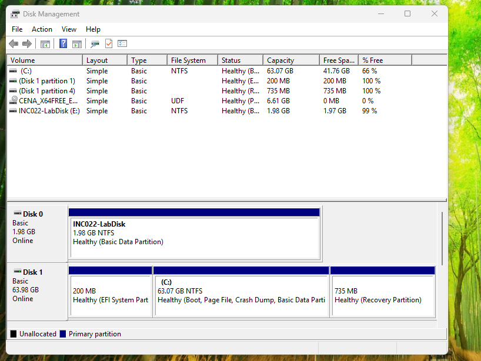
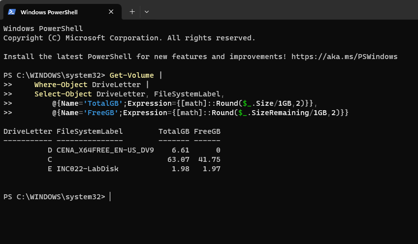
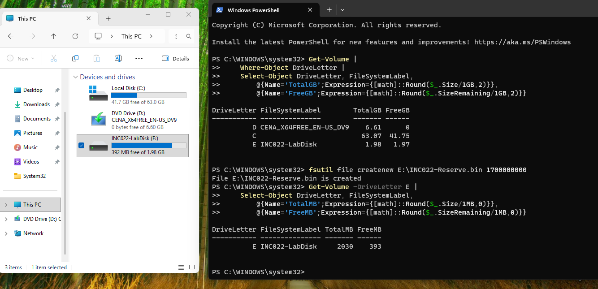
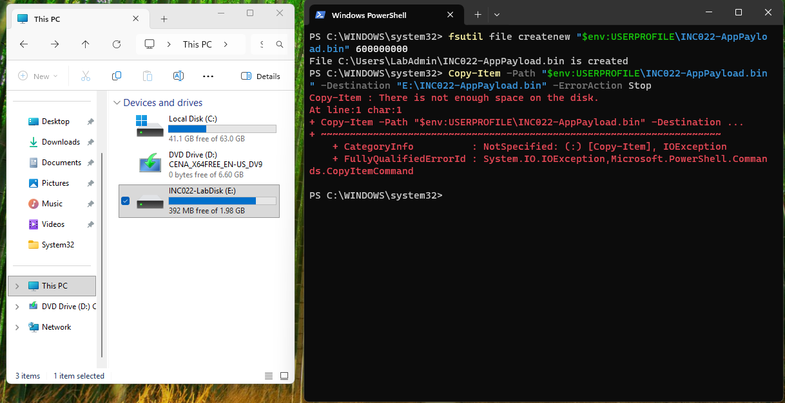
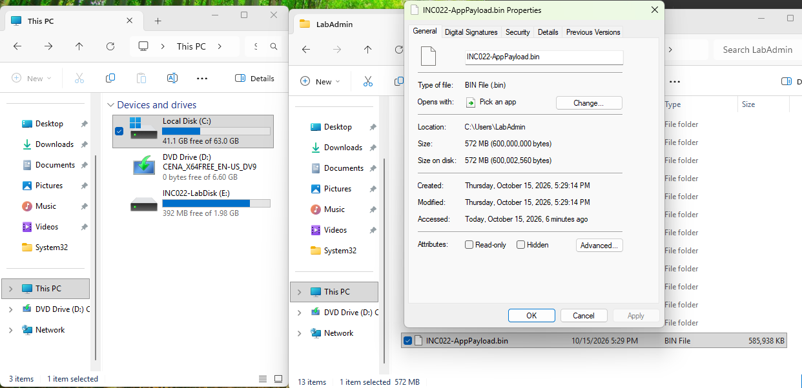
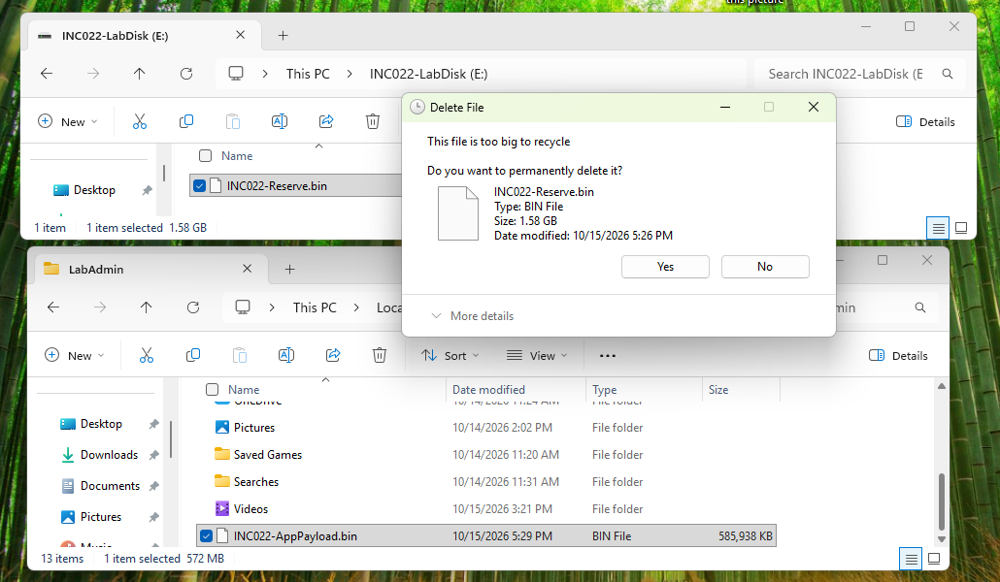
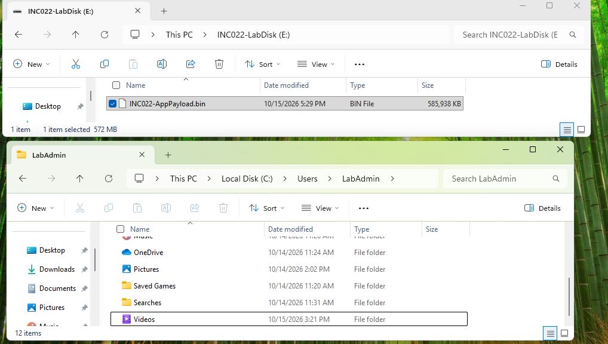
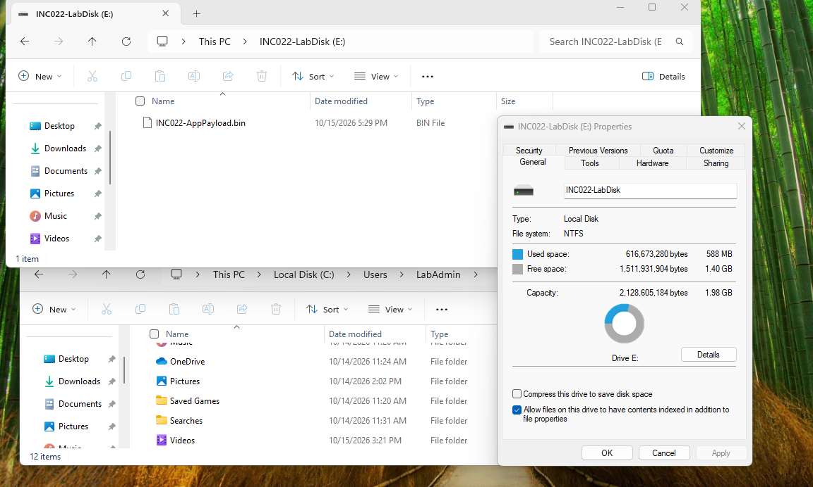

# INC-022 — Application Deployment Blocked by Low Disk Space

**Category:** Windows Client / Storage & Deployment  
**Status:** Resolved — simulated home-lab incident  
**Test system:** Windows 11, `INC012-PC02` (`HappySystem.local`)

## Reported issue

> An application deployment to the designated drive fails with an insufficient-disk-space error.

**Lab scope:** This ticket uses a 600 MB test payload as a stand-in for application files. It reproduces a real Windows file-transfer failure caused by low disk space; it does **not** represent an executed MSI installation or a production incident.

## Environment

- **System drive:** `C:` — 63.07 GB total, approximately 41.75 GB free at baseline.
- **Dedicated test volume:** `E:` (`INC022-LabDisk`) — 1.98 GB NTFS volume on a separate 2 GB VMware SATA virtual disk.
- **Installation/deployment target:** `E:` only. The system volume and Windows installation were left intact.
- **Original source file:** `C:\Users\LabAdmin\INC022-AppPayload.bin` (600,000,000 bytes).
- **Note:** `D:` was a mounted Windows installation ISO, not the affected volume.

## Troubleshooting and resolution

### 1. Confirmed the destination volume was healthy

Created and formatted a small virtual test disk, then checked the available volumes in Disk Management and PowerShell. The new `E:` volume had approximately **1.97 GB free**, while `C:` still had over 41 GB free.





### 2. Reproduced low disk space on E:

Created the lab-only reservation file `E:\INC022-Reserve.bin` with a size of 1,700,000,000 bytes. Available space on `E:` dropped to approximately **393 MB**. The Windows system drive was not filled.



### 3. Reproduced the deployment failure

Created a 600,000,000-byte payload under the local user profile and attempted to copy it to `E:`. PowerShell returned the actual error:

```text
Copy-Item : There is not enough space on the disk.
```



The source file's Windows Properties showed **600,000,000 bytes (approximately 572 MiB)**, exceeding the approximately **392–393 MB** free on the destination.



### 4. Freed space and retried the transfer

Using File Explorer, removed the lab-only reservation file from `E:`. Its deletion confirmation was recorded; the file was absent from the destination in the subsequent verification.



Retried the deployment transfer using File Explorer. The `INC022-AppPayload.bin` file was then present on `E:`. The later screenshots do not establish whether the GUI operation was **Copy** or **Move**, so this is described as a successful *transfer*, not a command-line copy retry.



The final `E:` properties showed **1.40 GB free** with the payload present. The test volume had sufficient capacity after cleanup, and no further insufficient-space error was observed during the successful transfer.



## Root cause

The **destination volume**, not the Windows system drive, lacked sufficient free space. The test payload required **600,000,000 bytes**, but only about **393 MB** remained on `E:`. The simulated deployment therefore could not complete.

## Resolution and verification

- Removed the large lab-only reservation file using File Explorer.
- Confirmed the transfer of the payload to the target `E:` volume.
- Verified **1.40 GB free** remained on `E:` after the transfer.
- Did not change or fill the Windows system drive.

**Outcome:** Reproduced an insufficient-disk-space error and verified successful file deployment after freeing destination space. This validates the storage-related failure and recovery, **not** a real software installation.

## Commands used and why

| Command | Reason |
|---|---|
| `Get-Disk` | Identified the original VMware system disk and the new test disk. Disk numbers are enumeration labels and do not by themselves indicate which disk contains Windows. |
| `Get-Volume` | Compared total size and free space on `C:` and `E:`. |
| `fsutil file createnew E:\INC022-Reserve.bin 1700000000` | Created a lab-only file that consumed free space on the separate test volume. |
| `fsutil file createnew "$env:USERPROFILE\INC022-AppPayload.bin" 600000000` | Created a dummy deployment payload of the required size. |
| `Copy-Item -Path "$env:USERPROFILE\INC022-AppPayload.bin" -Destination "E:\INC022-AppPayload.bin" -ErrorAction Stop` | Attempted the deployment and exposed the Windows insufficient-space error. |

Final cleanup and the successful transfer were performed in **File Explorer (GUI)** rather than PowerShell.

## Technician takeaway

Check the **actual destination volume** before assuming an installer, Windows service, or system drive is at fault. Compare payload requirements with *free space on that destination*. Once unnecessary test data is removed, confirm the operation succeeds and check the remaining capacity.

## References

- [Microsoft Support — Disk Management in Windows](https://support.microsoft.com/en-us/windows/experience/storage-filemanagement/disk-management-in-windows)
- [Microsoft Learn — Get-Volume (Storage)](https://learn.microsoft.com/en-us/powershell/module/storage/get-volume?view=windowsserver2025-ps)
- [Microsoft Learn — fsutil file](https://learn.microsoft.com/en-us/windows-server/administration/windows-commands/fsutil-file)
- [Microsoft Learn — Copy-Item](https://learn.microsoft.com/en-us/powershell/module/microsoft.powershell.management/copy-item?view=powershell-7.3)

---

*Personal Windows troubleshooting lab. All changes were made to a disposable, isolated VMware test disk.*
