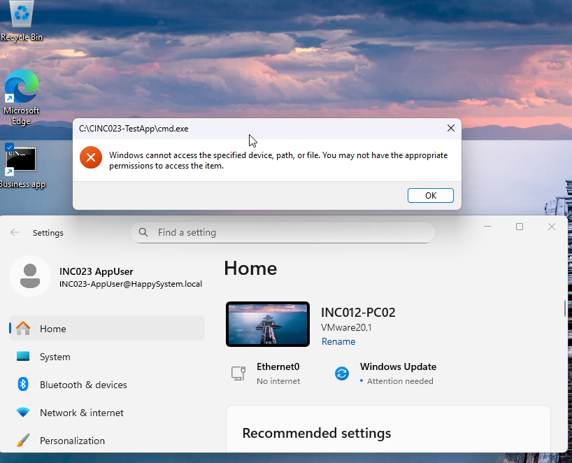
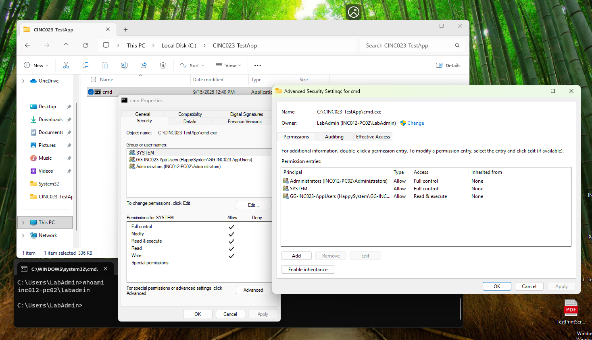
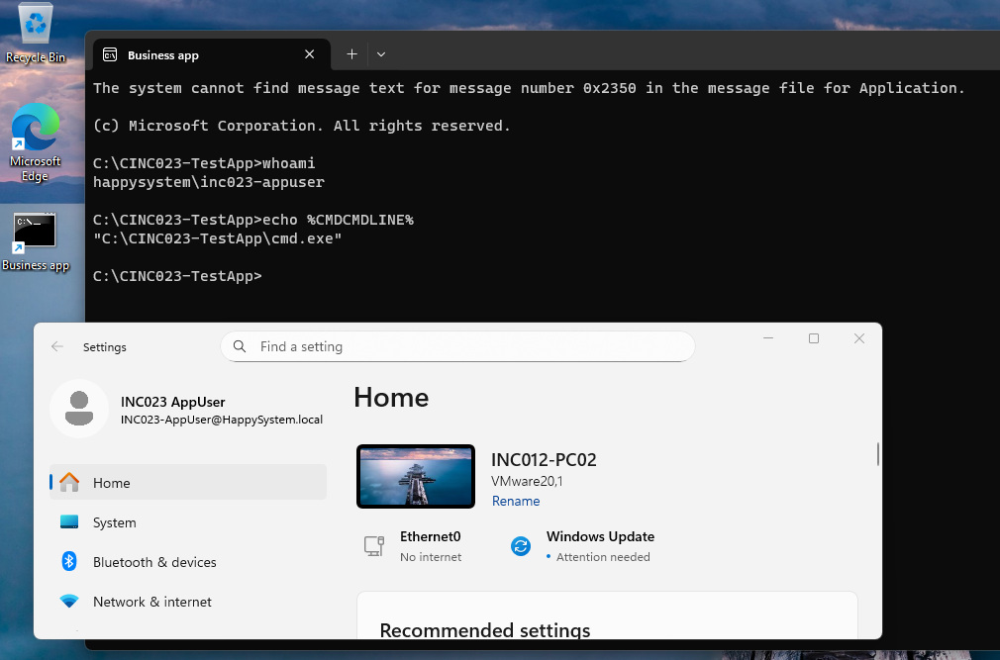

# INC-023 — Business App Launch Denied (NTFS Permissions)

**Type:** Simulated IT Support Incident  
**Environment:** Windows 11 domain client, Windows Server 2025 AD DS  
**Outcome:** Verified — executable launch restored after the group appeared in the user’s new logon token and Read & execute was granted

## User report

> "I can see the Business app shortcut, but Windows says I don't have permission to open it."

## Lab setup

| Component | Configuration |
| --- | --- |
| Domain | `HappySystem.local` |
| Client | `INC012-PC02` (Windows 11) |
| Test account | `HAPPYSYSTEM\inc023-appuser` (standard domain user) |
| AD security group | `GG-INC023-AppUsers` |
| Test executable | `C:\INC023-TestApp\cmd.exe` (a copy, not the System32 original) |
| Shortcut | `Business app` in `C:\Users\Public\Desktop` |

This was a controlled **executable launch test**, not a production application or MSI installation. The copied `cmd.exe` displays a nonblocking `0x2350` message-resource warning in this folder; it can still launch and accept commands when permissions allow.

## Investigation and reproduction

1. **Established a working baseline.** Signed in as `HAPPYSYSTEM\inc023-appuser`, launched the `Business app` shortcut, and confirmed `whoami` and `%CMDCMDLINE%` identified the test user and executable.
2. **Checked AD group membership.** ADUC showed `INC023-AppUser` as a member of `GG-INC023-AppUsers`.
3. **Reviewed inherited NTFS rights.** The executable initially inherited `Users: Read & execute` and `Authenticated Users: Modify` from `C:\`. Adding a group-level Read entry alone would **not** remove execute rights granted by those existing entries.
4. **Introduced a reversible fault on the test file only.** Disabled inheritance for `C:\INC023-TestApp\cmd.exe`, preserved `SYSTEM` and `Administrators` with Full control, removed the inherited broad entries, and granted `GG-INC023-AppUsers` **Read** (without Execute). No explicit Deny rule was added.
5. **Reproduced the complaint.** The domain user still saw the desktop shortcut but Windows displayed: **"Windows cannot access the specified device, path, or file. You may not have the appropriate permissions to access the item."**
6. **Investigated effective access and the user token.** The first Effective Access evaluation showed **neither Read nor Execute**. ADUC listed the group membership, but `whoami /groups` did **not** show `GG-INC023-AppUsers` in the earlier domain-user session. `whoami` confirmed the correct domain account, and DC discovery plus LDAP TCP 389 connectivity succeeded. After a restart and new sign-in, `whoami /groups` showed the group SID with enabled attributes. The evidence supports a difference between the initial and later logon tokens, but does not establish precisely why the earlier token lacked the group.

**Root-cause assessment / evidence limitation:** The test-file ACL restricted launch access and the user's earlier logon token did not list the only AD group granted Read. At the time of the captured failure, Effective Access reported **both Read and Execute unavailable**, not Read allowed / Execute denied. Once the group appeared in the refreshed token, the user did **not** run a separate Read test or repeat the launch denial *before* Execute permission was restored. Therefore, these screenshots **cannot isolate lack of Execute permission as the sole immediate cause** of the original error, or prove Read was available at that moment. Recovery is verified **after both** the token refresh and the Read & execute grant. This is a controlled NTFS/group-access troubleshooting lab, not an independently verified Read-versus-Execute-only experiment.

## Resolution and verification

- On **only** `C:\INC023-TestApp\cmd.exe`, changed `GG-INC023-AppUsers` from **Read** to **Read & execute** using **Properties → Security → Advanced**.
- Retained `SYSTEM` and `Administrators` as Full control; did not add the test user to local Administrators or change `C:\Windows\System32`.
- Signed back in as `HAPPYSYSTEM\inc023-appuser`, opened `Business app`, and confirmed:

```cmd
whoami
:: happysystem\inc023-appuser

echo %CMDCMDLINE%
:: "C:\INC023-TestApp\cmd.exe"
```

**Result:** The test executable launches and accepts commands under the standard domain user's account. The evidence verifies recovery, not which of the two relevant changes independently resolved the initial failure.

## Evidence

The screenshots below are **actual captures** from this simulated home lab. Each filename links directly to the image in the repository.

| Stage | Screenshot | What is visibly demonstrated |
| --- | --- | --- |
| Healthy baseline | [01 — Domain-user launch succeeds](../../screenshots/INC-023/01-healthy-app-baseline.png) | Shortcut works; `whoami` and the command line identify the domain user and copied executable. |
| AD membership | [07 — User's group membership in ADUC](../../screenshots/INC-023/07-ad-group-membership.png) | User's **Member Of** tab lists the lab security group. |
| Original inheritance | [09 — Inherited permissions](../../screenshots/INC-023/09-inherited-permissions-baseline.png) | The executable initially inherits Users: Read & execute and Authenticated Users: Modify from `C:\`. |
| Fault configuration | [02 — Test-file Read-only ACL](../../screenshots/INC-023/02-incorrect-ntfs-permissions.png) | The executable has explicit entries for SYSTEM, Administrators and the AD group with Read. |
| Launch failure | [03 — Domain-user Access Denied](../../screenshots/INC-023/03-application-access-denied.png) | Windows refuses to launch the executable under the domain account. |
| Effective Access diagnosis | [04 — Read and Execute both unavailable](../../screenshots/INC-023/04-effective-access-diagnosis.png) | Initial evaluation shows **both** Read and Execute unavailable. |
| Initial logon token | [10 — Lab group absent from filter](../../screenshots/INC-023/10-group-token-before-relogin.png) | `whoami` identifies the test account; group-name filtering returned nothing in that session; LDAP TCP 389 test passes. |
| New logon token | [08 — Group SID present after restart](../../screenshots/INC-023/08-group-token-after-relogin.png) | `whoami /groups` now lists `HAPPYSYSTEM\GG-INC023-AppUsers` with enabled attributes. |
| Permission recovery | [05 — Read & execute restored](../../screenshots/INC-023/05-ntfs-permission-restored.png) | Test-file ACL grants Read & execute to the AD group. |
| Final launch | [06 — Domain-user launch restored](../../screenshots/INC-023/06-application-launch-restored.png) | Same domain account successfully opens the test executable and runs commands. |

### Key screenshots

**Failure observed**



**Permission recovery**



**Verified application launch**



## Commands and why they mattered

| Command | Purpose |
| --- | --- |
| `whoami` | Verify that the app ran as the standard domain user, not as LabAdmin. |
| `whoami /groups` | Inspect the security groups present in the **current logon token**, not merely ADUC membership. |
| `echo %CMDCMDLINE%` | Confirm that the shortcut launched the test copy of `cmd.exe`. |
| `nltest /dsgetdc:HappySystem.local /force` | Check fresh domain controller discovery during troubleshooting. |
| `Test-NetConnection 192.168.146.10 -Port 389` | Confirm basic TCP reachability to the domain controller's LDAP service. |

Most permission changes were made through the **Windows Security GUI**.

## Lessons learned

- A working shortcut only confirms that the target path is visible; the target executable still needs suitable NTFS execute access.
- NTFS access is cumulative. Review inherited `Users` and `Authenticated Users` entries before concluding a group-specific entry controls execution.
- ADUC membership and groups in a particular Windows logon token can differ. In this test, the lab group was absent from the earlier token and visible after reboot/re-logon; the exact reason for the initial absence was not established.
- Apply least privilege to the **test file**, without changing system-file ACLs or granting administrator privileges to ordinary users.
- Distinguish **intended fault** from **observed failure**: the Read-only ACL was configured, but initial Effective Access showed neither Read nor Execute. Do not claim Read-only access or attribute the error exclusively to Execute without a separate successful Read test after token refresh.

## Microsoft Learn references

- [whoami — User, group and token checks](https://learn.microsoft.com/en-us/windows-server/administration/windows-commands/whoami)
- [icacls — Windows NTFS ACL concepts and permission codes](https://learn.microsoft.com/en-us/windows-server/administration/windows-commands/icacls)
